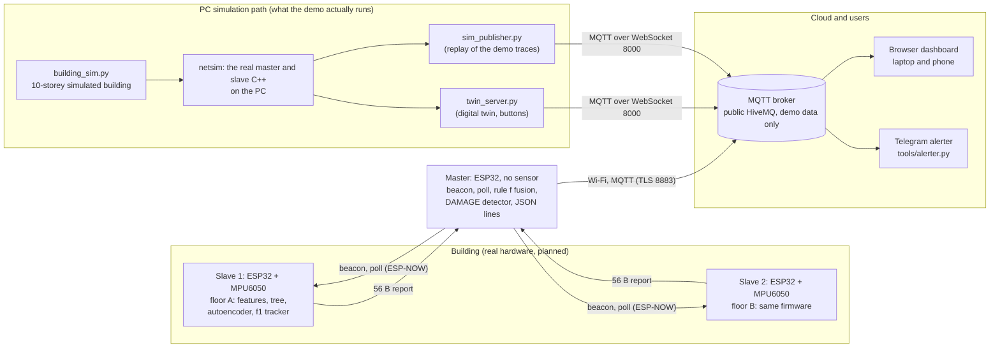
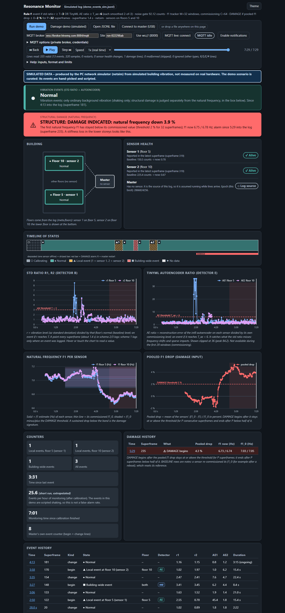
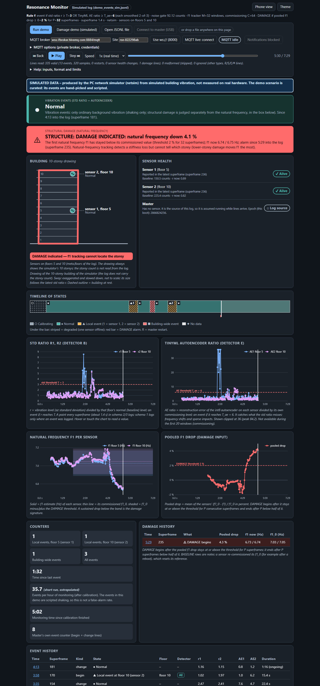
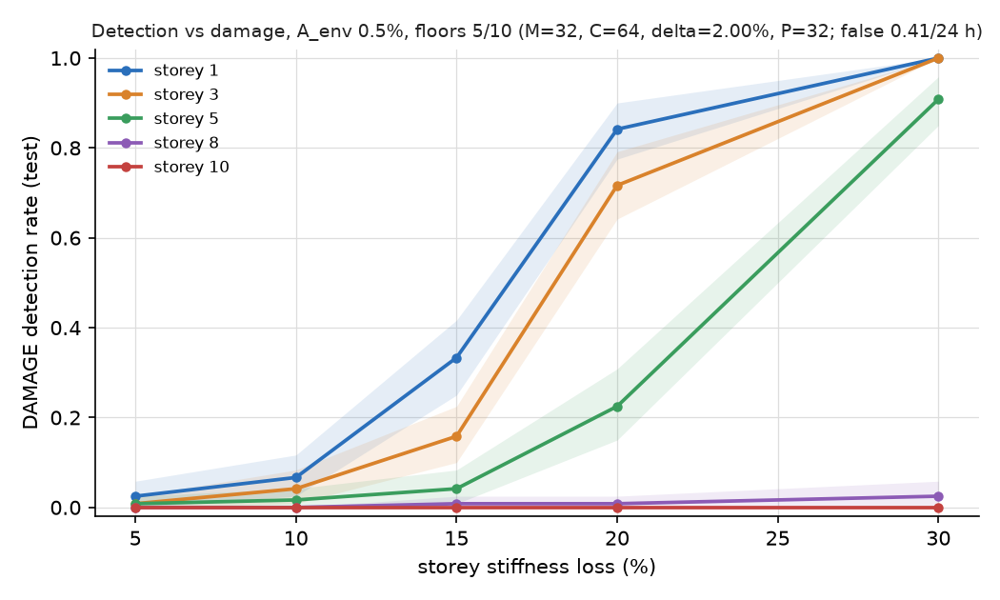

# Project guide: Structural Health Monitoring using IoT and TinyML

One document for the student who presents and runs the demo, and for examiners or mentors who want to see how everything fits. Every command below was run on this Windows laptop (repository `D:\Resonance`, branch `master`) before it was written down; section 6 says what you should see and how long it takes. Anything that could not be run here is listed in the last paragraph of section 6.

Reading order: sections 1 and 2 for the picture, 7 for demo day, 8 when something breaks, 9 before the viva. The deep detail lives in [docs/project_report.md](docs/project_report.md); this guide is the map and the cookbook.

**Contents**

1. [In one minute](#1-in-one-minute)
2. [Architecture](#2-architecture)
3. [How it works](#3-how-it-works)
4. [Repository map](#4-repository-map)
5. [Setup from scratch (Windows)](#5-setup-from-scratch-windows)
6. [How to run](#6-how-to-run)
7. [Demo day](#7-demo-day)
8. [Troubleshooting](#8-troubleshooting)
9. [What to say honestly](#9-what-to-say-honestly)
10. [Glossary](#10-glossary)

---

## 1. In one minute

**What it does.** Two sensor nodes (ESP32 + MPU6050 accelerometer) sit on two floors of a building. Each node analyses the vibration itself, on the chip, and sends a 56-byte report every 1.4 s to a third ESP32, the master. The master decides: nothing special (AMBIENT), something happened at one floor (LOCAL), something shook the whole building (BUILDING), or the structure has become less stiff (DAMAGE). The master publishes its decisions over MQTT to a browser dashboard, to phones and to Telegram.

**Three headline features**

1. **TinyML anomaly detection on every sensor node.** A 110-byte decision tree and an int8 autoencoder (574 parameters, 942 B of weights, trained on healthy data only) run on each node. The master fuses the nodes with **rule f**: raise an event if the vibration-level ratio says so (rule b) **OR** the autoencoder says so.
2. **Natural-frequency DAMAGE alarm.** Each node tracks the first natural frequency f1 of the building. A lasting drop of the pooled f1 (2 % for 32 superframes, about 45 s) means the structure got softer: a coarse alarm for large damage in the lower storeys.
3. **IoT layer.** MQTT (retained state, last will, TLS on the firmware path), a browser dashboard (replay, live, phone view with QR code), Telegram alerts, and an interactive **digital twin** where an examiner clicks "damage storey 1" and watches the real firmware logic react.

**Headline numbers** (all simulated; sources `models/selected/validation/fusion_eval_r3_test.md`, `freq_tracking.md`, `models/tinyml/ae_report.md`)

| | Result |
|---|---|
| Decision tree | 11 nodes, 110 B, accuracy about 0.93 on synthetic data (resampling estimate) |
| Autoencoder | 574 parameters, 942 B weights, C code bit-exact with TensorFlow Lite on the PC (0 mismatches on 10,000 vectors) |
| Rule f on the fresh pre-registered test block (240 buildings, 28 h) | mean event recall **0.734** vs 0.622 for the vibration-ratio rule alone (paired +0.113) |
| False onsets per hour | **1.64** [0.75, 2.79] (2.05 on healthy ambient alone): **the 1/h budget is NOT met** |
| DAMAGE, 30 % stiffness loss | detected 1.00 / 1.00 / 0.91 at storeys 1 / 3 / 5; almost never at storeys 8-10 (physics); latency 1-2 min |
| Slave firmware | 772,825 B flash, 72,788 B RAM (from `pio run -e slave1`) |

**Honesty statement.** Everything was measured in simulation (a building simulator, PC test harnesses, the Wokwi emulator). No real board has run this firmware yet and nothing was measured on a real structure; the hardware bring-up plan is written ([docs/hardware_bringup.md](docs/hardware_bringup.md)).

---

## 2. Architecture



**Per-superframe data flow (1.4 s)**

1. t = 0: the master broadcasts a **beacon** (17 B: superframe number and the master's random epoch).
2. Each slave samples a **window** of 128 values at 100 Hz (1.27 s from first to last sample) and then computes everything in one pass: features, tree class, autoencoder ratio, f1 estimate and drop.
3. t = 1.32 s: the master **polls** slave 1, then slave 2 (18 B poll). Each answers with a 56 B report (reply timeout 18 ms, one retry).
4. The master closes the superframe: fuses the reports (rule f), feeds the DAMAGE detector, prints one JSON `sample` line plus an event line when the state changes.
5. The same JSON lines go to USB serial and, in the MQTT build, to the broker.

**What runs where**

| Place | What runs | Real or simulated |
|---|---|---|
| Slave ESP32 | `net_main.cpp` + `slave_pipe.h` (sampling, features, tree, autoencoder, f1 tracker) | firmware written and built, **never run on a board** |
| Master ESP32 | `net_main.cpp` + `fusion.h`, `damage.h`, JSON formatter, MQTT task | same |
| Wokwi | one board per project; the cloud project runs the real master code with two **virtual** slaves | emulator, not hardware |
| PC `netsim` | the same C++ state machines and fusion code compiled for Windows, a discrete-event network simulator | the engine behind the dashboard demos and the twin |
| PC Python tools | `sim_publisher.py`, `twin_server.py`, `alerter.py`, `serve_dashboard.py` | helpers |
| Browser | `dashboard/index.html` (single file, no server needed) | the display |

The vibration signals themselves come from `data/generator/building_sim.py`, a 10-storey uniform shear building with sensors on floors 5 and 10.

---

## 3. How it works

### 3.1 Sensing and windows

- MPU6050, accelerometer +-2 g, gyroscope +-250 deg/s, built-in low-pass filter (DLPF) at 42-44 Hz. The firmware reads the registers back at boot and refuses to run if they are wrong (`config fail`): the DLPF is a hard requirement because the models never saw wideband noise.
- Sampling is a strict 100 Hz timer. A **window** is 128 non-overlapping samples (1.28 s, frequency resolution 0.78 Hz). Only the `az` and `gx` axes are used.
- **Noise gate**: a window whose `az` standard deviation is below 92.12 raw counts counts as "no real vibration". This value comes from synthetic data and is provisional. Without it the autoencoder rule fired 17.9 false onsets/h on the dev block.

### 3.2 Spectral front end

One DFT of `az` (bins 1..64) feeds two things (`spectrum.h`): **16 band powers** (log of the sum of 4 bins plus 1) for the autoencoder, and a **Hann-windowed Goertzel "zoom"** of 181 frequencies from 3.0 to 12.0 Hz in 0.05 Hz steps, whose peak (refined by parabolic interpolation) is the f1 estimate. All builds use `-ffp-contract=off` so the ESP32's float rounding equals the PC's; that is what makes bit-exact comparison with Python possible.

### 3.3 Decision tree (history) and int8 autoencoder (TinyML)

- **Decision tree** (Phase 3): 11 nodes, 110 B, 5 features (`az` std, kurtosis, dominant frequency; `gx` std, dominant frequency), classes normal / abnormal / faulty, accuracy about 0.93 on synthetic data, selected as the smallest model with at least 0.90 cross-validated accuracy. It still runs on the slaves and its class is reported, **but the master's final rule no longer uses it** (under the false-alarm-per-hour criterion it was over budget).
- **Autoencoder**: 20 inputs (16 band powers, `az` std and kurtosis, `gx` std and kurtosis), layers 20-12-2-12-20, 574 parameters. It is trained to reproduce **healthy** windows through a 2-neuron bottleneck; an unfamiliar window is reconstructed badly, and the error is the anomaly score. No fault examples are needed.
- **Commissioning normalisation**: each slave learns on the spot from its first 20 windows after power-on the median and robust spread of every input and a reference score. The thresholded quantity is the **AE ratio** = score / reference score. One trained model therefore fits every node.
- **int8**: post-training full-integer quantisation (int8 file 4,568 B, firmware tables 942 B, 528 int8 multiply-accumulates per window). Reconstruction error rises 4.2 % versus float.
- **Bit-exact C**: the firmware runs hand-written C (`ae.h`), not the TFLite Micro runtime. On the PC it matches `tf.lite.Interpreter` on 10,000 vectors with 0 mismatching outputs. Two rounding details had to be copied exactly (single-rounding fixed-point multiply; input quantiser `round_half_away(v / scale)`).

### 3.4 Edge fusion: rule f

Per slave and per superframe: the **b flag** = (`az_std` / own baseline >= 3), the **AE flag** = (AE ready and `az_std` >= 92.12 and AE ratio >= 6). Each flag is smoothed 2-of-3 on its own; the slave's event flag e = b OR AE. Both slaves e = BUILDING, one slave e = LOCAL(that slave), neither = AMBIENT. If a slave is dead the master continues in degraded mode (LOCAL or AMBIENT only, never BUILDING). Constants: `CHOSEN_RULE 'f'`, `T_AE 6`, `T_b 3`, debounce k = 1 in `fusion.h`; a test fails if they differ from the selection JSON.

**How it was selected** (`docs/` and `models/selected/validation/`):

| Step | What | Result |
|---|---|---|
| Dev block (240 buildings, 28 h) | pick the rule that maximises mean(LOCAL recall, BUILDING recall) subject to at most 1.0 false onsets/h | rule f: 0.89 false onsets/h, mean recall 0.730 vs 0.622 for rule b |
| Pre-registration | before simulating the fresh block the test, the candidate and the decision rule were committed (`r3_test_preregistration.md`): deploy f if the paired recall gain's interval excludes 0 and the extra false onsets are at most 0.5/h | written in advance |
| Fresh test block (seeds 6,400,000+240, scored once) | f vs incumbent b | f: 1.64 [0.75, 2.79] false onsets/h, LOCAL 0.666, BUILDING 0.803, mean 0.734 [0.720, 0.748]; b: 1.39 [0.54, 2.54]/h, LOCAL 0.441, BUILDING 0.803, mean 0.622 |
| Paired difference | f minus b | recall +0.113 [+0.103, +0.122]; false onsets +0.25/h [+0.04, +0.50]: both criteria hold |

Where the gain comes from: sparse single impacts 0.20 vs 0.06 and frequency shifts 0.80 vs 0.30; building-wide events are unchanged. **The false-alarm budget of 1/h is NOT met** (point estimate 1.64/h, 2.05/h on healthy ambient alone; the intervals still include values below 1). Dev (0.89/h) was a lucky draw.

### 3.5 f1 tracking and the DAMAGE alarm

- **Tracker (slave)**: keeps the last M = 32 zoom spectra, averages them, takes the peak as f1. After C = 64 consistent estimates (about 96 windows = 2.2 min after power-on) it fixes its own reference f1_0. The drop reported is (f1_0 - f1) / f1_0. Estimates outside f1_0 +-20 % are ignored (mode-jump guard).
- **Detector (master)**: pooled drop = mean over the slaves with a valid drop. DAMAGE BEGIN after P = 32 consecutive superframes at or above delta = 2 %; END after 32 below 1 %.
- **Physics, why the top storeys are invisible**: the first mode has little strain energy in the top storeys, so softening them barely moves f1. A 30 % stiffness loss lowers f1 by 3.88 % at storey 1, 2.42 % at storey 5, 0.77 % at storey 8 and 0.09 % at storey 10. Any f1-only detector has this limit.
- **Results** (test block, `freq_tracking.md`): detection with 30 % loss: 1.00 / 1.00 / 0.91 at storeys 1 / 3 / 5, 0.03 at storey 8, 0.00 at storey 10; mean over 25 storey/loss cells 0.217 [0.204, 0.232]; by loss 5 %: 0.01, 10 %: 0.03, 15 %: 0.11, 20 %: 0.36, 30 %: 0.59. False DAMAGE 0.41 [0.00, 1.22] per 24 h at 0.5 % environmental drift, 2.24 per 24 h at 1 %.
- It compares each slave only with its **own** commissioned f1_0, so it sees changes after commissioning, never the absolute condition. The reference is held in RAM: a slave that reboots on an already damaged structure recommissions on the damaged state (known limitation).

### 3.6 Network protocol (`net_proto.h`)

- **ESP-NOW** broadcast between the boards: connectionless, no router needed, so the sensor network keeps working with the Wi-Fi off.
- Fixed frames with magic, type, version (**3**), source, destination, sequence, payload, CRC-16. Beacon 17 B, poll 18 B, **report 56 B**: superframe, epoch, window, raw class, smoothed state, flags, 5 tree features, then `ae_ratio`, `f1_est`, `f1_drop`. Flags: LOW_SIGNAL, UNSYNCED, AE_READY, F1_VALID, F1_COMMISSIONED, F1_NOT_COMMISSIONED. A version-2 board is ignored: flash all three boards from the same build.
- **Epoch**: a random number drawn at master start, carried in every frame; slaves resynchronise when it changes (solves "restarted master counts from zero again").
- A slave that misses beacons free-runs for up to 5 superframes (flag UNSYNCED), then goes silent until it hears one. A slave with 3 consecutive missed superframes (about 4.2 s) is declared **DEAD**.

### 3.7 IoT layer

- **Topics** `resonance/<site>/...`: one topic per JSON line type (`meta`, `restart`, `sample`, `begin`, `change`, `node`, `damage`; the fusion `status` line goes to `status_line`). Retained: `state` (latest decision), `damage_state`, `meta`, and `status` = `{"state":"online"|"offline","epoch":E}`. `offline` is the **last will** the broker sends when the master vanishes.
- **Transport**: the firmware connects with TLS on port 8883 (root CA committed; this build checks the certificate chain but not its dates). The PC tools and the browser use MQTT over WebSocket `ws://broker.hivemq.com:8000/mqtt`, unencrypted, because on this network 1883 and 8884 are blocked.
- **Alerts**: `tools/alerter.py` subscribes and sends Telegram messages for LOCAL / BUILDING begins, sensor DEAD / ALIVE, master restart or offline, and DAMAGE BEGIN / END, with a cooldown and an hourly budget. Without the two environment variables it only prints the text ("dry run").
- **Public broker**: anyone who knows the site id can read (and for the twin, command) the topics. Demo data only.

### 3.8 Dashboard panels (`dashboard/index.html`)

Single file, works from `file://` with no server. Sources: embedded synthetic demo, **Damage demo (simulated)** (replay of `demo_events_sim.jsonl`), open a JSONL file, live over USB (Web Serial), **MQTT live**. Panels: system line (rule, thresholds), state banner and animated 10-storey **building view** (sways, pulses the LOCAL floor, ambers on BUILDING, red outline on DAMAGE; never marks a storey from sensor data), sensor health, DAMAGE banner (grey / green / amber / red), four charts (std ratio with T, AE ratio with T_ae, f1 per sensor with its f1_0 and a +-2 % band, pooled drop), timeline, event history with a Detector column (std / AE), DAMAGE history, **Digital twin** panel (only when a twin runs on the connected site), **Phone view** button (QR code), Theme and notification buttons.

### 3.9 Digital twin (`tools/twin_server.py`)

A simulated building (the demo building, f1 7.09 Hz, sensors on floors 5 and 10) is monitored by the real netsim firmware logic. The dashboard buttons publish validated commands (damage storey 1-10 by 10-40 %, repair, impact floor 5 or 10, building shake, kill / revive sensor 1 or 2, reset). The server changes the simulated building from 4 superframes in the future, re-runs netsim over the history and publishes the new lines in real time. Every alarm, DEAD and degraded-mode decision comes from the firmware C++ code; the server only makes the signals and replays netsim's log. A dotted "simulator truth" line shows the true f1 so the estimate can be compared with it.

### 3.10 LED and buzzer (Wokwi cloud demo)

`include/annunciator.h` drives local outputs from the master itself, with no cloud: blue heartbeat LED (D2) pulses each superframe; yellow EVENT LED (D26) is on during a vibration event with one chirp; at DAMAGE BEGIN the red LED (D25) blinks 10 s and the buzzer (D27) beeps 3 times, then the red LED stays on with a reminder beep every 30 s; at END a low tone. Pins are off by default and set in the `master_wokwi_cloud` env.

### 3.11 Phone view

`tools/serve_dashboard.py` serves only the `dashboard/` folder on the local network and answers `/lan.json`. On the laptop, the **Phone view** button turns the current view into a QR code (`?mqtt=1&site=...&broker=...` or `?replay=...`). The phone gets a one-column layout and the same live data, straight from the broker.

---

## 4. Repository map

Tags: **[generated]** = produced by a script, do not edit by hand; **[gitignored]** = not in git, regenerate; **[committed data]** = binary/test data in git, regenerate with the named script.

### Root

| File | What it is |
|---|---|
| `PROJECT_GUIDE.md` | this guide |
| `README.md` | short summary, headline results, links |
| `requirements.txt` | main `.venv`: numpy, pandas, scikit-learn, joblib, scipy (pinned) |
| `requirements-iot.txt` | `paho-mqtt` (+ optional `pyserial`) for the IoT tools |
| `requirements-tinyml.txt` | TensorFlow environment `.venv-tinyml`, only for retraining the autoencoder |
| `.claude/STRUCTURE.md` | the authoritative, very detailed repo and decision log (read for any "why" question) |
| `.gitignore`, `.gitattributes` | ignores `.venv*`, `.cache/`, `data/processed/`; keeps `*.jsonl` LF |

### `firmware/esp32/` (PlatformIO project; open this folder in VS Code)

| File | What it does |
|---|---|
| `platformio.ini` | 14 envs: `esp32dev`, `selftest` (single-node), `master`, `slave1`, `slave2`, `slave1_wokwi`, `slave2_wokwi`, `master_mqtt`, `master_wokwi_cloud` (ESP32); `native`, `netsim`, `espnow_logic`, `mqtt_logic`, `cloud_demo` (PC) |
| `src/net_main.cpp` | firmware of master and slaves (role from build flags) |
| `src/netsim_main.cpp` | the PC network simulator program (`netsim` env) |
| `src/main.cpp`, `src/selftest.cpp` | earlier single-board live firmware and boot self-test (606 windows plus the full slave pipeline timing check) |
| `include/net_proto.h` | protocol constants, frames, CRC, timing static asserts (wire version 3) |
| `include/tiers.h` | `SlaveNode` and `Master` state machines, noise gate |
| `include/fusion.h` | rule f, AMBIENT / LOCAL / BUILDING, DAMAGE hookup, `CHOSEN_*` constants |
| `include/damage.h` | master-side DAMAGE detector |
| `include/slave_pipe.h` | per-slave analytics (features, AE, zoom, f1 tracker) |
| `include/features.h`, `spectrum.h`, `smooth.h` | tree features, spectral front end, 2-of-3 smoothing |
| `include/f1track.h` | f1 tracker (ring of 32 spectra, commissioning, band gate) |
| `include/ae.h`, `ae_input.h` | int8 autoencoder kernels, normaliser, input builder |
| `include/fusion_json.h` | JSON-line formatter (schema 3) shared by netsim and the master |
| `include/annunciator.h` | LED and buzzer logic |
| `include/espnow_logic.h`, `transport.h`, `transport_espnow.h` | ESP-NOW receive logic (host-tested), transport interface and ESP-NOW implementation |
| `include/mqtt_logic.h`, `mqtt_uplink.h`, `mqtt_config.h` | MQTT topics/queue/back-off (host-tested), ESP32 uplink task, all MQTT/Wi-Fi settings |
| `include/virtual_net.h`, `netsim.h` | two virtual slaves for the Wokwi cloud demo; the network simulator |
| `include/node_config.h` | per-build role, node id, channel, floors, LED pins |
| `include/secrets.example.h` | template; copy to `secrets.h` (gitignored) for real Wi-Fi credentials |
| `include/hivemq_public_ca.h` | root CA for the TLS broker connection |
| `include/model.h` | **[generated]** the 110 B tree, by `tools/gen_model.py` |
| `include/ae_model.h` | **[generated]** autoencoder weights, by `tools/gen_ae.py` |
| `include/spectrum_tables.h` | **[generated]** Hann and Goertzel tables, by `tools/gen_spectrum.py` |
| `include/ae_selftest_vectors.h` | **[generated]** 64 vectors for the self-test, by `tools/gen_ae_vectors.py` |
| `include/selftest_data.h` | **[generated, gitignored]** by `tools/gen_testdata.py` |
| `include/demo_traces.h` | **[generated, gitignored]** by the PlatformIO pre-script `tools/pio_gen_demo.py` on every Wokwi/cloud_demo build |
| `test/test_native`, `test_ae`, `test_shm`, `test_annunciator` | env `native` (42 cases): tree and smoothing parity on 6000 windows, front end, autoencoder bit-exactness, f1 tracker and DAMAGE, LED logic |
| `test/test_net`, `test_fusion` | env `netsim` (115 cases): protocol, state machines, simulator, fusion parity |
| `test/test_espnow_logic`, `test_mqtt_logic`, `test_cloud_demo` | envs of the same name (26, 34, 6 cases) |
| `test/data/fusion_vectors.bin`, `ae_vectors.bin`, `demo_traces.bin(.floors)` | **[committed data]** parity vectors and the demo scenario traces |
| `test/data/windows.bin`, `smooth.bin` | **[gitignored]** 6000 windows and 2592 smoothing sequences, by `gen_testdata.py` |
| `tools/gen_*.py` | generators: `gen_model` (tree to C), `gen_ae` (autoencoder to C), `gen_spectrum`, `gen_testdata`, `gen_fusion_vectors`, `gen_ae_vectors`, `gen_traces` (demo scenario), `gen_demo_header`; `pio_gen_demo.py` is the build hook |
| `tools/frontend_lib.c`, `ae_lib.c`, `shm_lib.c` | C bridges that let Python call the firmware code (ctypes) |
| `wokwi/README.md` | Wokwi usage and wiring |
| `wokwi/master/`, `slave1/`, `slave2/`, `master_cloud/` | one Wokwi project each (`wokwi.toml` + `diagram.json`) |
| `wokwi/all_three/diagram.json` | wiring picture of all three boards, no `wokwi.toml` (cannot be simulated) |
| `wokwi/single_node/`, `single_node_selftest/` | earlier single-board projects |

### `models/`

| File | What it does |
|---|---|
| `training/train.py` | Phase 3 model selection (about 1 h) |
| `training/compare.py`, `compare_svm.py`, `dlpf_check.py`, `smoothing_eval.py` | checks of the tree against alternatives, the sensor filter, the smoothing |
| `training/frontend.py`, `ae_bridge.py`, `shm.py` | ctypes bridges: Python runs the real firmware C code |
| `training/ae_data.py`, `ae_design_search.py`, `ae_train.py`, `ae_final.py`, `ae_report.py` | autoencoder data, design search, training/quantisation (in `.venv-tinyml`), report |
| `training/fusion_eval.py` | fusion reference (`RefFusion`, bit-exact twin of `fusion.h`) and the superseded R2 evaluation |
| `training/fusion_eval_r2b.py`, `fusion_eval_r3.py`, `fusion_eval_r3_sim.py` | event-level selection (rule b, then rule f), dev and fresh test block |
| `training/compare_hierarchy.py` | hierarchy vs one node |
| `training/freq_tracking_eval.py`, `freq_tracking_figs.py` | f1 tracking / DAMAGE evaluation and its figures |
| `training/localisation_gate*.py`, `train_building.py` | the two storey-localisation gates (failed) and building-data retraining (kept old tree) |
| `training/cachedir.py` | where long runs cache (`.cache/`) |
| `training/test_gates.py`, `test_frontend.py` | Python tests |
| `selected/model_export.json`, `model.joblib`, `feature_spec.json`, `report.md/json` | the deployed tree, its export for C, feature spec, report |
| `selected/validation/*.md/.json` | **result files, the source of every number in this guide**; `r3_test_preregistration.md` is the pre-registration |
| `selected/comparison*` | tree vs alternatives |
| `selected_building/` | retraining on building data, not deployed |
| `tinyml/ae_int8.tflite`, `ae_float.keras`, `ae_norm.json` | the autoencoder, float and int8, and normalisation constants |
| `tinyml/ae_report.md/json`, `design_search.json`, `mahalanobis.json`, `ae_numbers.json` | autoencoder report, design search, the Mahalanobis baseline |

### `data/`

| File | What it does |
|---|---|
| `generator/generate.py` | synthetic dataset, 6000 windows, seed 42 |
| `generator/building_sim.py` | 10-storey shear-building simulator (damage, impacts, shaking) |
| `processed/dataset.csv` | **[gitignored]** output of `generate.py` |

### `dashboard/`

| File | What it does |
|---|---|
| `index.html` | the whole dashboard; edited directly. Contains an embedded copy of `demo_events_sim.jsonl` (updated with `tools/embed_sim.py`) |
| `demo_events_sim.jsonl` | **[committed data]** simulator log of the damage scenario (335 lines); regenerate with netsim (command in `dashboard/README.md`) |
| `demo_events_faults_sim.jsonl` | simulator log with a killed sensor and a master restart |
| `sample_events.jsonl` | scripted synthetic demo (schema 2, not simulator output) |
| `tools/validate_logs.py`, `test_validate_logs.py`, `embed_sim.py`, `test_mqtt_dom.js`, `short_reboot.jsonl` | log validator and its test, embedder, jsdom test of the page, a test log |
| `vendor/mqtt.min.js`, `qrcode.js` (+ licences) | third-party libraries, do not edit |
| `README.md` | dashboard details |

### `tools/` (repo root, Python)

| File | What it does |
|---|---|
| `sim_publisher.py` | run netsim (or a `.jsonl`, or a serial port) and publish to MQTT |
| `twin_server.py` | interactive digital twin |
| `alerter.py` | Telegram alerts (dry run without credentials) |
| `serve_dashboard.py` | serve `dashboard/` on the LAN for phones |
| `resonance_mqtt.py` | shared MQTT helpers (topic scheme, broker options) |
| `e2e_mqtt_test.py` | end-to-end test against a real broker |
| `test_iot_tools.py`, `test_serve_dashboard.py`, `test_twin.py` | offline tests |

### `docs/`

| File | What it does |
|---|---|
| `project_report.md` | the final report (read this for any detail) |
| `viva_prep.md` | pitch, 35 questions with short answers, numbers table |
| `demo_runbook.md` | the demo steps (this guide's section 6-7 are the checked version) |
| `hardware_bringup.md` | wiring, flashing, measurements and pass criteria for the boards |
| `slides_outline.md` | 14-slide outline |
| `simulation_validation.md`, `hierarchy_validation.md` | earlier stage reports (single node; hierarchy R1-R6) |
| `figures/` | screenshots and result plots (used below) |

---

## 5. Setup from scratch (Windows)

**Prerequisites** (already installed on the demo laptop)

| Tool | Why | Check |
|---|---|---|
| VS Code + **PlatformIO IDE** extension | builds the firmware; provides `pio` | `~\.platformio\penv\Scripts\pio.exe --version` prints "PlatformIO Core, version 6.2.0" |
| Python **3.12** | tools and tests | `py -3.12 --version` |
| **WinLibs gcc** (e.g. `winget install BrechtSanders.WinLibs.POSIX.UCRT`), on PATH | needed by the host envs (`native`, `netsim`, ...) and by `frontend.py` | `gcc --version` |
| Node.js (optional) | only for the dashboard page test | `node --version` (v24 here) |
| **Wokwi for VS Code** extension | the board emulator; needs a (free) Wokwi licence key activated in VS Code | VS Code command "Wokwi: Select Config File" exists |
| Chrome or Edge | the dashboard (Web Serial and Notifications need these) | |

First-time ESP32 builds download the toolchain and libraries (internet needed, several minutes; not timed here because they were already installed). Do this at home, not on demo day.

**`pio` in PowerShell.** `pio` is not on the PATH of a plain PowerShell. Either use the **PlatformIO terminal** in VS Code (PlatformIO icon > "New Terminal"), or define an alias once per window:

```powershell
Set-Alias pio "$env:USERPROFILE\.platformio\penv\Scripts\pio.exe"
pio --version          # PlatformIO Core, version 6.2.0
```

**Python environments** (from `D:\Resonance`)

```powershell
py -3.12 -m venv .venv
.venv\Scripts\python.exe -m pip install -r requirements.txt -r requirements-iot.txt
```

(Checked in a scratch folder: creating the venv and installing both files took about 4 minutes; imports of numpy, pandas, scikit-learn and paho-mqtt then work.) All commands in this guide call `.venv\Scripts\python.exe` explicitly, so no activation is needed.

The TensorFlow environment is **only** for retraining the autoencoder (section 6h); skip it for the demo:

```powershell
py -3.12 -m venv .venv-tinyml
.venv-tinyml\Scripts\python.exe -m pip install -r requirements-tinyml.txt
```

**Regenerate the gitignored data** (deterministic: the files came out byte-identical when re-run here, 4 s and 7 s):

```powershell
.venv\Scripts\python.exe data\generator\generate.py                    # data\processed\dataset.csv
.venv\Scripts\python.exe firmware\esp32\tools\gen_testdata.py          # test\data\windows.bin, smooth.bin, include\selftest_data.h
```

`include/demo_traces.h` is generated automatically by every Wokwi-cloud or `cloud_demo` build.

**Build the simulator once** (the twin, `sim_publisher.py` and the netsim checks need `firmware\esp32\.pio\build\netsim\program.exe`):

```powershell
cd firmware\esp32
pio run -e netsim            # about 2 s once the toolchain is cached
cd ..\..
```

`pio test -e netsim` overwrites that `program.exe` with the test runner, so **run `pio run -e netsim` again after every netsim test**.

---

## 6. How to run

Every command was run on this laptop. Run them from `D:\Resonance` in PowerShell unless it says `firmware\esp32`. To keep Telegram out of tests, start each window with:

```powershell
$env:TELEGRAM_BOT_TOKEN=$null; $env:TELEGRAM_CHAT_ID=$null      # this window only; nothing is sent
```

### 6a. All tests

**Firmware host suites** (`cd firmware\esp32`, alias `pio` defined):

| Command | Expect | Time |
|---|---|---|
| `pio test -e native` | `42 test cases: 42 succeeded` | 9 s |
| `pio test -e netsim` | `115 test cases: 115 succeeded` (63 test_net + 52 test_fusion) | 5 s |
| `pio run -e netsim` | `SUCCESS` (**needed again after the line above**) | 2 s |
| `pio test -e espnow_logic` | `26 test cases: 26 succeeded` | 2 s |
| `pio test -e mqtt_logic` | `34 test cases: 34 succeeded` | 2 s |
| `pio test -e cloud_demo` | `6 test cases: 6 succeeded` | 3 s |

**Python tests** (from `D:\Resonance`):

| Command | Expect | Time |
|---|---|---|
| `.venv\Scripts\python.exe tools\test_iot_tools.py` | `13 tests passed` | 1 s |
| `.venv\Scripts\python.exe dashboard\tools\test_validate_logs.py` | all `ok` | 1 s |
| `.venv\Scripts\python.exe tools\test_serve_dashboard.py` | `11/11 passed` | 8 s |
| `.venv\Scripts\python.exe tools\test_twin.py` | `39 checks passed` (needs `program.exe`; offline) | 1 min |
| `.venv\Scripts\python.exe models\training\test_gates.py` | `18/18 tests passed` | 26 s |
| `.venv\Scripts\python.exe models\training\test_frontend.py` | ends with `ok test_zoom_building` | 6 s |
| `.venv\Scripts\python.exe dashboard\tools\validate_logs.py dashboard\demo_events_sim.jsonl dashboard\demo_events_faults_sim.jsonl dashboard\sample_events.jsonl` | three lines starting `OK` | 1 s |
| `.venv\Scripts\python.exe dashboard\tools\embed_sim.py --check` | `embedded copy equals demo_events_sim.jsonl` | 1 s |

**Dashboard page test** (optional; needs the npm package `jsdom`, which is not a project dependency). Install it once in any scratch folder (`npm install jsdom` there), then point `NODE_PATH` at its `node_modules`:

```powershell
$env:NODE_PATH="C:\path\to\scratch\node_modules"
node dashboard/tools/test_mqtt_dom.js --offline        # 101 PASS lines, ends "SUMMARY OK", 26 s, no network
```

Without `--offline` it also talks to the public broker (needs `--url ws://broker.hivemq.com:8000/mqtt`, already the default).

### 6b. Offline dashboard replay (the safest demo)

No network, no server.

1. In Explorer double-click `D:\Resonance\dashboard\index.html` (Chrome or Edge), or paste `file:///D:/Resonance/dashboard/index.html` in the address bar.
2. Click **Damage demo (simulated)**. It plays at 10x by itself (about 45 s for the 7.5-minute scenario); use the speed buttons for 1x, 10x or 60x, and the Play button toggles pause.
3. A direct link, paused right after the alarm: `file:///D:/Resonance/dashboard/index.html?replay=demo_events_sim.jsonl&speed=20&at=sf236&play=0`. (`at=end`, `at=SECONDS` also work.)
4. The same through the local server (what a phone needs):

```powershell
.venv\Scripts\python.exe tools\serve_dashboard.py
```

It prints `Open on this computer: http://localhost:8080/` and the phone URL (here `http://192.168.1.4:8080/`). Open the localhost address, click **Damage demo (simulated)**. Stop with Ctrl+C. (`--port 8081` if 8080 is busy; verified: `/` returns 200, `/lan.json` returns the URL list, `demo_events_sim.jsonl` is served, `/tools/...` is 404.)

**What you should see** (times are log time into the scenario):

| Time | Event | Where |
|---|---|---|
| 0:00-0:28 | calibration, grey banner | state banner |
| about 2:10 | f1 of both sensors commissioned (about 7.03 Hz), band on the f1 chart | f1 chart |
| 2:50 | LOCAL event, sensor 1 (floor 5), tag AE | event history, AE chart spike |
| 3:27 | BUILDING-WIDE event | red timeline square |
| 3:58 | LOCAL event, sensor 2 (floor 10), detected **only by the autoencoder** (std chart flat) | AE chart over 6 |
| 4:29 | permanent 30 % stiffness loss in storey 1 starts (nothing visible yet) | f1 drifting down |
| 5:29 | DAMAGE alarm, red banner | DAMAGE history |

### 6c. Live cloud demo (simulator, MQTT, dashboard, alerter)

Needs internet. Use a **fresh private-looking site id** for every run so you do not mix with anybody else (the default `rsn-822298ab` is public and shared).

```powershell
$env:TELEGRAM_BOT_TOKEN=$null; $env:TELEGRAM_CHAT_ID=$null        # dry run (no Telegram)
$site = "demo48213"       # invent your own, lower case letters, digits, - or _, max 32 characters
# window 1: the alerter (start first)
.venv\Scripts\python.exe tools\alerter.py --site $site --transport websockets --port 8000 --cooldown 5
# window 2: the publisher (give the SAME site in that window: $site = "demo48213" again)
.venv\Scripts\python.exe tools\sim_publisher.py --site $site --speed 20 --transport websockets --port 8000
```

- Publisher output: `connected to broker.hivemq.com:8000, site <site>` then `published 335 lines: begin=3, change=5, damage=1, meta=1, sample=320, status_line=5`. Run time **42 s at `--speed 20`** (measured). `--speed 5` is slower and easier to narrate; `--speed 1` is real time; add `--loop -1` to repeat forever.
- Alerter (dry run) prints, in order: `The master is ONLINE`; `LOCAL vibration event at floor 5 (sensor 1) [sensor 1: AE 45.4 >= 6]`; `BUILDING-WIDE vibration event`; `LOCAL vibration event at floor 10 (sensor 2) [sensor 2: AE 6.2 >= 6]`; `DAMAGE ALARM: natural frequency down 4.3 % (f1 6.73/6.74 Hz vs 7.03/7.05 Hz at commissioning), sf 235`; and when the publisher ends `The master went OFFLINE (last will)`.
- Dashboard: open `dashboard\index.html`, press **MQTT live**, broker `ws://broker.hivemq.com:8000/mqtt`, site = your `$site`, **MQTT live: connect** (or use the link `index.html?site=<site>&broker=ws://broker.hivemq.com:8000/mqtt&mqtt=1`). Start the dashboard before the publisher, or it catches up from the retained state.
- The default broker URL of the page (`wss://...:8884`) is blocked here; the page falls back to `ws://...:8000` after 12 s, or press "Use ws:// (8000)" at once.

**Real Telegram messages.** `TELEGRAM_BOT_TOKEN` and `TELEGRAM_CHAT_ID` are set permanently (User scope) on this laptop, so **a normal PowerShell window will send real messages** when the alerter runs. Check without printing the secret:

```powershell
if ($env:TELEGRAM_BOT_TOKEN -and $env:TELEGRAM_CHAT_ID) { "Telegram is ON in this window" } else { "dry run" }
```

For a dry run clear them in that window (first block above). For the real thing, leave them set, run the alerter with `--cooldown 5`, and show the phone when the DAMAGE message arrives. `alerter.py --selftest-message` sends (or prints) one test message and exits. Never paste the token anywhere; to set up a new bot see `docs/demo_runbook.md` (b) step 4.

### 6d. Interactive digital twin

```powershell
$env:TELEGRAM_BOT_TOKEN=$null; $env:TELEGRAM_CHAT_ID=$null
.venv\Scripts\python.exe -u tools\twin_server.py --speed 2 --transport websockets --port 8000
```

It prints `digital twin running: site twin-xxxxxxxx, speed 2x ...` (a **new random site every start**; `--site` fixes it) after about 5-10 s. Open `dashboard\index.html` > MQTT live > broker `ws://broker.hivemq.com:8000/mqtt`, site = the printed id > connect: the **Digital twin** panel appears at once. Do **not** run `sim_publisher.py` on the same site.

- **Commissioning**: buttons are disabled until superframe 100 (the f1 reference needs it): 140 s at 1x, **70 s at `--speed 2`**, 7 s at `--speed 20`. The server prints `[twin] sf 100: commissioning complete, commands enabled`.
- **Wait about 4 s between clicks at `--speed 2`.** Commands must be at least 6 superframes (8.4 s of simulated time = 4.2 s of wall time at `--speed 2`) apart, one command at a time, and at most one per 2 s: a quicker click gets a `too soon ... wait N more superframes` line in the twin log and is ignored. After a command the stream can pause 1-3 s while netsim is re-run: normal.
- **Timings** (measured here, public broker, WebSocket 8000): at `--speed 20` a "damage storey 1, 30 %" command was logged as applied (`true f1 7.09 -> 6.82 Hz (-3.9 %)`) and DAMAGE BEGIN arrived 44 superframes later (about 3 s). At `--speed 2` that is about 41 s after the click (earlier measurement, `docs/demo_runbook.md`); kill sensor 2 shows DEAD after about 7 s. Use `--speed 4` if the audience is waiting.
- **What to click**: impact floor 5 / 10 (LOCAL event), building shake (BUILDING), damage storey 10 by 30 % (truth moves 0.1 %, **no alarm**: the honest limitation), repair, damage storey 1 by 30 % (alarm after about 40 s), kill sensor 2 (DEAD, degraded mode, no BUILDING), revive, reset.
- **Stop** with Ctrl+C (it publishes `running:false`). A killed window leaves a stale retained state; the dashboard shows "twin stopped / not responding" and disables the buttons.
- Anybody who knows the site id on the public broker can press the buttons (also from phones that scanned the QR code): simulated data only.

### 6e. Phone view over Wi-Fi

```powershell
.venv\Scripts\python.exe tools\serve_dashboard.py
```

1. Laptop and phone on the same Wi-Fi. Open the printed `http://192.168.x.y:8080/` **on the laptop** (not `file://`), connect what you want to show (MQTT live as in 6c/6d, or the damage replay), press **Phone view**: a QR code and link appear. Scan with the phone camera. The link carries the view (`?mqtt=1&site=...&broker=...` or `?replay=...`).
2. **Firewall.** The listening program is the base interpreter `C:\Users\raksh\AppData\Local\Programs\Python\Python312\python.exe` (the script prints this path), not the `.venv` launcher. **This laptop's Wi-Fi profile is Public** (checked with `Get-NetConnectionProfile`), and phone hotspots usually are too, so Windows' default "Private networks only" blocks the phone. Fix, one of:
   - set the network to Private for the demo: Settings > Network & internet > Wi-Fi > the network > Network profile type > **Private**; or
   - in the Windows firewall prompt tick **Public networks** as well (or Windows Security > Firewall > Allow an app > that `python.exe` > Public). Remove the rule afterwards.
3. **Test before the audience**: open the printed URL on a phone, or from another laptop. (On this laptop `curl http://192.168.1.4:8080/` from the laptop itself returns 200; that proves the server, not the firewall.)
4. **Hotspot fallback**: campus and guest Wi-Fi often isolate devices from each other. Start a hotspot on a phone, join the laptop and the other phones to it, restart the script and use the newly printed address.
5. The phone link is plain `http://` on your LAN; only the MQTT traffic leaves the network. If the twin is running, the phone gets the twin buttons too.

### 6f. Wokwi (VS Code, Wokwi extension)

Open the folder `D:\Resonance\firmware\esp32` in VS Code. For each project: build the env, **Wokwi: Select Config File**, pick the `wokwi.toml`, **Wokwi: Start Simulator**.

| Project (`wokwi/...`) | Build first | What you see |
|---|---|---|
| `slave1/`, `slave2/` | `pio run -e slave1_wokwi` (30 s) / `pio run -e slave2_wokwi` (30 s) | one sensor node, no radio, synthetic beacon every 1.4 s; one `W,` line per window with sample span, compute time, deadline misses, class; the MPU6050 on D21/D22 |
| `master_cloud/` | `pio run -e master_wokwi_cloud` (9 s; flash 1,267,185 B = 96.7 % of the app partition, RAM 59,588 B) | the real master code with **two virtual slaves** replaying the demo scenario in a loop (448 s per lap), joins Wi-Fi `Wokwi-GUEST`, publishes to the public broker under site `rsn-822298ab` (the default in `mqtt_config.h`); serial shows `wifi: connected ssid=Wokwi-GUEST channel=6`, `mqtt: connected`, JSON lines, `S,mqtt,...`; LEDs and buzzer as in 3.10 |
| `master/` | `pio run -e master` (7 s) | real master firmware alone; with no slaves it declares both DEAD after about 4 s |
| `all_three/diagram.json` | none | **wiring picture only**, no `wokwi.toml`; cannot be simulated |
| `single_node/`, `single_node_selftest/` | `pio run -e esp32dev` / `-e selftest` | earlier single-board configs |

**Why one board per project.** Wokwi cannot simulate several microcontrollers talking to each other in one project (open feature request wokwi/wokwi-features issue 186). The three-board network, with radio loss and dead nodes, is simulated on the PC by `netsim`; `master_cloud` shows the master with virtual slaves instead.

For `master_cloud`, watch it from a dashboard exactly as in 6c (site `rsn-822298ab`, broker `ws://broker.hivemq.com:8000/mqtt`) and do **not** run `sim_publisher.py` on that site at the same time. The firmware uses TLS 8883 by default because plain 1883 can open the TCP connection and still get no CONNACK from Wokwi's gateway. The Wokwi VS Code mode reaches the internet through its Private IoT Gateway and needs a Wokwi licence.

### 6g. Firmware builds for real hardware

Brief; the full procedure with pass criteria is `docs/hardware_bringup.md`. From `firmware\esp32`:

```powershell
pio run -e master        # 7 s here, 746,897 B flash
pio run -e slave1        # 32 s, 772,825 B flash, 72,788 B RAM  (slave2 identical apart from the id)
pio run -e master_mqtt   # 7 s, master with the cloud uplink, 905,237 B flash
pio device list                                    # find COM ports (prints nothing without boards)
pio run -e master -t upload --upload-port COM5     # flash (if it hangs at "Connecting...", hold BOOT)
pio device monitor -p COM5 -b 115200
```

All three boards must be flashed from the same build (wire version 3). `master_mqtt` needs Wi-Fi credentials: copy `include\secrets.example.h` to `include\secrets.h` (gitignored) and edit; without `WIFI_SSID` the uplink stays off. Wiring of each slave: MPU6050 VCC to 3V3, GND to GND, SDA to GPIO 21, SCL to GPIO 22; master has no sensor. Expected first output: `boot ok ... role=slave id=1`, `config ok dlpf=3 accel=0 gyro=0`. **Not run on a board yet.** Before trusting a slave build, run the `selftest` env on a board and read `pipeline us ... FITS | EXCEEDS the 45 ms budget`.

### 6h. Re-running the evaluations (optional)

Not needed for the demo. All from `D:\Resonance`; caches live in `.cache/` (gitignored, delete any time; missing parts are re-simulated). Long runs are resumable.

| Script | What | Runtime |
|---|---|---|
| `models\training\train.py` | tree selection | about 1 h |
| `models\training\fusion_eval_r2b.py` | rule b selection (dev and test) | about 5 min per block when primed, then seconds |
| `models\training\fusion_eval_r3.py` | rule f on the dev block (writes `fusion_eval_r3_dev.*`) | about 8 min cold |
| `models\training\fusion_eval_r3.py --block test` | fresh test block, **scored once**: do not re-run to "improve" | about 9 min cold |
| `models\training\freq_tracking_eval.py` | f1 tracking / DAMAGE | seconds with `.cache\freq_tracking_eval`, about 40 min without |
| `models\training\compare_hierarchy.py` | hierarchy vs one node (needs `program.exe`) | minutes |
| `models\training\ae_final.py` etc. | retrain the autoencoder | in `.venv-tinyml` only |

Not re-run for this guide (times are from `.claude/STRUCTURE.md`). Reproduction commands: `docs/project_report.md` Appendix A.

**Not verified here:** Wokwi runs (no Wokwi CLI; the build and the host equivalent `pio test -e cloud_demo` were verified), anything on real boards, the real Telegram delivery (credentials deliberately not used), the phone connection through the Windows firewall (server and LAN URL checked from the laptop only), TLS 8883 from firmware (cannot be run without a board or Wokwi), and the time of a first-ever ESP32 toolchain download.

---

## 7. Demo day

### 7.1 The night before

- [ ] Battery and charger, laptop updates postponed. `git status` clean on `master` (no `git pull` needed).
- [ ] Run the whole of 6a once (about 3 minutes plus the 1-minute twin test): all green.
- [ ] `cd firmware\esp32; pio run -e netsim` (rebuild `program.exe` after the netsim test).
- [ ] Open `dashboard\index.html` from `file://`, click **Damage demo (simulated)**: plays through to the red alarm. This is your safe path.
- [ ] Run 6c once with a fresh site, dashboard connected: lines arrive. Run 6d once.
- [ ] Decide on Telegram: real (variables set) or dry run, and **test the phone gets a message** (`alerter.py --selftest-message`) if real.
- [ ] Phone: charged, Telegram logged in, camera works for QR. Make sure a **hotspot** can be started on it (settings checked once).
- [ ] Wokwi: open `master_cloud`, run it for a minute, confirm LEDs and the dashboard shows data; know that you may have to fall back.
- [ ] Printed or on a USB stick: `docs/figures/dashboard_overview.png`, `dashboard_damage.png`, `docs/viva_prep.md`.
- [ ] Pick your network profile decision (6e step 2) and do it once with the real phone.

### 7.2 30 minutes before

- [ ] Join the venue network; test `ws://broker.hivemq.com:8000/mqtt` works: start `sim_publisher.py` (6c) for 10 s and see lines in the dashboard. If it does not, plan on the hotspot or the offline replay.
- [ ] Open tabs: (1) `dashboard\index.html` replay ready, (2) the same page for MQTT live, (3) `docs/figures` pictures as back-up, (4) VS Code with `master_cloud` selected.
- [ ] Terminals ready in `D:\Resonance` with `$env:TELEGRAM_...` decided, the alias `pio` defined, and the **commands typed but not run**: the twin command (6d) and the phone server command (6e).
- [ ] Start `serve_dashboard.py`, confirm the firewall prompt was answered and the phone opens the URL.
- [ ] Start the twin at least 90 s before you need it (70 s commissioning at `--speed 2`).
- [ ] Phone on silent except Telegram; laptop notifications off; zoom the browser to 110-125 % for the room.
- [ ] Close anything that uses ports 8080 or Wokwi; note that sleep mode kills the twin and the publisher.

### 7.3 A 10-12 minute demo script

| Min | Screen | Do | Say (one line) |
|---|---|---|---|
| 0:00 | slide or Mermaid diagram of section 2 | none | "Two sensor nodes, one master, a cloud; the analysis runs on the chip, and everything you will see is simulated." |
| 1:00 | `dashboard/index.html` from `file://` | click Damage demo, speed 10x | "A simulated 10-storey building; sensors on floors 5 and 10. First each sensor learns its own normal." |
| 2:00 | grey then green banner, f1 band appears | point | "It learns its normal level and its natural frequency, about 7 Hz, on the spot." |
| 2:30 | LOCAL event on floor 5, AE chart spike | pause on it | "An impact on floor 5: local, only that sensor reacts; the building view pulses that floor." |
| 3:15 | BUILDING event, then LOCAL on floor 10 | point at the Detector column | "The shaking of the whole building is caught by the vibration ratio; the frequency shift on floor 10 only by the TinyML autoencoder; that is why the rule is the OR of both." |
| 4:15 | f1 chart, DAMAGE banner turns red | let it run to the end | "A 30 % stiffness loss in storey 1: nothing visible to the eye, the building just gets slower; after 45 s of a steady 2 % drop the alarm fires." |
| 5:00 | event window or `figures/detection_vs_damage.png` | show | "Honest limit: damage at the top storeys barely moves the frequency; this is physics, not a bug." |
| 5:45 | MQTT live tab + Telegram on the phone (6c, `--speed 20` or 5) | start alerter then publisher | "The same data live through a cloud broker; Telegram pushes the alert to my phone." Show the phone at DAMAGE. |
| 7:00 | Phone view: QR on laptop, examiner scans (6e) | press Phone view | "Any phone on the same Wi-Fi sees the same dashboard, no app, no hosting." |
| 8:00 | digital twin panel (6d, already commissioned) | impact floor 5, then damage storey 10, then damage storey 1; one click per 4-5 s | "An examiner can break the building: storey 10 gives no alarm (physics), storey 1 gives it after about 40 s; every decision is the real firmware code." |
| 10:00 | Wokwi `master_cloud` (if it runs) | show LEDs/buzzer, serial | "The real master firmware in an emulator raises a local alarm by itself, without the cloud." |
| 10:45 | slide 'what is not done' | none | "No hardware measurements yet; false alarms 1.64 per hour against a target of 1; top-storey damage invisible. The hardware plan is written." |
| 11:30 | questions | `docs/viva_prep.md` | |

Cut order if short of time: Wokwi, then phone view, then twin; never cut the honesty slide.

### 7.4 Fallbacks

| Failure | Do this |
|---|---|
| MQTT does not connect (no data, "MQTT offline") | check you use `ws://broker.hivemq.com:8000/mqtt` and `--transport websockets --port 8000`; else switch to a phone hotspot; else run 6b (offline replay) and say the cloud part is shown as pictures; `docs/figures` |
| Venue Wi-Fi isolates devices, phone cannot open the QR link | phone hotspot for the laptop and phones (6e step 4); else show the phone view on the laptop in a narrow window or `docs/figures/dashboard_phone.png` |
| Wokwi will not start or connect | use 6c (same dashboard, same data); show `docs/figures/dashboard_building_view.png`; say it was verified on the PC (`pio test -e cloud_demo`) |
| Twin buttons disabled or silent | commissioning not done or server stopped; restart it (new site id!); else do the replay 6b |
| Telegram not arriving | the alerter prints the same text in the terminal; show that |
| `program.exe` missing | `pio run -e netsim`, or publish the stored log without the simulator: `.venv\Scripts\python.exe tools\sim_publisher.py --jsonl dashboard\demo_events_sim.jsonl --site <site> --speed 5 --transport websockets --port 8000` |
| Dashboard misbehaves | reload with the `?replay=` link, or show `docs/figures/dashboard_overview.png` and `dashboard_damage.png` |

Figures you can show (relative paths work in GitHub and VS Code preview):







---

## 8. Troubleshooting

| Symptom | Cause | Fix |
|---|---|---|
| `pio : The term 'pio' is not recognized` | PlatformIO CLI is not on the PATH of a plain PowerShell | use the PlatformIO terminal in VS Code, or `Set-Alias pio "$env:USERPROFILE\.platformio\penv\Scripts\pio.exe"` |
| `pio test -e native` fails with gcc / "could not find" errors | WinLibs gcc not on PATH | `gcc --version`; reopen the terminal after installing; `winget install BrechtSanders.WinLibs.POSIX.UCRT` |
| `program.exe` missing, or the twin / `sim_publisher.py` says netsim not found or behaves oddly | `pio test -e netsim` overwrote it with the test runner, or it was never built | `cd firmware\esp32; pio run -e netsim` |
| Python script finds the wrong module or fails on `import struct` | the current folder contains a file such as `struct.py` | run from `D:\Resonance` with `.venv\Scripts\python.exe` |
| MQTT live never connects, or the publisher hangs on connect | port 1883 and wss 8884 are blocked on this network | use `ws://broker.hivemq.com:8000/mqtt` in the page and `--transport websockets --port 8000` in the tools; else a hotspot |
| Dashboard shows a different site's or old data | public broker, shared default site `rsn-822298ab`, retained state of earlier runs | use a fresh random site id for every run; for the twin the id is already random |
| Phone cannot open the QR URL | Windows firewall (Python not allowed, or Wi-Fi is Public while only Private is allowed), or the Wi-Fi isolates clients | 6e step 2 (set Private or allow the **base** `Python312\python.exe` for Public); step 4 hotspot; make sure laptop and phone use the same network |
| QR code window only explains how to start a server | page opened from `file://` | open the address printed by `serve_dashboard.py` instead |
| Twin buttons are grey | system still commissioning (about 100 superframes: 70 s at `--speed 2`), the twin stopped or does not answer ("twin stopped / not responding"), or MQTT is disconnected | wait for `[twin] sf 100: commissioning complete`; restart `twin_server.py` and use the **new** site id |
| Twin log says `too soon ... wait N more superframes` | commands must be at least 6 superframes apart (about 4 s at `--speed 2`), and only one can be pending | wait about 4 s between clicks (use `--speed 4` if it feels slow) |
| Twin stream pauses for 1-3 s after a click | netsim is re-run over the history | normal; wait for the twin log line |
| Wokwi: `mqtt` never connects, no CONNACK | plain port 1883 opens TCP but gets no answer through Wokwi's gateway | the firmware defaults to TLS 8883, use that; do not build with `-DMQTT_PUBLIC_TLS=0`; check the Wokwi licence and internet |
| Wokwi: board does not start | firmware not built, or the wrong `wokwi.toml` selected | build the matching env first (table 6f), then "Wokwi: Select Config File" |
| Replay button does nothing from `file://` (other `?replay=` file names) | browsers refuse to read other files from `file://` | the "Damage demo (simulated)" button uses the embedded copy and always works; other files via `serve_dashboard.py` or "Open JSONL file" |
| Telegram not sending | `TELEGRAM_*` variables not set in that window, no internet, or the bot has no chat with you | check with the safe one-liner in 6c; send "hi" to the bot first; the alerter prints the text anyway |
| Telegram sending when you did not want it | the variables are set permanently at User scope | `$env:TELEGRAM_BOT_TOKEN=$null; $env:TELEGRAM_CHAT_ID=$null` before starting any tool in that window |
| `test_mqtt_dom.js` : `Cannot find module 'jsdom'` | jsdom is not a project dependency | install it in a scratch folder and set `NODE_PATH` (6a) |
| Everything stops after a while | laptop went to sleep | disable sleep for the demo |

---

## 9. What to say honestly

| Limitation | One-line answer |
|---|---|
| Simulation only | "Every number is from the project's building simulator and the PC test harness; nothing was measured on a board or a real structure. The hardware plan and pass criteria are written (`docs/hardware_bringup.md`)." |
| False-alarm budget not met | "Our target was 1 false onset per hour; the fresh test block gave 1.64 per hour (2.05 on healthy ambient alone), so we say it is not met and show the trade-off; the deployment decision followed a rule fixed in advance." |
| DAMAGE misses the top storeys | "Physics: the first mode barely moves when the top storeys soften (0.09 % at storey 10 for a 30 % loss), so a frequency-based alarm cannot see it; it is a coarse alarm for large damage in the lower storeys." |
| Small damage is not detected | "5-10 % stiffness loss: detection 0.01-0.03; 20 %: 0.36 (test block, all storeys pooled); 30 % at storeys 1 and 3: 1.00." |
| Axis mismatch with the mounting | "The simulator puts the sway on `az`, but the bring-up guide mounts `az` as the vertical axis, which would see little sway; the axis and threshold transfer must be settled at bring-up. It is an open issue." |
| The demo scenario is hand-picked | "The two clean events were chosen by scanning exciting realisations; on the fresh block the mean recall is 0.734, not 1.0. Do not read the demo as typical." |
| Public broker | "Anyone who knows the site id can read the data; it is demo data only. The firmware connects with TLS and a private broker is a configuration change." |
| TinyML on the board | "The autoencoder is hand-written C verified bit-exact against TensorFlow Lite on the PC; it has not run on a board, and compute time on an ESP32 is estimated (3-8 ms), not measured." |
| Hierarchy gain | "Two sensors give the same false-alarm rate as one ratio node; they add the second floor, event typing and survival of a dead sensor." |
| Commissioning reference lives in RAM | "A sensor that reboots on a damaged structure recommissions on the damaged state and would report no drop; storing the reference in non-volatile memory is future work." |
| Storey localisation | "We tried to locate the damaged storey; the pre-stated gates failed, so it is not claimed (the twin draws the true storey only as 'simulator truth')." |

More Q&A: `docs/viva_prep.md` (35 questions).

---

## 10. Glossary

| Term | Meaning |
|---|---|
| **Superframe** | the 1.4 s network cycle: beacon, window sampling, polling, fusion |
| **Window** | 128 samples at 100 Hz (1.28 s) analysed as one unit |
| **Commissioning** | the learning phase after power-on: 20 windows for the vibration baseline and the autoencoder normaliser, about 96 windows (2.2 min) for the f1 reference; the structure must be quiet |
| **Rule b** | event if `az_std` / baseline >= 3 on a slave (smoothed 2-of-3) |
| **Rule f** | event if rule b OR the autoencoder flag (AE ratio >= 6 and above the noise gate); the deployed rule |
| **AE ratio** | autoencoder anomaly score divided by the node's own commissioning score; about 1 when healthy |
| **f1** | first natural frequency of the building (the lowest resonance), about 7 Hz in the demo |
| **DAMAGE** | alarm when the pooled drop of f1 from its commissioned value stays at or above 2 % for 32 superframes |
| **False onsets per hour** | how often per hour an event is reported although nothing happened; the project's budget was 1/h, not met (1.64/h) |
| **Dev / test block** | disjoint sets of simulated buildings (different random seeds): everything is tuned on dev, the chosen setting is scored once on test |
| **Pre-registration** | writing the test and the decision rule down and committing them before looking at the test data, so the result cannot be picked afterwards |
| **ESP-NOW** | Espressif's connectionless peer-to-peer protocol over the Wi-Fi radio; no router needed |
| **MQTT** | publish/subscribe messaging protocol; clients talk to a broker through topics |
| **Retained message** | the broker keeps the last message of a topic and gives it to every new subscriber, so a late dashboard sees the current state at once |
| **LWT (last will)** | a message the broker publishes for a client that disappeared without saying goodbye (here: `status` = `offline`) |
| **Digital twin** | a simulated copy of the building that reacts to button presses and is watched by the real firmware logic |
| **Epoch** | random number the master draws at start, carried in every frame so slaves notice a restart |
| **DEAD / degraded mode** | a slave with 3 missed superframes (about 4.2 s) is DEAD; the master then decides from the other slave only (never BUILDING) |
| **Noise gate** | the minimum `az_std` (92.12 counts, provisional) below which a window is treated as no vibration |
