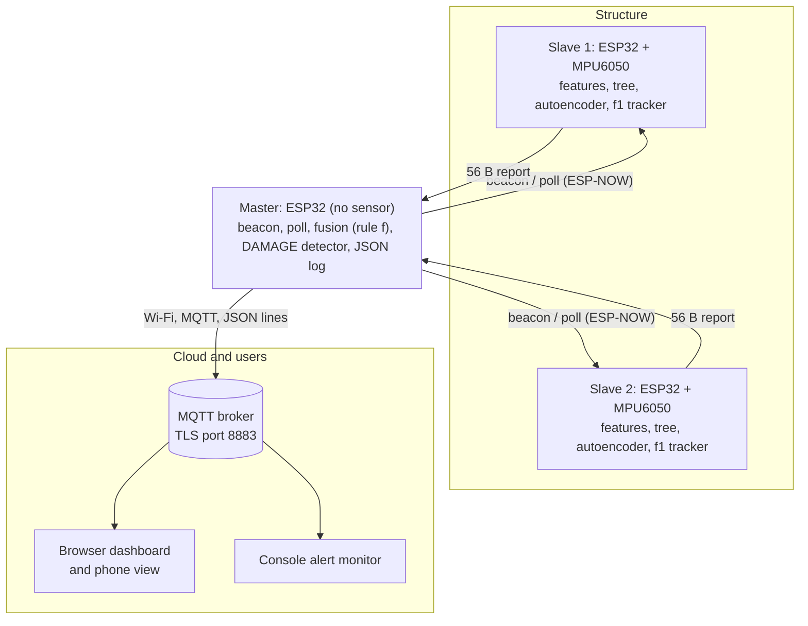
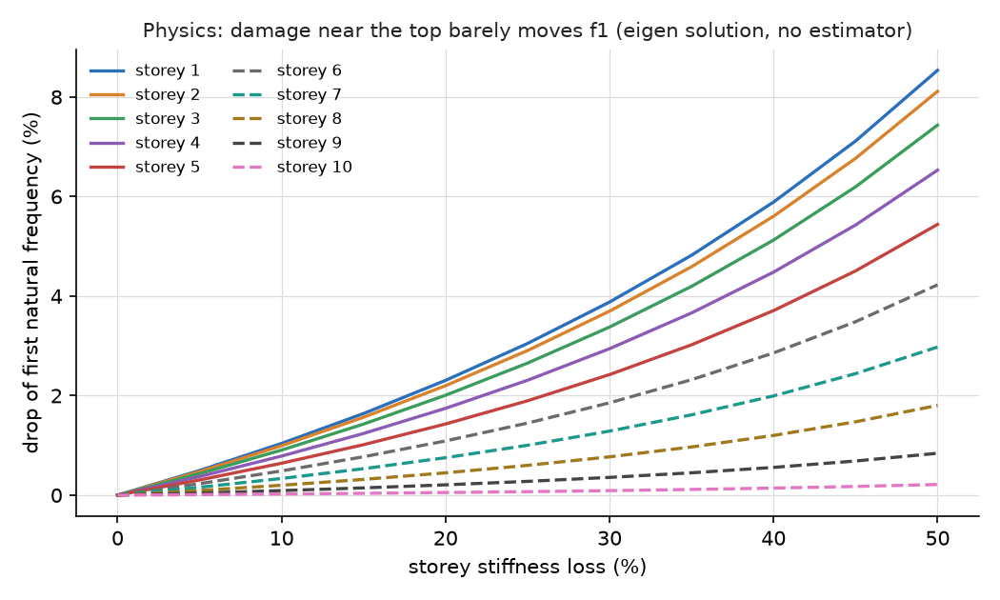
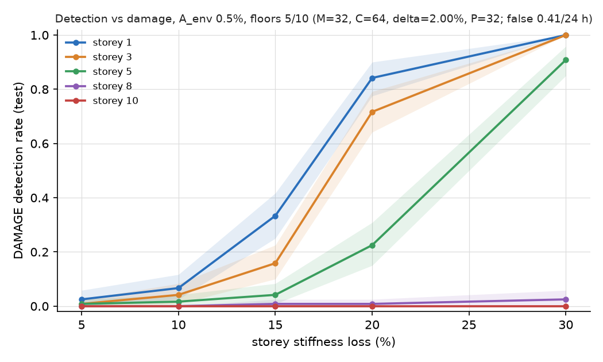
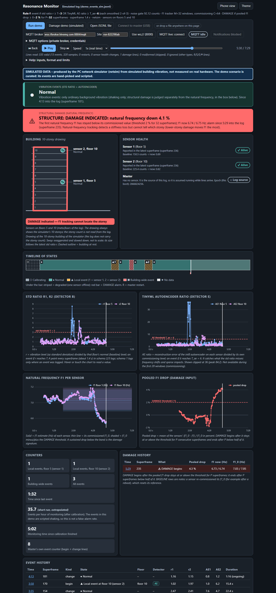

# Structural Health Monitoring using IoT and TinyML: Project Overview

Repository name: **Resonance**. This is the one document that explains the whole project from the problem to the results, in plain language. It is written for anyone who opens the repository: examiners, the faculty mentor, classmates and future readers. You need basic engineering knowledge, not knowledge of this code.

Where to go next: [PROJECT_GUIDE.md](../PROJECT_GUIDE.md) has every run command and the demo-day checklist. [project_report.md](project_report.md) is the detailed, fact-checked report. This overview gives the whole story and the numbers, and points to the result files that contain them.

**Contents**

1. [Summary](#1-summary)
2. [The problem, and why edge AI plus IoT](#2-the-problem-and-why-edge-ai-plus-iot)
3. [System setup](#3-system-setup)
4. [The sensor](#4-the-sensor)
5. [Data](#5-data)
6. [TinyML](#6-tinyml)
7. [Decisions at the master](#7-decisions-at-the-master)
8. [Damage detection by natural-frequency tracking](#8-damage-detection-by-natural-frequency-tracking)
9. [IoT and the demo tools](#9-iot-and-the-demo-tools)
10. [Results](#10-results)
11. [How it was verified](#11-how-it-was-verified)
12. [Limitations](#12-limitations)
13. [Ongoing and future work](#13-ongoing-and-future-work)
14. [Repository map and how to run](#14-repository-map-and-how-to-run)
15. [Glossary](#15-glossary)

How to read the numbers: every number comes from a result file in the repository. "Simulated" means it comes from the project's own building simulator (`building_sim`). "Host-measured" means it was timed on a PC. "Estimated" means it is a calculation or a datasheet-based guess. **Nothing in this project has been measured on real boards or on a real structure.** Sizes use 1 KB = 1000 B.

---

## 1. Summary

**The problem.** Buildings and bridges age, get shaken by wind, traffic and earthquakes, and can be damaged without anyone noticing. Structural health monitoring (SHM) puts sensors on a structure to notice unusual vibration, or a change in how the structure vibrates, early. Sending raw vibration data to a server all day costs power and bandwidth and stops working when the network fails.

**The solution.** Two small sensor nodes (an ESP32 microcontroller plus an MPU6050 accelerometer) sit on two floors. Each node analyses the vibration on the chip and sends a 56-byte summary every 1.4 seconds to a third ESP32, the master, over the radio protocol ESP-NOW. The master combines the two summaries into a decision and publishes it over MQTT to a cloud broker, from which a browser dashboard, a phone view and an alert monitor read.

**Three headline features.**

1. **TinyML anomaly detection on every sensor node.** A tiny neural network (an autoencoder, 574 parameters, 942 B of weights, 8-bit integer arithmetic) trained only on healthy vibration notices unusual vibration without ever having seen a fault.
2. **A natural-frequency DAMAGE alarm.** Damage makes a structure more flexible and lowers its first natural frequency. Each node tracks this frequency, and the master raises a DAMAGE alarm when it stays lower than its commissioned value for long enough.
3. **An IoT cloud layer and demo tools.** MQTT publishing (TLS, retained state, last-will), a browser dashboard with an animated building, a phone view opened by QR code, a console alert monitor, browser notifications, and an interactive "digital twin" where an examiner clicks buttons to damage a simulated building.

**Headline numbers (all simulated).**

| What | Result |
|---|---|
| Autoencoder size | 574 parameters, 942 B of weights, C code bit-exact with TensorFlow Lite on the PC (0 mismatches on 10,000 vectors) |
| Event recall, fresh pre-registered test block (240 simulated buildings, 28 h) | 0.734 with the autoencoder added, against 0.622 without it (paired gain +0.113) |
| False alarms | **1.64 false event onsets per hour** (2.05 on healthy ambient vibration alone). The project's own target of 1 per hour is **not met** |
| DAMAGE alarm, 30 % stiffness loss | detected 1.00 / 1.00 / 0.91 of the time at storeys 1 / 3 / 5, almost never at storeys 8-10 (this is physics, not a bug) |
| Slave firmware build | 772,825 B flash, 72,788 B static RAM |

**Honest status.** Everything was built and verified in simulation, on a PC, and in test harnesses. The hardware bring-up has not happened yet. Two targets are missed or only partly met: the false-alarm budget (not met) and damage detection (a coarse alarm for large damage in the lower storeys only). Section 12 lists every limitation.

---

## 2. The problem, and why edge AI plus IoT

### 2.1 Structural health monitoring

Bridges, buildings and towers are loaded by traffic, wind, people and earthquakes, and they slowly degrade. SHM looks for two kinds of things:

- **Events:** something hit or shook the structure now (an impact, a building-wide shaking).
- **Damage:** the structure itself has changed. A damaged structure is more flexible.

The classical idea behind damage detection is the **natural frequency**. Every structure has frequencies at which it prefers to vibrate. The lowest one, the first natural frequency f1, depends on mass and stiffness: f1 is proportional to the square root of stiffness divided by mass. Damage lowers stiffness, so f1 falls. Watching f1 over time is a standard SHM method, and it is what this project's DAMAGE alarm does.

### 2.2 Why compute on the device (edge, TinyML)

Streaming raw data is expensive. In the simulator, raw 6-axis data from two sensors would be 8.64 MB per hour. The summaries the nodes send instead are about 424 kB per hour of application payload (frame arithmetic with the current 56-byte report; an earlier 44-byte version was measured at about 363 kB per hour). Processing at the node also keeps the local network and the local alarm working when the internet is down.

**TinyML** means running machine learning on a microcontroller with kilobytes of memory. Here that is a small decision tree and a small neural network whose weights fit in under 1 KB each. The arithmetic uses **int8 quantisation**: weights and activations are stored as 8-bit integers with a scale factor instead of 32-bit floats. This saves memory and suits small processors.

### 2.3 Why IoT

A building's sensors are rarely where the engineer is. The master therefore publishes its decisions over **MQTT**, a lightweight publish/subscribe protocol that is widely used in IoT. A dashboard, a phone and an alert monitor anywhere can subscribe and watch the structure.

### 2.4 Targets

The project brief asked for at least 90 % accuracy, under 50 ms inference time, and a model under 100 KB. The mentor additionally required a hierarchical (multi-node) design. The team added its own false-alarm budget of 1.0 false event onset per hour (a choice, not derived from a standard).

| Target | Result | Kind of evidence |
|---|---|---|
| Accuracy at least 90 % | about 0.93 for the decision tree (a resampling estimate on synthetic data; the tree is not used by the master's final rule) | simulated |
| Inference under 50 ms | about 24 ms per window for the original tree pipeline in the Wokwi emulator; a real ESP32 is estimated at 3-8 ms for the full pipeline | emulator and estimate, not silicon |
| Model under 100 KB | decision tree 110 B, autoencoder weights 942 B | exact sizes |
| False alarms at most 1/h | 1.64/h: **not met** | simulated |

---

## 3. System setup

### 3.1 Three boards

Three ESP32 boards form the system:

- **Two sensor nodes ("slaves")**, each an ESP32 with an MPU6050 accelerometer, mounted on two different floors.
- **One master**, an ESP32 with no sensor. It keeps the clock, collects the slaves' reports, decides, and publishes to the cloud.

Two slaves are the smallest number that can compare two floors, that is, tell a "local" event (one floor reacts) from a "building-wide" event (both react). This hierarchical design was a mentor requirement.

| Tier | Hardware | Job |
|---|---|---|
| Sensor node (x2) | ESP32 DevKit + MPU6050 (SDA on GPIO 21, SCL on GPIO 22) | Sample at 100 Hz; for each window compute features, the decision-tree class, the autoencoder anomaly ratio, and the f1 estimate and drop; answer when polled |
| Master (x1) | ESP32, nothing attached | Keep the 1.4 s clock, send beacons, poll the slaves, learn baselines, fuse the reports, run the DAMAGE detector, write JSON lines, publish by MQTT |
| Cloud and users | MQTT broker, browser, console alert monitor | Remote viewing and alerts |

### 3.2 One 1.4-second cycle (a "superframe")

1. At t = 0 the master broadcasts a **beacon** (17 bytes: superframe number and the master's boot "epoch").
2. Each slave collects a window of 128 samples, 10 ms apart. After the last sample it computes everything in one pass.
3. At t = 1.32 s the master **polls** slave 1, then slave 2 (18-byte poll). Each answers with a **56-byte report**. The reply timeout is 18 ms per attempt, with one retry. Compile-time checks in the firmware verify that polling starts after the last sample and ends before the next beacon.
4. The master closes the superframe, fuses the two reports, feeds the DAMAGE detector, and writes one JSON "sample" line plus an event line if the state changed.
5. The same lines go to USB serial and, in the MQTT build, to the cloud.

### 3.3 The radio protocol

- **ESP-NOW** is Espressif's connectionless peer-to-peer radio protocol. It needs no router, so the local sensor network works even when the Wi-Fi is off. That is why it connects the nodes, while Wi-Fi and MQTT only carry data from the master to the cloud.
- Every frame carries a magic number, type, protocol version (3), source, destination, sequence number, payload and a CRC-16. Frames with a wrong length, type, CRC or version are rejected, so all three boards must run the same build.
- The 56-byte report holds the superframe, epoch, window number, raw class, smoothed state, flags, five tree features, and the three newer values: the autoencoder ratio, the f1 estimate and the f1 drop.
- The master draws a random **epoch** at every boot and puts it in every frame. A restarted master therefore cannot be confused with its previous run.
- A slave that misses a beacon waits 5 ms, then free-runs on its own clock for up to 5 superframes (flagged UNSYNCED), then goes silent until it hears a beacon again.
- A slave with three missed superframes in a row (about 4.2 s) is declared **DEAD**. The master then continues in a degraded mode on the other slave. In degraded mode it can say LOCAL or AMBIENT but never BUILDING.

Simulated packet loss (independent per packet; real loss is bursty and unmeasured; these recalls are for the earlier rule b, from `compare_hierarchy.md`):

| Packet loss | False DEAD per slave-hour | LOCAL recall | BUILDING recall |
|---|---|---|---|
| 0 % | 0.000 | 0.453 | 0.811 |
| 5 % | 0.000 | 0.449 | 0.800 |
| 10 % | 0.122 | 0.442 | 0.778 |
| 20 % | 4.809 | 0.413 | 0.681 |

The three-miss DEAD rule therefore suits only low loss. Real loss must be measured before the rule is trusted.

### 3.4 Hardware bill of materials (approximate)

These are rough Indian-rupee market prices, to be confirmed. They are not measured costs.

| Item | Qty | Approx. price each (INR) | Approx. total (INR) |
|---|---|---|---|
| ESP32 DevKit v1 | 3 | 450-700 | 1,350-2,100 |
| MPU6050 breakout (GY-521) | 2 | 150-300 | 300-600 |
| USB cables and 5 V supplies | 3 | 150-300 | 450-900 |
| Jumper wires, breadboards or perfboard, mounting | one set | 200-400 | 200-400 |
| **Total (approximate)** | | | **about 2,300-4,000** |

A broker is free (the public demo broker) or a small server running Mosquitto. An enclosure and a rigid mount are extra. The slaves are designed for USB or mains power: with the radio and CPU effectively always on they would drain a battery in hours to a few days (a datasheet-based estimate, not a measurement).

---

## 4. The sensor

The **MPU6050** is a small chip with a 3-axis accelerometer and a 3-axis gyroscope. The accelerometer measures acceleration, the change of speed, including the constant pull of gravity. The gyroscope measures rotation speed.

| Setting | Value |
|---|---|
| Accelerometer range | +-2 g (16,384 counts per g) |
| Gyroscope range | +-250 degrees per second |
| Sampling rate | exactly 100 Hz (a timer fires every 10 ms) |
| Built-in low-pass filter (DLPF) | configuration 3: 44 Hz for the accelerometer, 42 Hz for the gyroscope |
| Axes used | `az` (the accelerometer axis that carries the building's sway in the simulator, mounted as the gravity axis on the bring-up plan) and `gx` (gyroscope) |
| Window | 128 samples, not overlapping = 1.28 s; the frequency resolution is 0.78125 Hz |

The low-pass filter is a **hard requirement**. The training data never contained noise above 50 Hz, and in one independent check (not reproducible from the repository) switching the filter off changed about 16 % of predictions. The firmware reads the filter and range registers back at boot and refuses to classify if they are wrong (`config fail`). Thresholds are in raw sensor counts at these ranges.

---

## 5. Data

There are two kinds of data. A small synthetic dataset was used to pick the original decision tree. A building simulator then produced everything else.

### 5.1 The synthetic three-class dataset

Generated by `data/generator/generate.py` (random seed 42): **150 recordings, 50 per class, 40 windows each, 6,000 windows** in total, with six sensor axes of raw counts per window.

| Class | What it looks like |
|---|---|
| normal | a steady vibration at 4-12 Hz with small amplitude |
| abnormal | a larger amplitude (the amplitude grows during the recording), with some frequency drift and a slowly moving offset |
| faulty | the frequency jumps to 14-30 Hz, and/or damped impact spikes appear |

All windows of one recording are near duplicates, so data are always split by recording, never by window.

### 5.2 The building simulator

`data/generator/building_sim.py` models a **10-storey shear building**: equal floor masses, equal storey stiffnesses, driven at its base by random shaking. It computes the absolute floor acceleration an accelerometer would read, then passes it through an emulation of the MPU6050's 44 Hz filter, downsamples to 100 Hz, adds sensor noise and an offset, and rounds to 16-bit integers like the real chip.

Randomness per building (all drawn from the building's seed):

- first natural frequency f1 between 4 and 10 Hz;
- damping ratio 1 % to 3 %;
- an excitation level between 0.6 and 1.7 times a reference;
- per-floor sensor noise and offset (az noise 20-60 counts, az offset about 0 +- 40).

**Damage** is a fractional stiffness loss in one chosen storey (for example 30 % in storey 1).

**Events** the simulator can add: impacts (decaying spikes), a sparse single impact, a frequency shift, and building-wide shaking at 2, 3 or 5 times the normal level. The `gx` gyroscope channel is **modelled, not physical**: a gain times the sway signal plus noise.

### 5.3 The seed-block discipline

A model chosen and scored on the same data looks better than it is. The project therefore used strict rules:

- **Seed blocks.** Every simulated building comes from an integer seed. Ranges of seeds ("blocks") are reserved for one purpose each, and the code asserts that blocks never overlap.
- **Train, dev, test.** Models are trained on one block. Choices (thresholds, rules) are made on a **dev** block. The chosen configuration is then scored **once** on a **fresh test block** that nobody has looked at.
- **Pre-registration.** Before the fresh block for the final rule was simulated, a document (`r3_test_preregistration.md`) was committed, stating exactly which rule, which incumbent, and what outcome leads to which decision.
- **Bootstrap intervals.** 95 % intervals are obtained by resampling whole buildings 2,000 times.

| Seeds | Used for |
|---|---|
| 42 | synthetic dataset (decision-tree selection) |
| 5,200,000+ | first fusion test (criterion later found wrong, superseded), scored once |
| 6,100,000 + 240 buildings | rule selection (dev) |
| 6,200,000 + 240 | test of rule b, scored once; single-node vs hierarchy comparison |
| 6,300,000-6,300,399 | autoencoder training (healthy data) |
| 6,300,400-6,300,499 | autoencoder validation and design search |
| 6,400,000 + 240 | **fresh test block for rule f, scored once** |
| 6,500,000 + 120 | f1 tracker selection (dev) |
| 6,600,000 + 120 | f1 tracker / DAMAGE test, scored once (later re-run once after a robustness fix, see section 8.5) |
| 5,990,011 | the one building of the dashboard damage demo |

---

## 6. TinyML

### 6.1 What each node computes per window

For every 128-sample window the node computes:

- **Tree features (5):** the az standard deviation, excess kurtosis (how "spiky" the signal is) and dominant frequency, and the gx standard deviation and dominant frequency. The variance is computed in two passes (mean first) because a one-pass float32 formula flips predictions when `az` sits near 16,384.
- **Spectral front end,** shared by the autoencoder and the f1 tracker: one discrete Fourier transform of `az`, then
  - **16 band powers**, each the log of (sum of 4 spectral bins + 1);
  - a **zoom**: a Hann-windowed Goertzel evaluation at 181 frequencies from 3.0 to 12.0 Hz in 0.05 Hz steps (23,000 multiply-accumulates). Goertzel computes the power at one chosen frequency cheaply; the Hann window reduces leakage. The peak is refined by parabolic interpolation, which gives f1 to a fraction of the 0.78 Hz bin width.

All firmware is built with `-ffp-contract=off` so the ESP32 does not fuse multiply-adds, which keeps its float rounding equal to the PC's. That is what makes bit-level comparison with Python possible.

### 6.2 The decision tree (history)

A decision tree is a chain of "if feature > threshold" questions. Selection (`models/selected/report.md`): inputs were 18 mean-removed features; the rule was "the smallest model of at most 5,120 B whose repeated grouped 5-fold cross-validation accuracy is at least 0.90 in all 10 repeats". The winner is a depth-3 tree with **11 nodes and 110 B**, using 5 features of 2 axes.

- **Accuracy: 0.9315** over 200 random re-draws of the test recordings (0.9315 also over 40 repeats of 5-fold cross-validation).
- **This is an estimate of the training procedure, not an untouched test.** The selection rule was revised twice after results were seen, so no untouched data remain, and the data are synthetic.
- Alternatives under a replacement rule fixed in advance: a 50-tree random forest of depth 4 (0.938 / 0.940, 11.5 KB, kept as fallback), a best RBF SVM (0.911 / 0.912, up to 93 KB), a best linear SVM (0.907 / 0.907, 372 B), a small neural network (0.87). None qualified to replace the tree.
- **Role today:** the tree still runs on each slave and its state is reported, but **the master's final rule does not use it.** Rules that relied on the tree's "faulty" output were all over the false-alarm budget (alone on one node at floor 10 it gave 39.0 false onsets per hour on healthy ambient vibration).

Two-of-three smoothing on the tree's output (the state changes only when 2 of the last 3 windows agree) cut false-alarm episodes per normal recording from 0.50 to 0.17 (minus 65 %) at the cost of one window (1.3 s) of delay.

### 6.3 The int8 autoencoder

**Why an autoencoder?** A classifier needs labelled examples of every kind of fault, which nobody has for a real structure. An autoencoder is a neural network trained to rebuild its input through a narrow "bottleneck". Trained only on **healthy** vibration, it rebuilds healthy windows well and unfamiliar windows badly. The rebuilding error is the **anomaly score**. No fault examples are needed.

| Item | Value |
|---|---|
| Inputs (20) | the 16 az log band powers, az std, az kurtosis, gx std, gx kurtosis |
| Layers | 20-12-2-12-20, ReLU dense layers |
| Parameters | 574 |
| Training data | healthy simulated data only: 400 buildings x 10 floors, 880,000 windows (seeds 6,300,000-6,300,399); Adam, mean-squared-error loss, 30 epochs |
| Quantisation | full-integer post-training quantisation (PTQ) using 3,000 representative vectors |
| Firmware weights and tables | **942 B** (the int8 TFLite file is 4,568 B); 528 int8 multiply-accumulates per window |
| Architecture choice | 8-3-8, 12-2-12 and 12-4-12 were within seed noise (mean recall 0.58-0.63); larger ones generalised worse (0.47-0.49); 12-2-12 had the best two-seed mean |

**Commissioning normalisation.** Different nodes have different sensor gains and sit on different floors, so one trained model needs to be made comparable. On power-up each slave learns, from its own first 20 windows, a per-input median and a robust spread (median absolute deviation divided by 1.4826), plus a reference score (the median commissioning score). Later windows are normalised with these, and the **ratio** = score / reference score is what is thresholded.

**Quantisation cost** (validation healthy windows): the reconstruction error rises from 2.2541 (float) to 2.3487 (int8), plus 4.2 %; the per-window score correlation is 0.9899; the mean detection recall at a 0.5 % healthy false-positive threshold goes from 0.608 (float) to 0.600 (int8).

**Bit-exact with TensorFlow Lite on the PC.** The firmware runs hand-written C code (not the TFLite Micro runtime). Against the TensorFlow Lite reference interpreter it gives **0 mismatching int8 outputs on 10,000 vectors** (200,000 values). Two rounding details had to be matched, and they are the classic trap of porting integer networks:

1. TFLite rounds **once** in its fixed-point multiply. The textbook "double-rounding" form differs in 28 % of vectors.
2. The input quantiser must be `round_half_away(v / scale)` with a real float division. The faster `v * (1/scale)` differs at near-half values. An independent verification pass found this before the test block was scored; the dev selection was re-run and did not change.

**Is this really TinyML?** By the constraints, yes: a trained neural network, int8 post-training-quantised, under 1 KB of weights, compiled into the slave firmware. It has not yet been executed on a board or in Wokwi; its outputs were verified on the PC. It does not use TFLite Micro; that comparison is future work.

### 6.4 The Mahalanobis baseline

A statistical alternative on the same normalised inputs: the Mahalanobis distance (how many standard deviations a vector is from the healthy mean, accounting for correlations), with covariance shrinkage 0.8. It has 20 + 210 parameters (920 B), about 440 float multiply-accumulates, and a validation mean recall of 0.699 (int8 autoencoder 0.600). It misses sparse single impacts (0.01-0.015) and was not deployed.

### 6.5 Compact benchmark

Development block, the best configuration of each family under 1.0 false onsets per hour (`models/tinyml/ae_report.md`). "Shift" is frequency-shift recall; "sparse" is sparse-impact recall. Host times are on a PC, not an ESP32.

| Detector | Weights | Dev config | False onsets/h | LOCAL | BUILDING | shift | sparse |
|---|---|---|---|---|---|---|---|
| Decision tree (rule a, lowest false-onset row; over budget) | 110 B | a, T=1.5, smoothed, k=3 | 8.86 | 0.676 | 0.536 | 0.975 | 0.060 |
| Rule b (std over baseline) | 4 B | b, T=3, k=1 | 0.79 | 0.442 | 0.801 | 0.294 | 0.054 |
| Mahalanobis (rule m) | 920 B | m, T=4, k=3 | 0.96 | 0.618 | 0.737 | 0.848 | 0.013 |
| int8 autoencoder (rule e) | 942 B | e, T=5, k=1 | 0.43 | 0.692 | 0.382 | 0.867 | 0.212 |
| **Rule f = b OR e (deployed)** | 946 B | f, T=6 (b T=3), k=1 | 0.89 | 0.658 | 0.803 | 0.771 | 0.204 |
| Rule g = b OR m | 924 B | g, T=4 (b T=3), k=3 | 1.00 | 0.617 | 0.779 | 0.848 | 0.010 |

The autoencoder alone is worse than rule b at building-wide amplitude events (BUILDING 0.382), because its training data included 0.5-1.5 times level changes, so it largely "reconstructs" a louder building. The OR combination takes the strengths of both.

---

## 7. Decisions at the master

### 7.1 What the master outputs

For every superframe the master outputs one of: **COMMISSIONING** (still learning baselines), **AMBIENT** (normal background vibration), **LOCAL(slave)** (one floor reacts), **BUILDING** (both react), or **NO_DATA**, plus **DEGRADED** when one slave is dead.

Each slave's **baseline** is the median az standard deviation of its first 20 reports. The **std ratio** is r = az_std / baseline.

### 7.2 Rule b and rule f

- **Rule b** (the earlier rule): a slave is flagged if its std ratio r is at least 3 (smoothed 2-of-3). Both slaves flagged is BUILDING, exactly one is LOCAL for that slave, none is AMBIENT. It is good at amplitude events and weak on frequency shifts and sparse impacts.
- **Rule f = b OR e** (**deployed**): each slave's flag is (the b flag) OR (the autoencoder flag). The two flags are smoothed separately, 2-of-3. The autoencoder flag needs the autoencoder to be ready (after its 20 commissioning windows), az std of at least 92.12 counts (the noise gate), and a ratio of at least **6**. Thresholds: b at 3, autoencoder at 6, debounce k = 1.

### 7.3 Debounce, smoothing, and the noise gate

- **Smoothing** (2 of the last 3 windows must agree) removes isolated blips.
- **Debounce k** would require a decision to hold for k consecutive superframes before it is announced. The chosen k is 1 (off); it is implemented and tested.
- **Noise gate:** a window with az std below 92.12 counts is treated as "no real vibration" and cannot raise the autoencoder flag. The value was derived from synthetic data and is **provisional**; it must be re-measured on the real sensor. It matters a great deal: without it the autoencoder rule gave 17.9 false onsets per hour instead of 0.43 (dev block).

### 7.4 When a sensor dies

After 3 missed superframes (about 4.2 s) a slave is declared DEAD and the master continues in **degraded mode** on the other slave (LOCAL or AMBIENT only, never BUILDING). A `node` line is written at once so the dashboard shows "sensor dead". When the slave returns it recommissions its baselines.

### 7.5 How the rule was chosen

The history is part of the result.

1. **A first criterion failed.** "Per-superframe AMBIENT recall at least 0.95" picked a rule that produced 126.5 false events per hour on its test block. A 5 % error per 1.4 s superframe is one false alarm every 28 s. That block was not reused.
2. **Event-level criterion.** The criterion was rewritten: maximise mean(LOCAL event recall, BUILDING event recall) subject to at most 1.0 false onsets per hour, on a dev block of 240 buildings and 28 h of monitoring (63 candidates). The winner was rule b at T = 3. On its fresh test block it gave 2.04 false onsets per hour [1.04, 3.25] and the budget was not confirmed.
3. **Autoencoder added.** The same selection rule on the dev block picked rule f (T = 6, b T = 3, k = 1).
4. **Pre-registered test.** Deploy f if and only if (1) the paired 95 % interval of the mean-recall gain (f minus b) excludes 0, and (2) the paired increase in false onsets per hour has a point estimate of at most 0.5. Both held, so f is deployed.

---

## 8. Damage detection by natural-frequency tracking

### 8.1 The physics in plain words

If a storey loses stiffness (cracked columns, say), the building gets a little more flexible and f1 falls. But the first vibration mode bends the building mainly in its **lower** storeys. A stiffness loss near the top barely changes how the building vibrates in that mode, so f1 hardly moves. This limits **any** f1-based detector, however clever the estimator.

Eigen-solution of the shear model, f1 drop in percent (storey stiffness loss on top; `freq_tracking.md`):

| Storey | 5 % loss | 10 % | 20 % | 30 % | 50 % |
|---|---|---|---|---|---|
| 1 | 0.50 | 1.04 | 2.31 | 3.88 | 8.54 |
| 3 | 0.43 | 0.91 | 2.01 | 3.38 | 7.43 |
| 5 | 0.31 | 0.64 | 1.43 | 2.42 | 5.44 |
| 8 | 0.09 | 0.20 | 0.45 | 0.77 | 1.80 |
| 10 | 0.01 | 0.02 | 0.05 | 0.09 | 0.21 |

*Figure 1. How far the first natural frequency falls for a given stiffness loss in each storey. Storey 1 (top blue line) moves f1 the most; storey 10 (bottom pink line) hardly at all. This is computed from the building model, with no estimator involved.*

### 8.2 The tracker (on each slave)

- A ring of the last **M = 32** zoom spectra is averaged. The raw f1 estimate is the interpolated peak of the average.
- After a warm-up the slave **commissions** a reference f1 as the median of the last **C = 64** valid estimates, only if they form a single clean peak ("unimodal": (p90-p10)/median at most 0.10). This takes about 96 windows, 2.2 minutes of quiet data.
- Afterwards, estimates outside f1_0 times (1 plus or minus 0.20) are discarded as mode jumps.
- The slave reports **f1_drop = (f1_0 minus f1) divided by f1_0**.

### 8.3 The DAMAGE rule (on the master)

The master averages the drop over the slaves that have a valid drop ("pooled drop"). **DAMAGE BEGINS** after **P = 32** consecutive superframes (45 s) with the pooled drop at or above **delta = 2 %**. It **ends** after 32 superframes below 1 % (hysteresis). If no slave is usable, the state is held. If the slave that saw the damage is missing, an active alarm does not end because of its silence (a guard added after verification found that case).

These parameters (M, C, delta, P) were selected on a dev block (6,500,000 + 120 buildings; false DAMAGE at most 1 per 24 h; maximise mean detection) and scored once on a test block (6,600,000 + 120).

### 8.4 Results (test block, `freq_tracking.md`)

False DAMAGE per 24 h of healthy monitoring (118 h per cell):

| Stiffness drift of the environment | False DAMAGE per 24 h |
|---|---|
| none | 0.20 [0.00, 0.61] |
| 0.5 % | 0.41 [0.00, 1.22] |
| 1 % | 2.24 [0.81, 4.07] (budget exceeded under stronger drift) |

Detection rate (primary pair, floors 5 and 10, 0.5 % drift; latency in superframes of 1.4 s, detected cases only):

| Storey | 10 % loss | 20 % loss | 30 % loss | Latency at 30 % |
|---|---|---|---|---|
| 1 | 0.07 | 0.84 | 1.00 | 48.2 |
| 3 | 0.04 | 0.72 | 1.00 | 52.4 |
| 5 | 0.02 | 0.23 | 0.91 | 81.6 |
| 8 | 0.00 | 0.01 | 0.03 | 149.0 |
| 10 | 0.00 | 0.00 | 0.00 | not available |

Mean detection over all 25 (storey, loss) cells is **0.217 [0.204, 0.232]**. By loss: 5 % 0.01, 10 % 0.03, 15 % 0.11, 20 % 0.36, 30 % 0.59. By storey: 1 0.45, 3 0.39, 5 0.24, 8 0.01, 10 0.00. A latency of 48-82 superframes is 1-2 minutes. The f1 estimation error (floors 5 and 10, M = 32) has a median of 0.025 Hz and a 99th percentile of 0.12 Hz.

*Figure 2. DAMAGE detection rate on the test block against stiffness loss, one line per storey (shaded = 95 % interval). Storeys 1 and 3 are caught at 20-30 % loss, storey 5 only at 30 %, storeys 8 and 10 almost never.*

**Summary:** the DAMAGE channel is a coarse alarm for large (about 20-30 %) stiffness losses in the lower storeys, with a latency of one to two minutes. It is not a sensitive damage detector.

### 8.5 A post-hoc fix, and what it costs

After the test block was scored, independent verification found that on a **low floor of a low-f1 building** the first mode is weak and the spectral peak can jump to the second mode (about three times f1). The tracker was changed (unimodal commissioning test and the plus-or-minus 20 % band). This was not a re-selection and the cached results are essentially unchanged (mean detection 0.217 before and after), but **because the test numbers were re-run after the test block had been seen, they are no longer a clean one-shot.** Low floors of low-f1 buildings remain poor sensors for this method.

---

## 9. IoT and the demo tools

### 9.1 MQTT

The master publishes its JSON lines to topics `resonance/<site>/...`, where `<site>` is a random identifier (default `rsn-822298ab`). There is one topic per line type (`meta`, `restart`, `sample`, `begin`, `change`, `node`, and so on), plus retained topics, which a late subscriber receives at once:

| Retained topic | Content |
|---|---|
| `state` | the latest decision |
| `damage_state` | the latest DAMAGE line |
| `meta` | run metadata, re-published after every reconnect |
| `status` | `{"state":"online"|"offline","epoch":E}` |

- **Last will:** if the master vanishes the broker publishes "offline". The payload carries the master's boot epoch, so a stale will from an older session is ignored.
- **Queue behaviour:** a fixed-size queue drops the oldest sample first and keeps events and meta lines. The poll loop hands lines to the MQTT task on the other CPU core without ever waiting, so a bad network cannot delay the radio polling.
- **Security:** the default connection is **TLS on port 8883** with a committed root certificate. Limitation: this ESP32 framework build cannot check certificate expiry. The public broker is for **demo only**: anyone who knows the site id can read the (simulated) topics. A private broker with authentication is a configuration change, not a code change.

### 9.2 The browser dashboard

`dashboard/index.html` is one self-contained page. It can replay a log file, read live over USB (Web Serial), read live over MQTT, or play an embedded simulated damage demo that works by double-clicking the file. Panels: the state banner, a DAMAGE banner, an **animated 10-storey building** that sways in proportion to the vibration, pulses the floor of a LOCAL event, turns amber for BUILDING, greys a dead sensor and outlines DAMAGE in red, a timeline, charts of the std ratio, the autoencoder ratio, f1 per sensor and the pooled drop, a DAMAGE history, and an event history that says which detector fired. The building drawing never marks a storey from sensor data, because the system cannot localise the storey.

*Figure 3. The dashboard replaying the simulated demo log just after the DAMAGE alarm (superframe 235). Top: the red DAMAGE banner (natural frequency down 4.1 %). Left: the animated building outlined in red. Middle: the std-ratio and autoencoder-ratio charts show the earlier events; the f1 chart shows both sensors' frequencies falling below the shaded band, and the pooled drop crosses the 2 % line. A banner states that the data are simulated and the scenario is curated.*

### 9.3 Alerts

- `tools/alerter.py` is a **console alert monitor**. It subscribes to the topics and prints one line per alert in its own terminal, for example `LOCAL vibration event at floor 10 (sensor 2) [AE 6.2 >= 6]` or `DAMAGE ALARM: natural frequency down 4.3 % (f1 6.73/6.74 Hz vs 7.03/7.05 Hz at commissioning)`. It has a cooldown and an hourly budget, and it sends nothing anywhere.
- The dashboard offers **browser notifications** ("Enable notifications") on LOCAL or BUILDING events, a sensor going DEAD, and a DAMAGE alarm.

### 9.4 Phone view

Run `tools/serve_dashboard.py` on the laptop; it serves only the `dashboard/` folder on the local network. Press **Phone view** in the dashboard to get a QR code. Scan it with a phone on the same Wi-Fi and the phone opens the same live view (or the same replay) in a one-column layout. Campus networks often isolate devices; a phone hotspot is the fallback.

### 9.5 The interactive digital twin

`tools/twin_server.py` runs a simulated building monitored by the **real firmware logic** (compiled for the PC), and the dashboard shows a "Digital twin" panel with buttons: impact on floor 5 or 10, building shake, damage in a chosen storey and loss, repair, kill or revive a sensor, reset. An examiner clicks, and within seconds the stream shows the firmware's reaction. A dotted "simulator truth" line on the f1 chart shows the real f1 of the simulated building. Damage in storey 10 moves the truth by only 0.1 % and rightly gives no alarm; damage of 30 % in storey 1 lowers it by 3.9 % and the DAMAGE alarm follows after about 82 simulated seconds. Commands are rate-limited and validated. Anyone who knows the site id on the public broker could press the buttons, so it is for simulated demo data only.

### 9.6 The Wokwi cloud demo

Wokwi is an ESP32 emulator in the browser or in VS Code. The firmware environment `master_wokwi_cloud` runs the real master code with two virtual slaves fed from the demo traces, with LEDs (heartbeat, event, DAMAGE) and a buzzer (a chirp for an event, three beeps at DAMAGE BEGIN, a reminder beep every 30 s). It is verified on the PC by a test that compares its output with the simulator's golden log; it has **not** been run in Wokwi itself (the command-line tool was not available).

---

## 10. Results

All numbers in this section are simulated. Sources: `models/selected/validation/fusion_eval_r3_test.md`, `fusion_eval_r3_dev.md`, `freq_tracking.md`, `compare_hierarchy.md`, `models/tinyml/ae_report.md`.

### 10.1 Rule f against rule b on the fresh test block

The block (seeds 6,400,000 + 240) has 240 buildings and 28.0 h of healthy-plus-noise monitoring, scored once. Primary pair is floors 5 and 10. "False onsets" are events announced when there was none.

| Rule | False onsets/h [95 %] | vs 1/h target | Healthy only /h | LOCAL recall | BUILDING recall | Mean recall |
|---|---|---|---|---|---|---|
| **f (deployed)** | 1.64 [0.75, 2.79] | **not met** | 2.05 [0.94, 3.48] | 0.666 | 0.803 | **0.734** [0.720, 0.748] |
| b (incumbent) | 1.39 [0.54, 2.54] | **not met** | 1.74 [0.67, 3.17] | 0.441 | 0.803 | 0.622 [0.607, 0.637] |

**Paired difference f minus b** (same resampled buildings): mean recall **+0.113 [+0.103, +0.122]**, LOCAL recall +0.225, BUILDING recall +0.000, false onsets **+0.25 per hour [+0.04, +0.50]** (46 against 39 false onsets in 28 h). Both pre-registered criteria hold, so rule f was deployed.

**Recall by kind of event** (f against b):

| Event kind | Rule f | Rule b |
|---|---|---|
| dense impacts | 1.000 | 0.969 |
| sparse single impact | 0.202 | 0.056 |
| frequency shift | 0.796 | 0.298 |
| building-wide 2x | 0.433 | 0.433 |
| building-wide 3x | 0.975 | 0.975 |
| building-wide 5x | 1.000 | 1.000 |

The gain is in sparse impacts and frequency shifts, where the autoencoder helps. Building-wide events are unchanged. The secondary pair (floors 3 and 7) tells the same story: f 1.43 false onsets/h, mean recall 0.710; b 1.18/h, 0.615.

### 10.2 The false-alarm budget, stated plainly

- Point estimates of both rules exceed 1 per hour. The 1.64/h headline includes 5.6 h of noise-only recordings in which neither rule fires. **On healthy ambient monitoring alone, the rate a quiet real building would see, f is at 2.05/h and b at 1.74/h.**
- Both 95 % intervals still include values below 1 per hour (one 28 h block is a noisy estimate; the dev block gave 0.89/h for f), so the team does **not claim** the budget.
- The defensible comparison is the paired one: **+0.113 recall for +0.25 false onsets per hour**.
- A real deployment would raise thresholds or add debounce. For example f at T = 4, k = 3 gave 0.21 false onsets/h with mean recall 0.676 on dev.
- Weaknesses carried over: 3x building-wide events briefly show as LOCAL before BUILDING (wrong-class share 0.621 for f), and sparse impacts are mostly missed (0.20).

### 10.3 DAMAGE detection and false DAMAGE

See section 8.4: 30 % loss at storeys 1 / 3 / 5 is detected 1.00 / 1.00 / 0.91 of the time, 20 % loss 0.84 / 0.72 / 0.23, top storeys almost never; false DAMAGE 0.41 per 24 h at 0.5 % drift (0.20 with no drift, 2.24 at 1 % drift).

### 10.4 Hierarchy against a single node

`compare_hierarchy.md` compared three boards with one standalone node using the std-ratio rule (rule b, R2b test block):

| Measure | One node (floor 10) | Hierarchy |
|---|---|---|
| False onsets/h, healthy ambient | 2.41 | 2.54 |
| Building-wide event detection | 0.833 | 0.844 |
| Events on its own floor (10) | 0.429 | 0.429 |
| Events on the other floor (5) | 0.022 | 0.487 |

**Honest reading:** the hierarchy does not reduce false alarms and does not detect more on one floor. It adds the second floor, the typing of events (LOCAL against BUILDING) and graceful degradation when a slave dies. For "something happened here or building-wide", one ratio node is as good and simpler. The cost of the hierarchy is three boards, a radio link and packet-loss sensitivity.

### 10.5 Storey localisation: a negative result

Locating the damaged storey from amplitude ratios failed both pre-stated gates (gate 1 top-1 accuracy 0.452, within-one 0.481; gate 2 exact 0.893 and within-one 0.908 passed, but the alarm rate 0.770 was under the required 0.80). It is **not claimed**. Retraining the tree on building data was also rejected (more false alarms, 0.0511 against 0.0069 smoothed). These negative results are kept deliberately.

### 10.6 Resource use

| Build | Flash | Static RAM |
|---|---|---|
| `esp32dev` (original single node, autoencoder not linked) | 296,889 B | 22,364 B |
| `master` | 746,853 B | 44,808 B |
| `slave1` = `slave2` (full pipeline) | 772,825 B | 72,788 B (of 320 KB) |
| `master_mqtt` (TLS) | 905,189 B | 59,252 B |
| `master_wokwi_cloud` (two virtual slaves) | 1,258,013 B (96.0 % of the partition) | 59,428 B |

The models are tiny (tree 110 B, autoencoder 942 B). The rest of the firmware is the Arduino core and the Wi-Fi and TLS stacks. The f1 tracker needs about 23.4 KB of RAM and the autoencoder 1.7 KB, together about 25.1 KB per slave.

**Compute time.** The original tree pipeline took about 24 ms per window in Wokwi (simulated time, not silicon). The full slave pipeline (features, bands, autoencoder, zoom, tracker, tree) took about 30-45 microseconds on average on a PC (host-measured). **The ESP32 figure is an estimate of roughly 3-8 ms** from instruction counts; nothing has been timed on a real board. The poll timing tolerates about 50 ms of slave compute.

---

## 11. How it was verified

**Host unit and parity tests** (all passing at the last recorded run):

| Command | What it covers | Count |
|---|---|---|
| `pio test -e native` | tree on all 6,000 windows, smoothing, front end, autoencoder, tracker and detector | 42 test cases |
| `pio test -e netsim` | protocol, state machines, simulator, fusion, JSON | 115 (63 + 52) |
| `pio test -e espnow_logic` | radio helpers | 26 |
| `pio test -e mqtt_logic` | MQTT logic | 34 |
| `pio test -e cloud_demo` | virtual cloud pipeline | 6 |
| Python tests | IoT tools 13, log validator 7, gates 18, dashboard server 11 | 49 |

**Bit-exact chains.** The same arithmetic is run in Python and in C and compared:

- decision tree on all 6,000 windows, 0 mismatches; smoothing on 2,592 sequences, 0 mismatches; the Wokwi self-test matched 606 of 606 windows (original tree pipeline only);
- autoencoder C kernel against the TFLite reference interpreter, 0 mismatches on 10,000 vectors;
- fusion code against its Python reference, 89 sequences, 3,157 decisions, 1,407 events, 0 mismatches; the reference against the vectorised evaluation on 151,200 dev superframes, 0 mismatches;
- a test compares every selected constant in the firmware with the selection result files, so changing a threshold without re-running the selection fails the test.

The Python evaluations **run the firmware C code** through a bridge, so what was evaluated is what is deployed.

**Independent verification.** Each phase was reviewed by a separate agent that re-ran the tests and tried to break the change. Several real defects were found this way: the master-restart blackout, a master-stall bug, the quantiser rounding difference, the mode-2 lock of the tracker, and a stale-DAMAGE case.

**Reproducibility.** Test vectors, demo traces and logs can be regenerated from fixed seeds by scripts. Large evaluations are cached, resumable and deterministic. Commands are in [PROJECT_GUIDE.md](../PROJECT_GUIDE.md) and [project_report.md](project_report.md) (appendix A).

---

## 12. Limitations

1. **Simulation only.** No sensor data from a real structure and no run on real ESP32 boards exist. The cloud demo was not run in Wokwi. The newer slave pipeline has not run on an ESP32 or in Wokwi; its `logf` calls may differ from the PC in the last bit.
2. **The false-alarm budget is not met:** 1.64 per hour (2.05 on healthy ambient only) against a target of 1.0. Both intervals include values below 1, but that is not a claim.
3. **Damage detection is limited to large losses in the lower storeys.** Damage in the top storeys is invisible to f1 by physics. Detection under realistic drift is untested; false DAMAGE rises to 2.24 per 24 h at 1 % drift; and the test numbers are not a clean one-shot after the post-hoc fix.
4. **The damaged storey is not localised.** Both localisation gates failed.
5. **Mounting-axis question.** The simulator puts the sway on `az`, while the bring-up guide mounts `az` as the vertical gravity axis, which would see little of a building's sway. The axis choice and the threshold transfer must be settled on hardware.
6. **Simulator frequencies are not full-scale.** The simulated buildings have f1 of 4-10 Hz. That corresponds to a low-rise or laboratory-scale structure, not a full-scale 10-storey building (whose f1 is typically around 1 Hz). The simulator is also a uniform shear building with stationary excitation, no temperature or mass changes, and a modelled (non-physical) `gx`.
7. **Fit to our own simulator.** The simulator, the thresholds and the scoring were all written by this project, so the results show the method works under these assumptions, not on a real structure.
8. **Provisional noise gate** (92.12 counts), derived from synthetic data. It also cuts out many windows on quiet low floors (98 % on floor 1), so upper floors (5 and 10 as evaluated) are recommended.
9. **Commissioning is held in RAM.** Baselines (rule b, autoencoder normaliser, f1 reference) are learned in the first minutes after power-on and lost on reboot. A slave that reboots on a damaged structure recommissions on the damaged state and hides the damage. Nothing detects a bad commissioning.
10. **Weak events are missed:** sparse single impacts are caught 0.20 of the time, and building-wide 2x shaking 0.43.
11. **A curated demo scenario.** The dashboard demo (impact, building-wide shaking, frequency shift, damage) is hand-picked and scripted. It illustrates the pipeline; it is not a statistic.
12. **Network and security:** packet loss was simulated as independent (real loss is bursty); the DEAD rule suits low loss only; Wi-Fi and ESP-NOW channel coexistence is unverified on hardware. The public MQTT broker is demo-only, certificate expiry is not checked in this build, and ESP-NOW trust-on-first-use is not attacker-proof.
13. **Accuracy of the tree** (0.93) is a resampling estimate on synthetic data with no untouched test.

---

## 13. Ongoing and future work

**In progress / planned, not yet validated.** The following is a statement of direction. None of it has produced results yet, and none of it is on `master` unless named elsewhere in this document.

- **A realism upgrade of the simulator (in progress).** A full-scale 10-storey building simulator with f1 of about 1 Hz, realistic loads (wind, traffic, footsteps, machinery, earthquakes), temperature effects and more realistic sensor noise. This addresses the scale and realism limits of section 12.
- **Redesigned frequency tracking (planned)** for the lower frequencies and the new load types.
- **Second-mode (f2) and amplitude-ratio damage localisation (planned),** to try to see the upper storeys and to say which storey is damaged.
- **An adaptive-baseline false-alarm reduction (planned),** to bring the false-alarm rate nearer the budget.
- **Reboot-safe calibration (planned):** storing baselines in non-volatile memory so a reboot does not re-learn on a damaged structure.
- **Authenticated radio frames (planned),** replacing trust-on-first-use.
- **A TFLite Micro comparison (planned)** against the hand-written C kernel.
- **Long-term trend history (planned).**
- **Hardware bring-up on a physical model (planned),** following [hardware_bringup.md](hardware_bringup.md): confirm the sensor configuration at boot, time the slave compute, measure radio loss, tune the noise gate on real data, test the router-off case, record real labelled data, and ideally test on a small laboratory frame whose stiffness can be reduced in steps.

---

## 14. Repository map and how to run

### 14.1 Map

| Path | Contents |
|---|---|
| `data/generator/` | `generate.py` (synthetic dataset), `building_sim.py` (10-storey shear building simulator) |
| `models/training/` | model selection, fusion evaluations, f1-tracking evaluation, autoencoder training |
| `models/selected/` | the deployed tree, reports, and `validation/` result files (md and json) |
| `models/tinyml/` | the int8 autoencoder, its normaliser data and `ae_report.md` |
| `firmware/esp32/` | PlatformIO project: `include/` (protocol, fusion, autoencoder, tracker, MQTT logic), `src/` (master and slave firmware, simulator CLI), `test/`, `wokwi/` |
| `dashboard/` | the browser dashboard, demo logs, validators, headless tests |
| `tools/` | MQTT publisher, alert monitor, digital twin server, dashboard server, end-to-end test |
| `docs/` | this overview, the full report, viva preparation, demo runbook, hardware bring-up guide, figures |

### 14.2 The three most important commands

Full instructions, setup and checked outputs are in [PROJECT_GUIDE.md](../PROJECT_GUIDE.md). From the repository root on Windows, with the Python environment `.venv` set up:

1. **See the demo, no installation of anything else:** double-click `dashboard/index.html` and press **Damage demo (simulated)**.
2. **Run the firmware's host tests** (from `firmware/esp32`): `pio test -e native` and `pio test -e netsim`.
3. **Run the interactive digital twin** (after building the simulator once with `pio run -e netsim`): `.venv\Scripts\python.exe tools\twin_server.py --speed 2 --transport websockets --port 8000`, then open the dashboard, choose MQTT live and enter the printed site id.

---

## 15. Glossary

| Term | Meaning |
|---|---|
| Accelerometer | A sensor measuring acceleration, including gravity |
| Ambient vibration | The normal background vibration of a structure |
| Autoencoder | A neural network trained to rebuild its input through a narrow bottleneck; the rebuilding error shows how unfamiliar an input is |
| Baseline | A node's own learned "normal" level, measured in its first 20 windows |
| Beacon | The master's periodic radio message that sets the 1.4 s clock |
| Bit-exact | Producing identical results, bit for bit, in two implementations |
| Bootstrap interval | A 95 % interval from resampling whole buildings 2,000 times |
| Commissioning | The first minutes after power-on during which a node learns what normal looks like |
| DAMAGE | The alarm raised when the first natural frequency stays lower than its commissioned value |
| Debounce | Requiring a decision to hold for several superframes before announcing it |
| DEAD | A slave that has missed 3 superframes in a row |
| DLPF | The MPU6050's built-in digital low-pass filter (44 Hz / 42 Hz here) |
| Dev / test block | Disjoint sets of simulated buildings: choices are made on dev, the test block is scored once |
| ESP-NOW | Espressif's connectionless peer-to-peer radio protocol |
| ESP32 | A Wi-Fi microcontroller board |
| Event recall | The share of true events announced, with the right class, at least once |
| f1 | The first (lowest) natural frequency of a structure |
| False onset | An event announced when there was none |
| Goertzel | A cheap method to compute the spectrum power at one chosen frequency |
| Hierarchy | The two-slave plus master design |
| int8 / PTQ | 8-bit integer arithmetic / post-training quantisation |
| Kurtosis | A measure of how spiky a signal is |
| LOCAL / BUILDING / AMBIENT | One floor reacts / both floors react / normal |
| Master / slave | The coordinating ESP32 / a sensor ESP32 |
| Mahalanobis distance | A distance from the healthy mean that accounts for correlations |
| MQTT | A lightweight publish/subscribe messaging protocol |
| Noise gate | A minimum vibration level (92.12 counts) below which a window cannot raise the autoencoder flag |
| Pre-registration | Writing down the test and the decision rule before looking at the test data |
| Retained message | An MQTT message the broker keeps for late subscribers |
| Shear building | A building model in which each storey moves like a spring between floors |
| Std ratio | A window's vibration level divided by that node's baseline |
| Stiffness | Resistance to bending or deformation |
| Superframe | One 1.4 s network cycle |
| TinyML | Machine learning on microcontrollers with kilobytes of memory |
| Wokwi | An ESP32 emulator used for no-hardware demos |
| Window | 128 samples at 100 Hz = 1.28 s, the unit of analysis |
