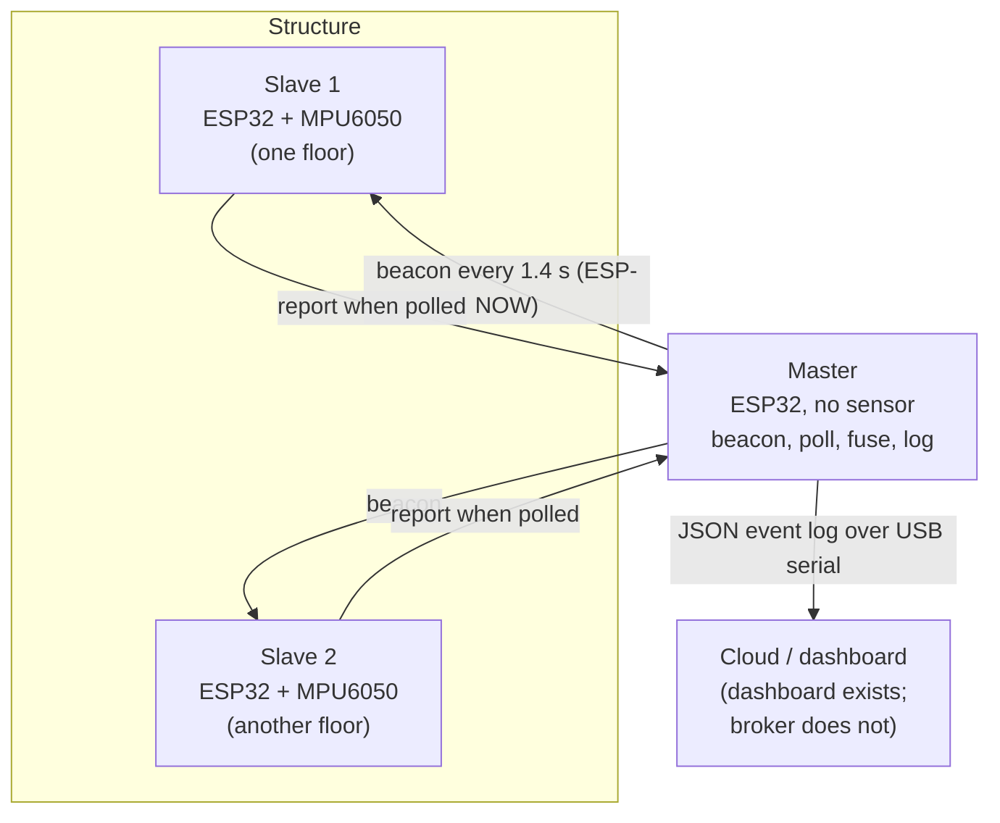

# Resonance: Hierarchy Validation Report (R1 to R6)

Status as of 11 November 2026. This report covers the work done after the simulation stage described in [simulation_validation.md](simulation_validation.md): a simulated multi-storey building, an attempt to locate damaged storeys, retraining of the floor model, a three-board network (one master, two slaves), the master's decision logic, a comparison with a single node, and a browser dashboard. It also lists what must be measured once the boards arrive.

**Nothing in this report has run on real hardware or in a real browser.** Every result comes from a simulator, a PC test harness or the Wokwi emulator. Real radio loss, real timing, real sensor noise and accuracy on a real structure are untested.

Numbers are taken from the result files named in each section. Where a number comes from an independent verification run that is not stored in the repository, it is labelled "independent verification" (§1.1 lists them). Intervals are 95% bootstrap intervals that resample whole simulated buildings, unless stated otherwise.

## Terms used

| Term | Meaning here |
|---|---|
| Window | 128 accelerometer samples at 100 Hz (1.28 s), classified by the on-board decision tree |
| Superframe | One 1.4 s cycle of the network: the master sends a beacon, both slaves sample one window, the master polls each slave for its report (§6) |
| Commissioning baseline | The median `az_std` (vibration strength) of a slave's first 20 reports, taken while the structure is assumed to be in quiet, normal condition. Later readings are expressed as a ratio to it |
| Ratio r | Current `az_std` divided by the commissioning baseline |
| LOCAL / BUILDING / AMBIENT | The master's three outputs: an event near one named slave; an event at both slaves (building-wide); nothing unusual |
| Event onset, false onset | An onset is the moment the master's output changes from AMBIENT to LOCAL or BUILDING. A false onset is one that happens on a recording with no event in it (healthy structure or sensor noise only) |
| Recall | The share of true events that were detected. "Event recall" counts an event as detected if the correct class (and the correct slave for LOCAL) was output for at least one superframe during the event's recording |
| Debounce k | A new LOCAL/BUILDING decision must hold for k consecutive superframes before it is output. The final rule uses k = 1, i.e. no extra delay |
| Development / test block | Disjoint sets of simulated buildings (different random seeds). Choices are made on the development block; the chosen configuration is scored once on the test block |

## 1. Summary

**What was built.**
- A simulator of a 10-storey shear building (`data/generator/building_sim.py`) that produces MPU6050-like floor acceleration, with controllable damage, impacts and strong excitation.
- A three-board network: a master with no sensor and two slaves, each with one MPU6050 and the existing decision tree. Firmware state machines, wire protocol, a PC network simulator, an ESP-NOW hardware layer and a bring-up guide (`docs/hardware_bringup.md`).
- Master decision logic: from the two slaves' reports it outputs AMBIENT, LOCAL (naming the slave) or BUILDING.
- A single-file dashboard (`dashboard/index.html`) that replays event logs or reads the master over USB.

**What works (in simulation).**
- The network protocol survived two rounds of independent verification (§6). Firmware builds and host tests pass.
- Master logic on the test block (`fusion_eval.md`): LOCAL event recall 0.453, BUILDING event recall 0.811, at 2.04 false onsets per hour (all monitoring) and 2.54 per hour of healthy monitoring.
- Against one standalone node with the same ratio rule, the hierarchy detects events on a second floor (0.487 against 0.022 on floor 5) and names the event type; it does not detect more events on the first floor and does not have fewer false alarms (`compare_hierarchy.md`, §8).

**What failed.**
- Locating the damaged storey did not pass either of two pre-stated gates (§4). Storey localisation is therefore report-only and is not claimed.
- Retraining the floor model on building data did not replace the deployed tree (decision: KEEP OLD, §5).
- The first criterion for choosing the master's rule was wrong: it allowed about 126 false flags per hour (§7). It was replaced and the selection redone on fresh data.
- The final rule's false-alarm rate on the test block (2.04 per hour) exceeds the 1.0 per hour budget used for selection. The pooled estimate over both blocks is about 1.4 per hour (independent verification), so the budget is probably not met in expectation.

**What remains.** Everything that needs hardware (§10); a cloud broker (§9); a rule that does not mislabel building-wide events as local for the first superframes (§7.4); a longer or more realistic test of damage detection, which the simulation cannot supply.

### 1.1 Facts from independent verification (not reproducible from the repository)

Verification runs were done by a separate reviewer and are not stored here. They are quoted as given and marked "independent verification" where used. Where a repository file covers the same number, the file was checked and agrees; the one figure not stored in a file (the 0.40 false-alarm rate under half-strength excitation) is explained in item 1 below.

1. Gate 1 and gate 2 results (also in the repository files, §4); changed-excitation false alarms of 0.25 to 0.40. The repository file shows 0.247 (band 2–15 Hz) and 0.36 (10 dB tilt) for its two changed-spectrum cases (§4.2). The 0.40 (0.397) is the verifier's own extra run with the excitation at half strength, which is not in the repository file; doubling the strength lowered false alarms (0.010) because the signal-to-noise ratio rises.
2. Retraining verified by a byte-identical re-run and an independent scorer; the noise gate fails once sensor noise is about 1.5 to 1.75 times the assumed level.
3. Fusion round 2: the 0.79 to 2.04 per hour gap is consistent with sampling noise (building-level permutation p about 0.07); pooled estimate about 1.4 per hour; the old tree's false "faulty" comes entirely from its loud-window branch; rule b briefly shows a building-wide event as LOCAL in 59% of 3x events (file value 0.592).
4. Protocol: mutation tests, about 600,000 superframes of fault injection, 12 million fuzz iterations; a master-restart blackout and a master-stall bug were found and fixed; false DEAD about 0.12 per slave-hour at 10% packet loss and about 4.8 at 20%; slave 1 compute-time limits (§6).
5. No hardware or browser run yet.

## 2. Why a hierarchy

The project began as a single node: one ESP32 and one MPU6050 classifying its own vibration as normal, abnormal or faulty. The hierarchical design adds a second tier so that the system can say something a single node cannot: where an event is, and whether it affects one place or the whole building. A hierarchy was a requirement set by the project's mentor; the choice of one master with two slaves is the smallest arrangement that can compare two floors, which is what separating "local" from "building-wide" needs.



| Layer | What it does | Where |
|---|---|---|
| Slave (x2) | Samples az and gx at 100 Hz, computes 5 features, runs the depth-3 tree (11 nodes, 110 B) and the noise gate, smooths 2-of-3, and sends one report per superframe: window number, raw class, smoothed state, flags and the 5 features | `firmware/esp32/include/tiers.h`, `src/net_main.cpp` |
| Master | Keeps the superframe clock, sends beacons, polls each slave (one retry), declares a slave DEAD after 3 missed superframes, measures each slave's commissioning baseline, applies the decision rule, prints the event log | `tiers.h`, `include/fusion.h`, `src/net_main.cpp` |
| Cloud / dashboard | Shows live state and history from the master's JSON lines. Replay of files and live USB reading exist. A cloud broker (MQTT or similar) does not | `dashboard/` |

Each slave still runs the original on-device classifier, so a slave keeps producing a local state even if the network fails. The noise gate (`NOISE_GATE_COUNTS` = 92.12 in `tiers.h`) forces a window with `az_std` below 92.12 counts to "normal" and sets a LOW_SIGNAL flag. The value is provisional; it comes from the synthetic dataset (`localisation_gate.json`, Part C) and must be re-set from the real sensor's noise (§10).

The final decision rule (§7) does not use the tree's class at all, only the vibration-strength ratio against the commissioning baseline. The tree still runs on each slave and its output is reported, but it does not affect the master's LOCAL/BUILDING decision.

## 3. The simulated building

Source: `data/generator/building_sim.py`; sanity checks in `localisation_gate.json` (`sanity_checks_building_sim`). Limits are listed in `models/selected_building/report.md`.

**What it models.**
- Ten floors of equal mass joined by equal-stiffness storeys (a uniform shear model). Damage is a fractional loss of stiffness in one storey.
- Excitation is stationary band-limited random base acceleration, 2 to 12 Hz by default. Output is absolute floor acceleration, passed through an emulation of the MPU6050 low-pass filter (second-order, 44 Hz), decimated to 100 Hz, with per-floor sensor noise (sigma 20 to 60 counts) and offset added.
- First-mode frequency f1 is drawn from 4 to 10 Hz, damping from 1% to 3%, excitation level from 0.6x to 1.7x. This is a scale model's frequency range, not a full-size building's.
- Excitation strength is set so that the reference building (f1 = 7 Hz, damping 2%) has a roof `az_std` of about 173 counts. In the simulated population the top-floor `az_std` lies in 100 to 300 counts for 86% of buildings (`sanity_checks_building_sim.top_floor_az_std_signal_only.frac_in_100_300`).

**What it does not model.**
- `gx` is not physical. As in the original dataset generator it is a gain (0.02 to 0.2) times the lateral signal plus noise and offset. Only `gx_std` and `gx_domfreq` reach the tree.
- The excitation is stationary. Real wind, traffic and occupancy vary in level and spectrum over hours.
- Mass and stiffness are uniform; real buildings are not. There is no torsion, no soil interaction, no temperature effect on stiffness and no mounting error.
- A real structure's damage, impact and drift signatures may differ from the simulator's.

Because the simulator, the thresholds and the scoring were written by the same project, results describe fit to the simulator. They are evidence that the method works under these assumptions, not that it works on a structure.

## 4. Attempt to locate damaged storeys

**Question.** With a sensor on every floor, can the pattern of vibration amplitudes reveal which storey lost stiffness? The method computes, for each storey k, the ratio of adjacent-floor amplitudes (noise-corrected) and compares it with the same ratio from a healthy recording of the same building. The storey with the largest change is the prediction. The method, thresholds and pass criterion were written into the scripts before any result existed.

Note: this test assumes one sensor on each of the 10 floors. The three-board hierarchy has two. Even a pass would not have given storey-level output from the hierarchy as built.

**Criterion (30% stiffness loss, default excitation, fresh seeds).** Gate 1: top-1 accuracy at least 0.70, within-one at least 0.90, false alarm at most 0.05.

### 4.1 Gate 1: FAILED (`localisation_gate.json`, `gate` = "FAIL")

| Measure | Required | Result |
|---|---|---|
| Top-1 storey (unconditional, 1000 damaged buildings) | at least 0.70 | **0.452** |
| Within one storey | at least 0.90 | **0.481** |
| False alarm (1500 healthy assessments) | at most 0.05 | **0.0747** |

The alarm (detection) rate at 30% loss was only 0.168. The method worked on the lowest storeys (top-1 0.90 for storey 1, 0.91 for storey 2) and not on the upper ones (0.03 for storey 10). The reason is physical: the first-mode frequency shift from 30% stiffness loss is about -0.27 Hz when the damage is in storey 1 and about -0.006 Hz in storey 10, against a frequency-bin width of 0.78125 Hz. A noise-free, infinite-averaging calculation reached top-1 0.969 (exploratory result E1, same file), so the information exists in the model but not in 30 noisy windows.

A single sensor-noise gate placed from this data (G = 92.12 counts, Part C of the same file) would also cut out 0.390 of healthy simulated floor-windows overall (0.982 on floor 1, 0.110 on floor 10), because the lower floors of the simulated building vibrate less than the sensor's noise-gate level.

### 4.2 Gate 2: FAILED (`localisation_gate_v2.json`, `verdict` = "FAIL")

A second and final attempt was allowed, with a stated rule: no third attempt. Changes: 120 windows instead of 30, normalisation of each storey's score by its healthy variability, and a 97.5th-percentile threshold. Criterion adds: alarm rate at least 0.80.

| Measure | Required | Result | 95% interval |
|---|---|---|---|
| Exact storey | at least 0.70 | 0.893 (pass) | 0.872 to 0.911 |
| Within one storey | at least 0.90 | 0.908 (pass) | 0.888 to 0.924 |
| Alarm rate at 30% loss | at least 0.80 | **0.770 (fail)** | 0.743 to 0.795 |
| False alarm on 1500 healthy | at most 0.05 | 0.0307 (pass) | 0.023 to 0.041 |

The gate fails on one of four conditions. Per storey, the alarm rate is high for storeys 3 to 8 (0.96 to 1.00) and low at the ends: 0.49 and 0.55 for storeys 1 and 2, 0.70 for storey 9, 0.06 for storey 10. For 15% loss (report only) the alarm rate was 0.176.

**Sensitivity to the excitation (off-verdict cases, same file).** With the excitation level doubled the false-alarm rate was 0.010. With the excitation band widened to 2 to 15 Hz it was 0.247, and with the spectrum tilted by 10 dB across the band it was 0.36. The independent verification found false alarms of 0.25 to 0.40 under changed excitation spectra. The method assumes the healthy baseline and the later assessment see the same kind of excitation; real ambient excitation does not guarantee that.

### 4.3 What this means

Storey localisation does not meet its own criterion and is **not claimed**. It is reported as a finding. The pattern is that it works in mid-height storeys and fails at the ends, and that it is fragile to changes in excitation. The hierarchy's output is limited to "event near slave 1", "near slave 2" or "building-wide".

## 5. Floor model: retraining on building data

**Question.** The deployed tree was trained on isolated synthetic recordings. Would a tree trained on simulated-building data, using ratios to each floor's commissioning baseline as extra features, do better? Source: `models/selected_building/report.md` and `report.json`; design in `models/training/train_building.py`.

**Replacement rule (fixed beforehand).** The new tree replaces the old only if its false-alarm rate (smoothed, mean over floors, on healthy ambient and noise-only windows) is lower than the old tree plus noise gate, and its local-event detection is at least as high. No margin.

**Data.** 240 development buildings, 150 held-out buildings, all seeds disjoint from earlier blocks. Selection by 10x repeated grouped 5-fold cross-validation on development buildings only.

**Selection.** With absolute features only (set A) no model reached the 0.90 cross-validation bar (best depth-8 tree: 0.8787). Adding two commissioning-relative features (`az_std_rel`, `gx_std_rel`; set B) made a depth-3 tree eligible (cross-validation mean 0.9141, 15 nodes, 150 B). The chosen tree used `az_std`, `az_kurt`, `az_domfreq` and `az_std_rel`. It therefore needs a per-node commissioning value stored on the device.

**Decision on the 150 held-out buildings (smoothed):**

| Model | False alarm | Detection of local events |
|---|---|---|
| New tree | 0.051 (0.039 to 0.064) | 0.879 |
| Old tree + noise gate | **0.007** (0.004 to 0.010) | 0.887 |
| Old tree, no gate | 0.406 | 0.887 |

The difference in false alarm, new minus old+gate, is 0.033 to 0.056 (interval). The difference in detection is -0.025 to 0.010, which includes zero. The new tree fails the first condition. **Decision: RETRAIN: KEEP OLD** (old tree plus noise gate). A byte-identical re-run and an independent scorer confirmed this (independent verification).

Two findings from the same table are worth stating:
- **The noise gate is doing a lot of work.** The old tree without the gate reports a false alarm on 0.406 of healthy-floor windows, and its false "faulty" comes entirely from its loud-window branch (`az_std` > 354 and kurtosis > -1.19) on upper floors (independent verification). The gate suppresses this by treating windows below 92.12 counts as noise. Independent verification found the gate stops working once sensor noise is about 1.5 to 1.75 times the level assumed. The gate value must be set from the real sensor (§10).
- **The decision rule did not score building-wide events.** The new tree treated 3x and 5x building-wide excitation as abnormal (0.95 and 0.96 of windows on floor 10), where the old tree reports "faulty" on 0.56 (3x) and 0.82 (5x) of windows. A strong but healthy shaking should not be called "faulty", so the new tree is better here. The rule was fixed beforehand and did not count it, so the decision stands. This is a case where the fixed rule and a reasonable engineer's preference differ; it is reported, not hidden.

Neither tree detected a 30% stiffness loss: 0.9505 (new) and 0.9935 (old+gate) of windows were reported normal. Window-level classification does not detect the damage that §4 tried to locate.

On the original `dataset.csv` the old tree scores 0.9523 in-sample (6000 windows); the new tree cannot be computed on it because it needs commissioning-relative features.

## 6. Network protocol

Sources: `firmware/esp32/include/net_proto.h` (constants and packet format), `tiers.h` (state machines), `compare_hierarchy.md` (loss tables), `.claude/STRUCTURE.md` (tests).

**Superframe.** A 1.4 s cycle (`SUPERFRAME_US` = 1,400,000). At the start the master broadcasts a **beacon** carrying the superframe number. Each slave starts sampling 128 samples at 100 Hz, which takes 1.27 s from first to last sample. At 1.32 s the master **polls** slave 1, then slave 2, and each replies with a **report**. Each poll waits at most 18 ms per attempt (`REPLY_TIMEOUT_US`), with exactly one retry (`POLL_ATTEMPTS` = 2). Compile-time checks ensure polling begins after the last sample and ends before the next beacon in the worst case.

**Packets.** Magic byte, type, version (2), source, destination, sequence, payload, CRC-16/CCITT. Fixed lengths; any frame with a wrong length, type or CRC is rejected.

**Epoch and restart.** At each start the master picks a fresh 32-bit random epoch and puts it in every beacon, poll and report. A slave that sees a new epoch resynchronises at once; frames with a foreign epoch are ignored. Without this, a restarted master (whose superframe counter restarts at 0) would be ignored by slaves that expect numbers to increase. Independent verification found a master-restart blackout and a master-stall bug in earlier versions; both were fixed. The decision logic keeps the commissioning baselines across a master restart and across a slave outage.

**Missed beacons.** A slave that misses a beacon waits 5 ms past the expected time (`BEACON_GRACE_US`), then free-runs on its own clock for up to 5 consecutive superframes (`MAX_MISSED_BEACONS`), marking its reports UNSYNCED. After that it goes silent until it hears a beacon. A beacon whose superframe number jumps by more than 8 is rejected unless the slave is lost or freshly booted.

**Dead detection.** The master declares a slave **DEAD** after 3 consecutive superframes without a valid report (`DEAD_AFTER_MISSES`), i.e. about 4.2 s (measured in the simulator: 4.2 s in 240 of 240 runs for each slave, `compare_hierarchy.md`). With one slave dead the master continues in **DEGRADED** mode: it can output LOCAL for the surviving slave or AMBIENT, never BUILDING. A single node that dies is blind and silent. At the moment it declares a slave DEAD (or ALIVE again), the master writes a dedicated `node` line to the event log, which the dashboard shows at once (`dashboard/demo_events_faults_sim.jsonl` has an example: DEAD at superframe 32, ALIVE at 62). The older indirect signals remain: `degraded_alive` in a change event (which also fires for a single lost report) and `alive: false` on the next periodic status line, up to 64 superframes (about 90 s) later (`compare_hierarchy.md`).

**Verification.** Host tests: protocol, slave, master, simulator invariants, restart at several superframes, tick lateness and master stalls (57 tests, `test/test_net`), plus the decision logic and event-log formatter (39 tests, `test/test_fusion`; 96 in total with `pio test -e netsim`). Two rounds of independent verification (independent verification): mutation tests (deliberately broken copies of the code must be caught), about 600,000 superframes of fault injection and 12 million fuzz iterations.

**Behaviour under packet loss** (simulated, independent loss on each packet, `compare_hierarchy.md`; real loss is bursty and has not been measured):

| Loss per packet | False DEAD per slave-hour (95% interval) | LOCAL correct-type recall | BUILDING correct-type recall |
|---|---|---|---|
| 0% | 0.000 (0.000 to 0.237) | 0.453 | 0.811 |
| 5% | 0.000 (0.000 to 0.024) | 0.449 | 0.800 |
| 10% | 0.122 (0.074 to 0.191) | 0.442 | 0.778 |
| 20% | 4.809 (4.470 to 5.166) | 0.413 | 0.681 |

False DEAD means a healthy slave declared dead because three reports in a row were lost. The independent verification gives about 0.12 at 10% and about 4.8 at 20%, in agreement. At 20% loss a false DEAD roughly every 12 minutes per slave would make the DEAD indicator unreliable; whether 20% is realistic is unknown until measured.

**Limits found by verification.** Slave 1's first poll fails if its compute time exceeds about 50 ms (a retry is needed), and it is wrongly declared dead from about 68 to 70 ms (independent verification; `hardware_bringup.md` gives about 68). The simulated compute time is about 24 ms (§5 of `simulation_validation.md`), leaving a margin of roughly a factor of two that must be confirmed on hardware.

**Radio traffic** (simulated, application payload only, `compare_hierarchy.md`): about 363 kB per hour for all three nodes at 0% loss. Streaming raw 6-axis data from the two slaves would be 8.64 MB per hour. The events-only JSON uplink is about 10.5 kB (10,516 B) per hour at 0% loss and 233,067 B per hour at 20% loss, because loss makes the output flicker.

## 7. Master decision logic

The master converts the two slaves' reports into one output per superframe. Four candidate rules were defined (a to d), each with a threshold T (1.5, 2 or 3), a tree variant (raw or smoothed) and a debounce k. In the ratio rules, e_i = (r_i >= T), smoothed 2-of-3; F_i = the tree says "faulty".

| Rule | Output |
|---|---|
| a | both F = BUILDING, one F = LOCAL |
| b | both e = BUILDING, one e = LOCAL (the tree is not used) |
| c | both e = BUILDING; F and e on one slave while the other slave's ratio is below 1.5 = LOCAL for that slave |
| d | both e = BUILDING; otherwise F on exactly one slave = LOCAL; F on both = LOCAL on the slave with the higher ratio |

Anything else is AMBIENT. The C++ implementation (`fusion.h`) is checked against a Python reference with 69 test sequences (2,214 decisions, 0 mismatches); and on 136,800 superframes of simulated data the C++ network simulator and the Python reference differed on none (`compare_hierarchy.md`, parity line).

### 7.1 Round R2: first criterion (superseded)

Criterion: maximise the mean of LOCAL and BUILDING recall per superframe, subject to AMBIENT recall at least 0.95 per superframe. The chosen configuration was rule d, T = 3, smoothed tree. Result on the test block (`fusion_eval.md`, round R2; 160 buildings): AMBIENT recall 0.951, BUILDING recall 0.432, LOCAL recall 0.884, and **126.5 false events per hour** (109.2 to 149.1).

An AMBIENT recall of 0.95 per superframe sounds good but means that 5% of 1.4 s superframes, about one every 28 s, are false. For an alarm system the correct unit is the false alarm per hour, not the share of correct superframes. The criterion was wrong, and it was found when the test block was scored. This was a planning error, not an implementation fault. The R2 test block was used once and then not used again.

### 7.2 Round R2b: event-level criterion (final)

Fixed before the final run: maximise the mean of LOCAL and BUILDING **event recall**, subject to at most **1.0 false onset per hour** on the development block. 63 candidates (rules a to d, T, tree variant, k = 1 to 3). Fresh seed blocks: development 6,100,000+ (240 buildings), test 6,200,000+ (240 buildings). The budget of 1.0 per hour was chosen by the project; it is not derived from a requirement. The criterion was written after seeing R2's failure, so the design is informed by R2; the seeds are fresh.

**Chosen: rule b, T = 3, k = 1** (no tree). On the development block it had 0.79 false onsets per hour (combined healthy and noise-only), LOCAL event recall 0.442 and BUILDING event recall 0.801 (`fusion_eval.md`). Several candidates had higher recall but all were over budget: for example rule d, T = 2, raw, k = 1 reached 0.988 mean recall at 55.36 false onsets per hour. Under the 1.0 per hour budget the best available was far less sensitive. The development table shows the trade-off directly: at a 10 per hour budget the best option reached a mean recall of 0.770; at 60 per hour, 0.988.

### 7.3 Test results for the chosen rule

Scored once on the test block, primary pair (floors 5 and 10), 28.0 h of monitoring (`fusion_eval.md`):

| Measure | Result (95% interval) |
|---|---|
| False onsets per hour, all monitoring | **2.04** (1.04 to 3.25) |
| False onsets per hour, healthy ambient only | 2.54 (1.29 to 4.06) |
| False onsets per hour, noise only | 0.00 |
| LOCAL event recall | 0.453 (0.436 to 0.471) |
| ...dense impacts / sparse impact / frequency shift | 0.990 / 0.048 / 0.321 |
| BUILDING event recall | 0.811 (0.789 to 0.832) |
| ...2x / 3x / 5x excitation | 0.442 / 0.992 / 1.000 |
| Onset latency, superframes (dense / 3x / 5x) | 2.63 / 5.62 / 1.34 |

On the secondary pair (floors 3 and 7), the same rule gave 1.82 false onsets per hour (0.79 to 3.11), LOCAL 0.501, BUILDING 0.733.

**How to read this.**
- The test false-onset rate (2.04 per hour, roughly one every 30 minutes) is higher than the development rate (0.79). The lower end of the test interval (1.04) is above the 1.0 budget. The independent verification judged that the gap is consistent with sampling noise (building-level permutation p about 0.07) and estimated the pooled rate at about 1.4 per hour. Taken together, **the 1 per hour budget is probably not met in expectation.** The pooled figure is the simple average of two blocks of equal monitoring time (28.0 h each).
- Strong impacts are caught (0.990) but single weak impacts almost never (0.048) and frequency shifts only partly (0.321). A 2x building-wide excitation is detected 0.442 of the time. The rule detects large changes in vibration strength; it is not a sensitive damage detector.
- Latency for a 3x event is about 5.6 superframes (about 8 s).

### 7.4 Weaknesses

1. **Building-wide events are briefly mislabelled.** One slave's ratio may cross T a superframe or two before the other's, so the output is LOCAL before it becomes BUILDING. Events with a wrong-class output: 3x 0.592 (0.529 to 0.658), 5x 0.283, 2x 0.229. The independent verification quotes 59% for 3x. The event is detected, but the dashboard will show a spurious "local event" first.
2. **The tree is not used.** The most elaborate part of the earlier phases contributes nothing to the master's decision. This is a result: under the event-level criterion every candidate of rules a and d (which rely on the tree's "faulty" output) was over the 1.0 per hour budget on the development block, while rules b and c were under it only at T = 3.
3. **Assumes quiet commissioning.** The baseline is the median of the first 20 windows. If the structure is already vibrating strongly at that time, ratios will be too low; if conditions drift, every ratio drifts with them. Both are untested in the simulation (`compare_hierarchy.md`, limits).
4. **Uninstrumented floors.** An event on a floor with no sensor is reported only, and seldom appears (0.021 and 0.017 of recordings for an impact and a shift on the primary pair).

### 7.5 The alternative: rule c

Rule c was the runner-up on the development block (mean recall 0.617 against 0.622 for rule b, 0.61 against 0.79 false onsets per hour). It was **not selected**: the fixed criterion preferred rule b. After the test block had been scored once, `compare_hierarchy.md` reported rule c as post-hoc context only:

| Measure (primary pair, test block) | Rule b (final) | Rule c (post-hoc) |
|---|---|---|
| False onsets per hour, all monitoring | 2.04 | 1.36 (0.54 to 2.39) |
| LOCAL correct-type recall | 0.453 | 0.433 |
| BUILDING correct-type recall | 0.811 | 0.811 |
| Wrong-class output, 3x events | 0.592 | 0.033 (0.013 to 0.058) |

Rule c has a lower false-onset rate and almost no building-wide mislabelling at a cost of 0.020 in LOCAL recall. It looks better on these numbers. But it was looked at after seeing the test block, so using it now would be selecting on test data. It should be tested as a candidate on a new block of fresh seeds before replacing rule b. The paragraph is a recommendation for the next round, not a result.

## 8. Hierarchy against a single node

Source: `compare_hierarchy.md`. Same test recordings (240 buildings, 28.0 h of monitoring, nine event kinds), same sensor signals for every system; nothing selected on them. Primary pair: floors 5 and 10.

| System | What it is |
|---|---|
| S1 | One node on floor 10: the old tree + noise gate + 2-of-3 smoothing; alarm = any non-normal state |
| S2 | The same on floor 5 |
| S3 | One node on floor 10 using the ratio rule (r at least 3.0, smoothed 2-of-3) with the same commissioning baseline |
| H | The hierarchy: rule b, T = 3, k = 1 |

**False onsets per hour (healthy ambient).** S1 39.02, S2 11.65, S3 2.41, H 2.54. S3 and H are statistically indistinguishable (intervals overlap).

**Detecting that something happened (any alarm).** Mean of LOCAL and BUILDING event detection: S1 0.712, S2 0.570, S3 0.530, H 0.651. S1 detects the most but with about 15 times the false alarms of H, so it is not comparable at the same operating point. The fair comparison for H is S3, which has the same false-alarm rate:

| Events | S3 | H |
|---|---|---|
| Building-wide (mean of 2x, 3x, 5x) | 0.833 | 0.844 |
| Local events on floor 10 (S3's own floor) | 0.429 | 0.429 |
| Local events on floor 5 (the other floor) | 0.022 | 0.487 |

**In favour of the hierarchy.**
1. **Event type and which sensor.** H says LOCAL (slave) or BUILDING (correct-type recall 0.453 and 0.811). A single node cannot, so its score on this is zero by construction, not by measurement.
2. **Two-floor coverage.** The whole advantage in detecting local events is the second floor (0.487 against 0.022).
3. **Dead-node handling.** H reports DEGRADED after about 4.2 s and keeps working on the other slave. A single node that dies is silent unless an external watchdog exists.

**Against the hierarchy, or neutral.**
1. No fewer false alarms than one ratio node (2.54 against 2.41), and no better detection on the first floor or of building-wide events.
2. Weak and rare events (sparse impacts, 2x excitation) are missed equally by S3 and H.
3. Costs: three boards, a working radio link, and about 363 kB per hour of radio traffic (a single node uplinking only alarms would send less). Loss: at 20% packet loss BUILDING correct-type recall falls from 0.811 to 0.681; false DEAD about 4.8 per slave-hour (§6).
4. Where only "did something happen on my floor or in the building" matters, one ratio node is as good and simpler.

The comparison is among simulated recordings. S1's very high false-alarm rate shows the old tree alone is poorly suited to a changing structure (§5), not that a hierarchy is needed to fix it: S3 fixes it as well.

## 9. Dashboard and cloud

Source: `dashboard/README.md`. `dashboard/index.html` is one file with inline code, no external scripts and no build step; nothing leaves the computer.

**What exists.**
- **Demo** with a scripted scenario, labelled as synthetic.
- **Simulated log** (`demo_events_sim.jsonl`): real output of the PC network simulator running the master and slave firmware logic, labelled as simulated.
- **Replay** of any JSON-lines file with play, pause, step, speed (1x, 10x, 60x) and seek.
- **Live over USB** (Web Serial; Chrome or Edge on desktop): reads the master's JSON lines at 115200 baud and can save the log.
- It shows state per sensor, last-report age, calibration progress, the threshold line from the log's metadata, master restarts and degraded mode.

**What does not exist.** There is no broker or cloud service; the master does not connect to Wi-Fi or MQTT. The page has not been opened in a real browser by the author of the dashboard; its script was syntax-checked and run against a stub page, and layout, canvas drawing and Web Serial were not tested. Live mode has never read a real master. Lost serial lines are possible when the buffer is short; they are counted.

The dashboard is a viewer for the master's log, not an alarm system. Raising an alarm at a distance, retaining history and notifying people require a broker and a service that do not exist.

## 10. Hardware status and next steps

Source: `docs/hardware_bringup.md`. Three ESP32 DevKit v1 boards (master, slave 1, slave 2), an MPU6050 on each slave (SDA 21, SCL 22, address 0x68, az as the gravity axis). Firmware environments `master`, `slave1`, `slave2`. A Wokwi build (`slave_wokwi`) checks the sensor path and 64-bit timing, not the radio.

Measurements to take (still, 5 minutes each, then link loss for 2 to 3 hours or more), with what a failure would change:

| # | Measurement | Pass | If it fails, what could change |
|---|---|---|---|
| 5.1 | Slave compute time | max well under 50 ms, target under 35 ms | Replace the direct DFT with a radix-2 FFT (about 10 to 20 times fewer operations, estimated); slave 1 retries above about 50 ms and is declared dead from about 68 ms |
| 5.2 | Poll round trip | max under about 9 ms, retries about 0 | Change `SUPERFRAME_US`, `POLL_START_OFFSET_US`, `REPLY_TIMEOUT_US` together and re-run the network tests |
| 5.3 | Master tick lateness | under 5,000 us | Find the stall; only then raise `BEACON_GRACE_US` |
| 5.4 | Sample span with radio on | 1,270,000 +/- 200 us | Replace the RTOS delay in the sampling wait with a spin; check interrupt load |
| 5.5 | Slave start offset | difference under 1 ms | Anchor both slaves at beacon receipt plus a fixed lead |
| 5.6 | Link loss over 2 to 3 hours | miss rate under 2% per slave, no run of 3 or more missed superframes | Change channel or position; raise `DEAD_AFTER_MISSES` above the longest observed run (each +1 delays DEAD by 1.4 s) |
| 5.7 | Noise level on a still structure | sets the gate | Set `NOISE_GATE_COUNTS` above the still structure's `az_std` maximum and below the weakest vibration to be classified; independent verification found the gate stops working once noise is about 1.5 to 1.75 times the assumed level |

Thirty minutes of link testing with two slaves is about one slave-hour, so zero false DEAD events would bound the rate only below about 3 per slave-hour (rule of three); the guide asks for 2 to 3 hours or more.

Beyond these: record labelled real data (the guide describes still, shaken and tapped sessions, command `r` on a slave); then repeat the model and rule evaluation with the measured noise. The key unknowns are the real noise level (affects the gate and the thresholds), the real excitation (affects the ratio rule), packet loss (affects DEAD), and whether the unmodelled gx axis carries information at all.

## 11. Limitations

1. **Everything is simulation or host testing.** No hardware, no real radio, no real structure, no real browser.
2. **The simulator is simple** (§3): uniform shear model, stationary excitation, modelled gx, scale-model frequencies. Results measure the method against these assumptions.
3. **No damage localisation** (§4). Neither the window classifier nor the master detects 30% stiffness loss.
4. **The false-alarm budget is probably not met:** 2.04 per hour on the test block, about 1.4 pooled (independent verification), against a budget of 1.0 per hour. About one false onset every 30 minutes at the test block's rate.
5. **Weak or rare events are mostly missed** (sparse impact 0.048, 2x excitation 0.442).
6. **Building-wide events are shown as LOCAL first** in a large share of events (§7.4).
7. **The noise gate depends on an assumed sensor noise level** and stops working at about 1.5 to 1.75 times it (independent verification).
8. **The baseline assumes quiet commissioning** and a stable level afterwards.
9. **Packet loss was simulated as independent per packet;** real loss is bursty. Air-time, collisions and ESP-NOW framing are not modelled.
10. **Selection effort:** 63 fusion candidates were examined on the development block; the final configuration was scored once on the test block, but the first-round test block (R2) was used to find a mistake, and rule c was examined on the test block after the fact (§7.5).
11. **Security:** nodes pin the first MAC seen per id (trust on first use); this guards against accidents, not against an attacker (`hardware_bringup.md`).
12. **No cloud broker** (§9). Dead-node alerts exist as `node` lines in the event log (§6), but have only been exercised in the simulator.
13. **Provisional constants:** the noise gate (92.12) and the 20-window commissioning length have not been tested on real data.

## 12. How to reproduce

From `d:\Resonance`, with the Python 3.12 virtual environment and `requirements.txt` installed. Several scripts are long; run times are estimates from the script headers or result files and assume a warm cache. Every script and flag below exists, and the quick `--small` modes were run successfully in the final verification; the full evaluations were not re-run then.

```
# Phase 1-5 (see simulation_validation.md for the full list)
.venv\Scripts\python.exe data\generator\generate.py

# Simulator and gate tests (prints one line per test)
.venv\Scripts\python.exe models\training\test_gates.py

# Localisation gates (gate 1 about 12 minutes, gate 2 about 7 seconds)
.venv\Scripts\python.exe models\training\localisation_gate.py
.venv\Scripts\python.exe models\training\localisation_gate_v2.py

# Retraining on building data (writes models/selected_building/)
.venv\Scripts\python.exe models\training\train_building.py

# Fusion rule selection: R2 (superseded), then R2b (final; merges both rounds into fusion_eval.md)
.venv\Scripts\python.exe models\training\fusion_eval.py
.venv\Scripts\python.exe models\training\fusion_eval_r2b.py --prime dev
.venv\Scripts\python.exe models\training\fusion_eval_r2b.py --prime test
.venv\Scripts\python.exe models\training\fusion_eval_r2b.py

# Hierarchy against a single node (needs the netsim executable; see the script header)
.venv\Scripts\python.exe models\training\compare_hierarchy.py
```

Firmware, from `firmware/esp32` (PlatformIO; a host GCC is needed for the native and netsim environments):

```
pio test -e native            # Phase 4/5 tests
pio test -e netsim            # protocol, state machines, simulator and decision logic
pio test -e espnow_logic      # ESP-NOW receive filter and queue logic
pio run -e master             # the three network builds
pio run -e slave1
pio run -e slave2
pio run -e slave_wokwi        # one slave in Wokwi, no radio

# regenerate test vectors and demo traces (after any change to fusion.h)
..\..\.venv\Scripts\python.exe tools\gen_fusion_vectors.py
..\..\.venv\Scripts\python.exe tools\gen_traces.py

# dashboard log from the network simulator
pio run -e netsim
.pio\build\netsim\program.exe --traces test\data\demo_traces.bin --events-jsonl ..\..\dashboard\demo_events_sim.jsonl --quiet
```

Then open `dashboard/index.html` in Chrome or Edge. Hardware flashing and measurements: [hardware_bringup.md](hardware_bringup.md).

Result files:

| Result | File |
|---|---|
| Gate 1 / gate 2 | `models/selected/validation/localisation_gate.json`, `localisation_gate_v2.json` |
| Retraining | `models/selected_building/report.md`, `report.json` |
| Fusion R2 and R2b | `models/selected/validation/fusion_eval.md` (both rounds), `fusion_eval_r2.md`, `fusion_eval_r2b_only.md` |
| Hierarchy against a single node, packet loss | `models/selected/validation/compare_hierarchy.md`, `.json` |
