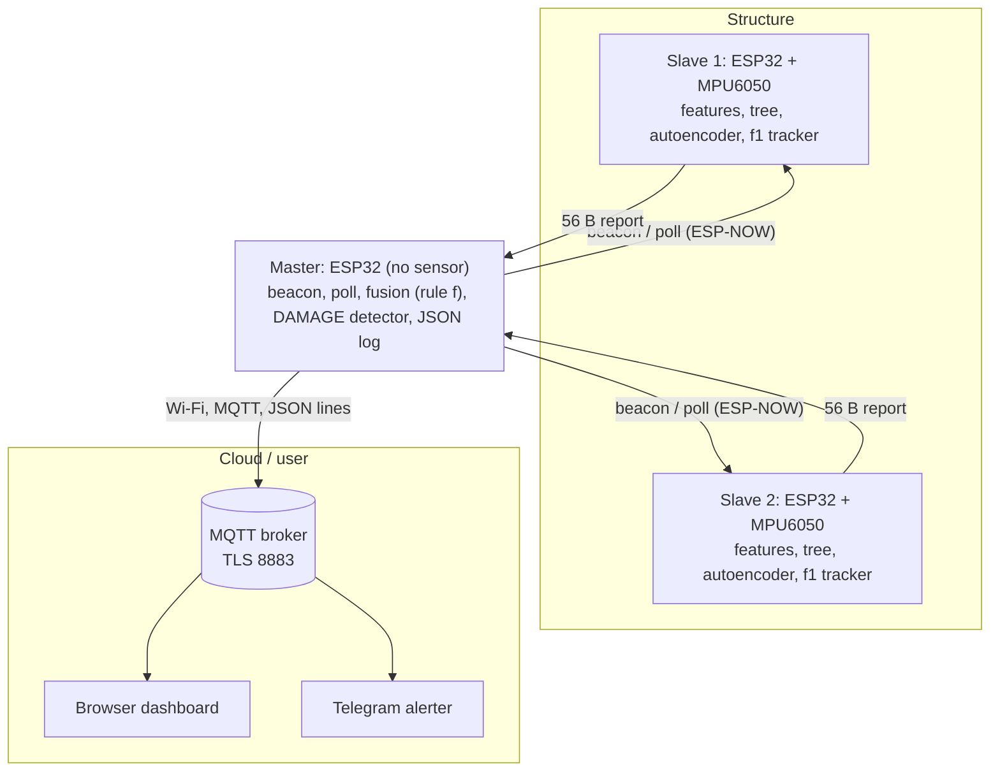
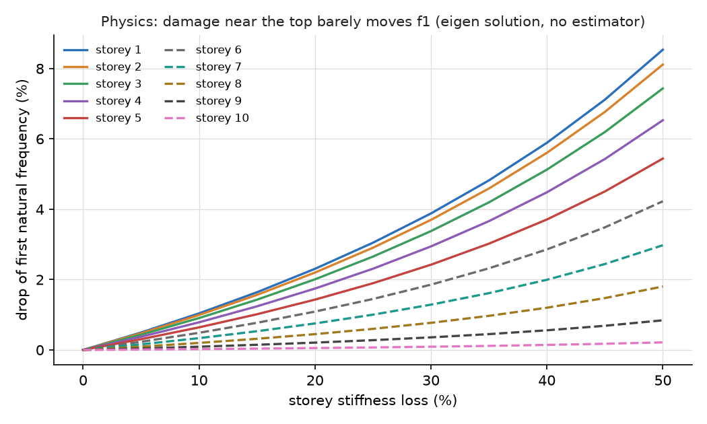
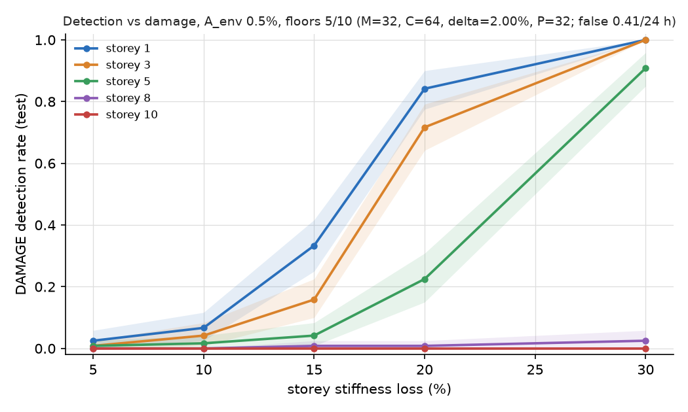
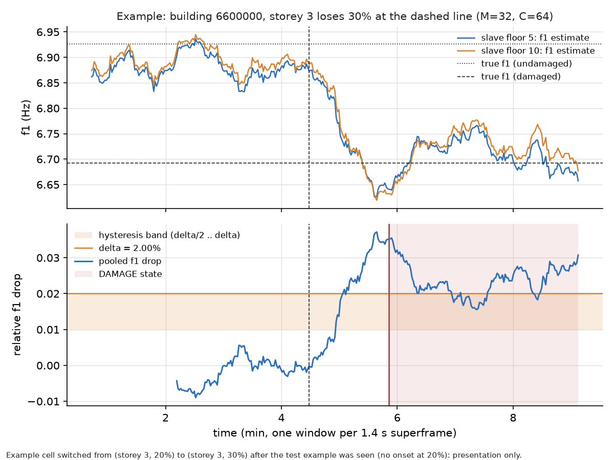
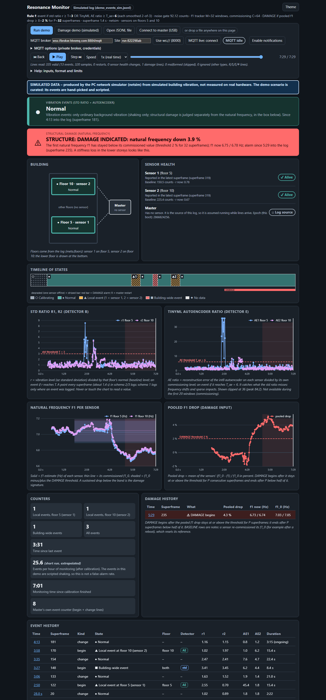
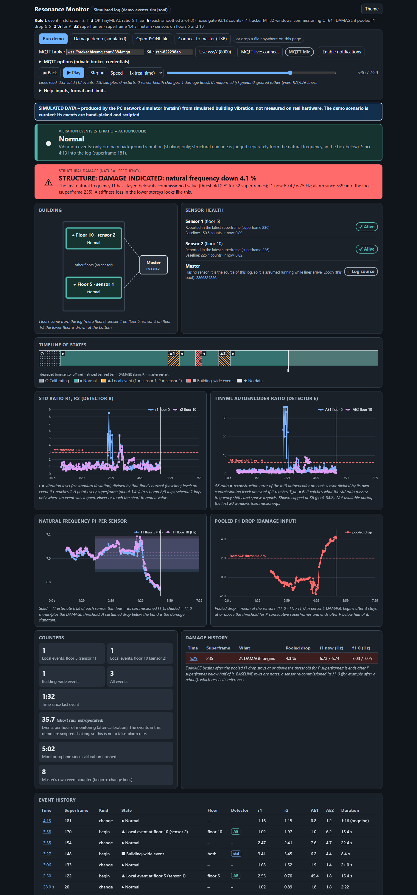

# Structural Health Monitoring using IoT and TinyML: Final Project Report

Project name in the repository: **Resonance**. Branch `tinyml-iot`. Status: the whole system is built and verified in simulation and on a PC; **no result in this report was measured on real hardware.** Hardware bring-up is the next step (section 13).

How to read the numbers: every figure comes from a result file in the repository (named next to it). "Simulated" means it comes from the project's building simulator `building_sim`, "host-measured" means it was timed on the PC, "estimated" means it is a calculation or a datasheet-based guess. Nothing is "measured" in the sense of a physical experiment. Sizes use 1 KB = 1000 B.

---

## 1. Abstract

We built a three-tier structural health monitoring (SHM) system: two ESP32 + MPU6050 sensor nodes, one ESP32 master that fuses their reports, and a cloud layer (MQTT, browser dashboard, Telegram alerts). Each sensor node runs a 110-byte decision tree, an int8 autoencoder (a TinyML anomaly detector, 942 B of weights) and a natural-frequency tracker on-device. The master decides AMBIENT / LOCAL / BUILDING events and a separate DAMAGE alarm. In simulation (fresh, pre-registered test block, 240 simulated buildings, 28 h): mean event recall rose from 0.622 to **0.734** by adding the autoencoder, at **1.64 false onsets per hour** (our 1/h budget was **not met**). Frequency tracking detects 30 % stiffness loss in storeys 1, 3 and 5 (1.00 / 1.00 / 0.91) but is nearly blind to damage in the top storeys. On the PC, the C inference code is bit-exact with TensorFlow Lite (0 mismatches on 10,000 vectors). The 110 B tree reaches about 93 % accuracy on synthetic data (resampling estimate). Everything is simulation; no hardware measurement exists yet.

---

## 2. Introduction and objectives

### 2.1 Motivation

Bridges, buildings and towers age, are loaded by traffic, wind and earthquakes, and can be damaged. **Structural health monitoring (SHM)** places sensors on a structure to detect unusual vibration or changes in its dynamic behaviour early. Two kinds of questions matter: *events* (something hit or shook the structure now) and *damage* (the structure itself has become more flexible).

A key physical idea is the **natural frequency**: every structure has frequencies at which it prefers to vibrate. The lowest one, the **first natural frequency f1**, depends on mass and stiffness (f1 is proportional to the square root of stiffness over mass). Damage reduces stiffness, so f1 falls. Monitoring f1 over time is a classical SHM method.

### 2.2 Why edge computing and TinyML

Streaming raw vibration to a server is expensive in power and bandwidth. In the simulator, streaming raw 6-axis data from two slaves would be 8.64 MB per hour. The hierarchy's radio traffic was measured at about 363 kB per hour of application payload with the earlier version-2 protocol (44 B reports, `compare_hierarchy.md`); with the current 56 B report it is about 424 kB per hour by the same frame arithmetic (not re-measured). The events-only cloud uplink (`JSON_SAMPLES` = 0) was 10.5 kB per hour with the older schema-2 lines (about 12-14 kB per hour estimated for schema 3); the default build also publishes one `sample` line per superframe for the live dashboard, about 0.7 MB per hour. Processing at the node ("edge") also keeps the local network working when the internet fails.

**TinyML** means running machine-learning inference on microcontrollers with kilobytes of memory. Here: a small decision tree and a small neural network (autoencoder) whose weights occupy under 1 KB each and whose arithmetic uses 8-bit integers (**int8 quantisation**: weights and activations are stored as 8-bit integers with a scale factor, instead of 32-bit floats; this cuts memory and suits integer hardware).

### 2.3 Why IoT

A building's sensors are rarely where the engineer is. The master therefore publishes its decisions over MQTT (a lightweight publish/subscribe protocol used widely in IoT) so that a dashboard on any device and a Telegram bot can show and push alerts.

### 2.4 Targets

From the project brief (`.claude/STRUCTURE.md`): accuracy of at least 90 %, inference time under 50 ms, model size under 100 KB. The mentor additionally required a hierarchical (multi-node) design. We added a false-alarm budget of 1.0 false event onset per hour (our own choice, not derived from a requirement).

| Target | Result | Where measured |
|---|---|---|
| Accuracy >= 90 % | about 0.93 (resampling estimate, synthetic data; the tree is not used by the master's final decision, section 5.1) | simulated |
| Inference < 50 ms | about 24 ms per window in Wokwi simulator for the original tree pipeline; a real ESP32 is estimated at 3-8 ms for the full pipeline | simulator / estimate, not silicon |
| Model < 100 KB | 110 B tree; 942 B autoencoder weights | exact sizes |

### 2.5 Terms used

| Term | Meaning |
|---|---|
| Window | 128 accelerometer samples at 100 Hz = 1.28 s, the unit of analysis |
| Superframe | One 1.4 s network cycle in which both slaves deliver one window report |
| Commissioning | The first minutes after power-on in which a node learns what "normal" looks like for itself |
| False onset | The master announces an event (LOCAL or BUILDING) when there was none. **False onsets per hour** is the alarm-system measure of nuisance |
| Event recall | Share of true events that were announced (correct class) at least once |
| Dev / test block | Disjoint sets of simulated buildings. All choices are made on the dev block; the chosen configuration is then scored once on the test block |
| Pre-registration | Writing down, before looking at the test data, exactly what will be scored and what result leads to which decision, and committing it to version control |
| Bootstrap interval | A 95 % interval obtained by resampling whole simulated buildings 2000 times |

---

## 3. System architecture

### 3.1 Three tiers



| Tier | Hardware | Job |
|---|---|---|
| Sensor node (x2) | ESP32 DevKit + MPU6050 (SDA 21, SCL 22) | Sample 100 Hz, per window compute features, tree class, int8 autoencoder ratio, f1 estimate and drop; reply when polled |
| Master (x1) | ESP32, no sensor | Keep the 1.4 s clock, beacon, poll, commission baselines, fuse, run DAMAGE detector, write JSON, publish over MQTT |
| Cloud | public or private MQTT broker, browser, Telegram | Distance viewing, history, push alerts |

The hierarchy was a mentor requirement. Two slaves are the smallest number that can compare two floors, i.e. separate "local" from "building-wide".

### 3.2 Data flow in one superframe (1.4 s)

1. t = 0: master broadcasts a **beacon** (17 B: superframe number, master epoch).
2. Each slave starts a window: 128 samples, 10 ms apart (1.27 s first to last sample). After the last sample it computes everything in one pass.
3. t = 1.32 s: master **polls** slave 1 then slave 2 (18 B poll); each answers with a 56-byte **report**. Reply timeout 18 ms per attempt, one retry. Static compile-time asserts check that polling starts after the last sample and ends before the next beacon.
4. The master closes the superframe, fuses the two reports (section 6), feeds the DAMAGE detector (section 7), and writes one JSON `sample` line plus an event line when the state changes.
5. The same lines go to USB serial and (in the MQTT build) to the MQTT task.

### 3.3 Protocol (`net_proto.h`)

- Transport: **ESP-NOW** broadcast (Espressif's connectionless peer-to-peer Wi-Fi-layer protocol). It needs no access point, so the local sensor network works with the router off. This is why we chose it over Wi-Fi/MQTT between nodes.
- Frame: magic, type, version (**3**), source, destination, sequence, payload, CRC-16/CCITT. Fixed lengths; wrong length, type, CRC or version is rejected. A version-2 board is ignored, so all three boards must run the same build.
- Report (56 B): superframe, epoch, window number, raw class, smoothed state, flags, 5 tree features, then `ae_ratio`, `f1_est`, `f1_drop`. Flags: LOW_SIGNAL, UNSYNCED, AE_READY, F1_VALID, F1_COMMISSIONED, F1_NOT_COMMISSIONED. Unavailable floats are NaN on the wire.
- **Epoch**: at every start the master draws a random 32-bit number and puts it in every frame. Slaves resynchronise when it changes, and ignore frames of another epoch. This solves the "restarted master counts from zero again" problem.
- Missed beacons: a slave waits 5 ms, then free-runs for up to 5 superframes flagged UNSYNCED, then goes silent until it hears a beacon.
- **DEAD** detection: 3 consecutive superframes without a report (about 4.2 s; simulator: 4.2 s in 240 of 240 runs per slave). The master then continues in DEGRADED mode on the other slave (can output LOCAL or AMBIENT, never BUILDING).
- Packet loss (simulated, i.i.d. per packet; real loss is bursty and unmeasured), `compare_hierarchy.md`:

| Loss | False DEAD per slave-hour | LOCAL correct-type recall | BUILDING correct-type recall |
|---|---|---|---|
| 0 % | 0.000 | 0.453 | 0.811 |
| 5 % | 0.000 | 0.449 | 0.800 |
| 10 % | 0.122 | 0.442 | 0.778 |
| 20 % | 4.809 | 0.413 | 0.681 |

(These recalls are for the earlier rule b; they were not re-run for rule f.) The 3-miss DEAD rule therefore suits only low loss; real loss must be measured before choosing it.

---

## 4. Sensing and signal processing

- **Sensor**: MPU6050, accelerometer +-2 g (16384 counts/g), gyroscope +-250 deg/s. Only the `az` (gravity axis) and `gx` axes are used.
- **DLPF** (digital low-pass filter inside the sensor, CFG=3: 44 Hz accel / 42 Hz gyro) is a **hard requirement**: the training data never contained wideband noise above 50 Hz. In an independent verification (not reproducible from the repository), turning it off, with simulated wideband noise above 50 Hz, changed about 16 % of predictions. The firmware reads back the DLPF and range registers at boot and refuses to classify if they are wrong (`config fail`).
- **Sampling**: exact 100 Hz timer, 128-sample non-overlapping windows (1.28 s), frequency resolution 0.78125 Hz. Thresholds are in raw counts at these ranges.
- **Tree features** (5): `az` standard deviation, excess kurtosis and dominant frequency; `gx` standard deviation and dominant frequency. Variance is computed in two passes (mean first) because a one-pass float32 formula flips predictions on `az`, which sits near 16384.
- **Spectral front end** (`spectrum.h`), shared by the autoencoder and the f1 tracker:
  - one DFT of `az` gives bins 1..64;
  - **16 band powers**: log of (sum of 4 bins + 1);
  - **Hann-windowed Goertzel "zoom"**: 181 frequencies from 3.0 to 12.0 Hz in 0.05 Hz steps, 23k multiply-accumulates. (The Goertzel algorithm computes the power at one chosen frequency cheaply; the Hann window reduces spectral leakage.) The peak is refined by parabolic interpolation, giving f1 to a fraction of the 0.78 Hz bin width.
- **Noise gate**: a window with `az_std` below 92.12 counts is treated as "no real vibration". The value comes from the synthetic data and is **provisional**; it must be re-measured on the real sensor. It matters a lot: without it the autoencoder rule gave 17.9 false onsets/h instead of 0.43 (dev block, rule e, `fusion_eval_r3_dev.md`).
- **Smoothing**: the tree's reported state changes only when 2 of the last 3 windows agree. On out-of-fold predictions this cut false-alarm episodes per normal recording from 0.50 to 0.17 (-65 %) at a cost of one window (1.3 s) of delay (`simulation_validation.md`).
- **Floating-point exactness**: all builds use `-ffp-contract=off` so the ESP32 does not fuse multiply-adds, keeping its float rounding equal to the PC's. This is what allows bit-level comparison with Python (section 9).

### 4.1 The simulator and its limits

`data/generator/building_sim.py`: a 10-storey **uniform shear building** (equal floor masses, equal storey stiffnesses), stationary band-limited random base excitation (2-12 Hz), f1 drawn 4-10 Hz, damping 1-3 %, per-floor sensor noise and offset, MPU6050 low-pass emulation. Damage = fractional stiffness loss in one storey. `gx` is **not physical** (a gain times the lateral signal plus noise). The simulator also puts the lateral (sway) floor acceleration on `az`, on top of the 1 g gravity offset, whereas the bring-up guide mounts `az` as the vertical (gravity) axis, which would see little of a shear building's sway. Which sensor axis to use, and whether the thresholds transfer, must be settled at hardware bring-up. Mass changes, temperature effects, torsion, soil interaction and non-stationary excitation are not modelled. Because the simulator, thresholds and scoring were all written by this project, the results show the method works **under these assumptions**, not on a real structure.

---

## 5. TinyML models

### 5.1 The decision tree (original single-node classifier)

- **Data**: 150 synthetic recordings (50 per class: normal / abnormal / faulty), 40 windows each = 6000 windows (`generate.py`, seed 42). Splits are always by recording, never by window, because windows of one recording are near duplicates.
- **Selection** (`models/selected/report.md`): inputs = 18 mean-removed features (raw RMS excluded because it contains gravity and offset). Rule (third version; the rule was revised twice after results were seen, see the selection history in `report.md`): smallest model of at most 5120 B whose repeated grouped 5-fold CV accuracy is at least 0.90 in all 10 repeats. Winner: **depth-3 tree, 11 nodes, 110 B** (retrained on all 150 recordings), using 5 features of 2 axes.
- **Accuracy**: 0.9315 (sd 0.028) over 200 random re-draws of the test recordings; 0.9315 (sd 0.0075) over 40 repeats of 5-fold CV on all 150 recordings. **This is an estimate of the training procedure, not an untouched test**: the set-aside recordings were used as evidence when the selection rule was revised, so no untouched data remains. It is accuracy on synthetic data.
- **Alternatives** under a replacement rule fixed in advance: random forest of 50 trees depth 4: 0.938 / 0.940, 11.5 KB (kept as documented fallback); best RBF SVM 0.911 / 0.912 up to 93 KB; best linear SVM 0.907 / 0.907 372 B; small neural network 0.87 dev CV. None qualified to replace the tree.
- **Role today**: the tree still runs on each slave and its state is reported, but **the master's final decision does not use it**. Under the event-level false-alarm criterion every candidate of rules a and d, which rely on the tree's 'faulty' output, was over budget on the dev block; rule c (tree AND std ratio) met it at T = 3 but ranked below rule b (`hierarchy_validation.md` 7.4). The old tree alone on a single node gave 39.0 false onsets/h at floor 10 (healthy ambient, `compare_hierarchy.md`).

### 5.2 The int8 autoencoder (anomaly detector)

**Why an autoencoder, not a classifier.** A classifier needs labelled examples of every kind of fault, which we cannot have for a real structure. An **autoencoder** is a neural network trained to reproduce its input through a narrow bottleneck. Trained only on **healthy** data, it reconstructs healthy windows well and unfamiliar ones badly; the reconstruction error is an anomaly score. No fault examples are needed, and it can respond to kinds of change not seen in the simulator.

- **Inputs (20)**: the 16 `az` log band powers, `az_std`, `az_kurt`, `gx_std`, `gx_kurt`. (A shape-only input design was tried and was worse: it did not lower the healthy false-positive tail and lost most frequency-shift sensitivity; `design_search.json`.)
- **Per-node commissioning normalisation**: each slave learns, on-device from its first 20 windows after power-on, the per-input median and scaled median absolute deviation (MAD / 1.4826; robust spread) and a reference score (median commissioning score). Later windows are normalised with these, and the anomaly **ratio** = score / reference score is what is thresholded. This makes one trained model usable on every node despite different sensor gains and floors.
- **Architecture**: 20-12-2-12-20, ReLU dense layers, **574 parameters**. Selected on a validation split only: 8-3-8, 12-2-12 and 12-4-12 were within seed noise (mean recall 0.58-0.63), larger ones generalised worse (0.47-0.49); 12-2-12 had the best two-seed mean.
- **Training**: healthy simulated data only, 400 buildings x 10 floors (seeds 6,300,000-6,300,399), 880,000 windows, Adam, MSE, 30 epochs; validation seeds 6,300,400-6,300,499.
- **Quantisation**: full-integer post-training quantisation using 3000 representative training vectors. The int8 TFLite file is 4568 bytes; the firmware's weight and quantisation tables are **942 B**; 528 int8 multiply-accumulates per window.
- **Float vs int8**: validation reconstruction error 2.2541 vs 2.3487 (+4.2 %); per-window score correlation 0.9899; window-level mean recall at the healthy 0.5 % false-positive threshold 0.608 (float) vs 0.600 (int8).
- **Bit-exact C kernel.** The firmware runs hand-written C (no TFLite Micro runtime). Against `tf.lite.Interpreter` (reference kernels) it gives **0 mismatching int8 outputs on 10,000 vectors (200,000 values)**. Two rounding details had to be matched, and are the typical trap of integer-network porting:
  1. TFLite rounds **once** in its fixed-point multiply (single-rounding form); the textbook "gemmlowp" double-rounding form differs in 28 % of vectors.
  2. The input quantiser is `round_half_away(v / scale)` (a float division). The earlier `v * (1/scale)` differs at near-half values (10,171 of 10^6 adversarial values; essentially never on real windows). Found by the independent verifier, fixed before the test block was scored, and the dev selection was re-run and did not change (all 165 table rows identical in false onsets/h and mean recall).
  
  Note also that TFLite's default XNNPACK resolver is not the reference (its QUANTIZE rounds half to even, and it differed in 1 of 200,000 outputs).
- **Is this 'really TinyML'?** By the constraints, yes: a trained neural network, int8 post-training quantised, under 1 KB of weights, compiled into the ESP32 slave firmware. It has not yet been executed on a board or in Wokwi; its outputs were verified on the PC. It is not running inside TensorFlow Lite Micro; it is hand-written C verified bit-exact against TFLite on the PC. A TFLM runtime comparison is future work.

### 5.3 Mahalanobis baseline

A statistical alternative on the same normalised inputs: the Mahalanobis distance (how many standard deviations a vector is from the healthy mean, accounting for correlations) with covariance shrinkage 0.8 (chosen on validation). It has 20 + 210 parameters, 920 B, about 440 float MACs, validation mean recall 0.699 (int8 AE: 0.600). It beat the autoencoder on dev for some rules but misses sparse single impacts (0.01-0.015), so it was not deployed.

### 5.4 Benchmark (dev block, best configuration of each family under 1.0 false onsets/h; `ae_report.md`)

| Detector | Flash (weights) | Ops per window | Host time per window | Dev config | False onsets/h | LOCAL | BUILDING | shift | sparse |
|---|---|---|---|---|---|---|---|---|---|
| Decision tree (rule a, lowest false-onset row; over budget) | 110 B | ~3 compares (+ 2 DFTs, 32,768 MAC) | 33.5 us (features5) | a, T=1.5, smoothed, k=3 | 8.86 | 0.676 | 0.536 | 0.975 | 0.060 |
| Rule b (std / baseline >= T) | 4 B | 1 divide + compare (+ std pass) | < 1 us | b, T=3, k=1 | 0.79 | 0.442 | 0.801 | 0.294 | 0.054 |
| Mahalanobis, rule m | 920 B | ~440 MAC | 1.98 us | m, T=4, k=3 | 0.96 | 0.618 | 0.737 | 0.848 | 0.013 |
| int8 autoencoder, rule e | 942 B | 528 int8 MAC | 1.41 us | e, T=5, k=1 | 0.43 | 0.692 | 0.382 | 0.867 | 0.212 |
| **Rule f = b OR e (deployed)** | 946 B | 528 int8 MAC + b | as e | f, T=6 (b T=3), k=1 | 0.89 | 0.658 | 0.803 | 0.771 | 0.204 |
| Rule g = b OR m | 924 B | as m + b | as m | g, T=4 (b T=3), k=3 | 1.00 | 0.617 | 0.779 | 0.848 | 0.010 |

Host times are on a PC (x86), not an ESP32. The tree-based rules do not meet the budget.

---

## 6. Edge fusion and the decision rule

### 6.1 What the master decides

Per superframe the master outputs COMMISSIONING / AMBIENT / LOCAL(slave) / BUILDING / NO_DATA (+ DEGRADED when one slave is dead). Each slave's baseline (median `az_std` of its first 20 reports) is the denominator of the **std ratio** r = az_std / baseline.

- **Rule b**: slave flag e = (r >= 3), smoothed 2-of-3. Both slaves flagged = BUILDING; exactly one = LOCAL(that slave); none = AMBIENT. Good at amplitude events, weak on frequency shifts and sparse impacts.
- **Rule f = b OR e** (deployed): the same, but each slave's flag is (b flag) OR (autoencoder flag), the two smoothed separately. The autoencoder flag requires AE_READY, `az_std >= 92.12` (the noise gate) and ratio >= **6**. T_b = 3, debounce k = 1.

### 6.2 How the rule was chosen: the methodology

The history is part of the result, because it shows why the numbers are credible.

1. **Round R2 (superseded)**: criterion "per-superframe AMBIENT recall >= 0.95". On its test block this chose a rule with **126.5 false events per hour**. Per-superframe accuracy is the wrong unit for an alarm system (5 % of 1.4 s superframes wrong is one false alarm every 28 s). Found when the test block was scored; the block was not reused.
2. **Round R2b**: criterion rewritten at event level: maximise mean(LOCAL event recall, BUILDING event recall) subject to <= 1.0 false onsets per hour, on a **dev block** (240 buildings, seeds 6,100,000+, 28 h). 63 candidates. Winner rule b, T = 3, k = 1. Scored once on a **fresh test block** (6,200,000+): 2.04 false onsets/h [1.04, 3.25], LOCAL 0.453, BUILDING 0.811. Budget **not** confirmed (dev 0.79 was a lucky draw; pooled dev+test about 1.4/h).
3. **Phase B/R3**: add the int8 autoencoder and Mahalanobis rules. Dev selection with the same rule picked **f, T = 6 (b T = 3), k = 1** (dev table below).
4. **Pre-registration** (`r3_test_preregistration.md`, committed before the 6,400,000 block was simulated, checked by an independent verifier): which block, which candidate, which incumbent (b), and the deployment decision: deploy f **if and only if** (1) the paired bootstrap 95 % interval of the mean-recall gain (f - b) excludes 0, and (2) the paired increase in false onsets per hour has a point estimate <= 0.5/h; otherwise deploy b. It also stated in advance: "We expect both to exceed 1/h, and that will be stated plainly."
5. **Test block scored once**: 6,400,000 + 240 buildings, 28.0 h.

### 6.3 R3 dev block (`fusion_eval_r3_dev.md`, primary pair floors 5/10)

| Family | Config | False onsets/h | LOCAL | BUILDING | Mean | sparse | shift |
|---|---|---|---|---|---|---|---|
| b | T=3, k=1 | 0.79 | 0.442 | 0.801 | 0.622 | 0.054 | 0.294 |
| e | T=5, k=1 | 0.43 | 0.692 | 0.382 | 0.537 | 0.212 | 0.867 |
| m | T=4, k=3 | 0.96 | 0.618 | 0.737 | 0.678 | 0.013 | 0.848 |
| **f (selected)** | T=6 (b T=3), k=1 | 0.89 | 0.658 | 0.803 | **0.730** | 0.204 | 0.771 |
| g | T=4 (b T=3), k=3 | 1.00 | 0.617 | 0.779 | 0.698 | 0.010 | 0.848 |

The autoencoder alone is worse than rule b (misses building-wide amplitude events: BUILDING 0.382) because its training data included 0.5-1.5x level changes, so it largely reconstructs a louder building. The OR combination takes the strengths of both.

### 6.4 R3 fresh test block (`fusion_eval_r3_test.md`, scored once, simulation)

Primary pair (floors 5/10), healthy + noise monitoring, 28.0 h:

| Rule | False onsets/h [95 %] | vs 1/h | Healthy only /h | LOCAL | BUILDING | Mean recall |
|---|---|---|---|---|---|---|
| **f (candidate, deployed)** | 1.64 [0.75, 2.79] | **not met** | 2.05 [0.94, 3.48] | 0.666 | 0.803 | **0.734** [0.720, 0.748] |
| b (incumbent) | 1.39 [0.54, 2.54] | **not met** | 1.74 [0.67, 3.17] | 0.441 | 0.803 | 0.622 [0.607, 0.637] |
| e (info) | 0.68 [0.28, 1.18] | met | 0.85 | 0.700 | 0.360 | 0.530 |
| m (info) | 1.14 [0.54, 1.93] | not met | 1.43 | 0.612 | 0.721 | 0.666 |
| g (info) | 1.32 [0.64, 2.18] | not met | 1.65 | 0.612 | 0.756 | 0.684 |

**Paired difference f minus b**: mean recall **+0.113 [+0.103, +0.122]**, LOCAL +0.225, BUILDING +0.000, false onsets **+0.25/h [+0.04, +0.50]** (46 vs 39 false onsets in 28 h). Both pre-registered criteria hold, so **rule f is deployed**.

Per event kind (f vs b): dense impacts 1.000 vs 0.969; sparse single impact **0.202 vs 0.056**; frequency shift **0.796 vs 0.298**; 2x / 3x / 5x building-wide 0.433 / 0.975 / 1.000 for both (unchanged). The gain is in sparse impacts and frequency shifts. Secondary pair (floors 3/7): f 1.43/h, mean 0.710; b 1.18/h, mean 0.615.

### 6.5 The false-alarm budget: stated plainly

- **The 1/h budget is not met** by either rule on point estimates: f 1.64/h, b 1.39/h over healthy + noise monitoring.
- The headline figure includes 5.6 h of noise-only recordings where neither rule fires. **On healthy ambient monitoring alone, which is what a real quiet building would see, the rates are higher: f 2.05/h, b 1.74/h.**
- Both 95 % intervals still include values below 1/h (one 28 h block is a noisy estimate); the dev block gave 0.89/h for f. Taken together we do not claim the budget.
- The defensible comparison is the paired one: **+0.113 mean recall for +0.25 false onsets/h**. The interval of the second number reaches the 0.5/h limit, so the alarm cost is only bounded at about that level.
- A real deployment would raise the thresholds or add debounce (k = 3 etc.; the dev trade-off tables give the options, e.g. f at T=4, k=3: 0.21 false onsets/h, mean 0.676) at a recall cost.
- Weaknesses carried over: 3x building-wide events briefly show as LOCAL first (wrong-class share 0.621 for f, 0.600 for b); sparse impacts are mostly missed (0.20).

### 6.6 What the hierarchy adds compared with one node (`compare_hierarchy.md`, rule b, R2b test block)

| Measure | One ratio node (S3, floor 10) | Hierarchy H |
|---|---|---|
| False onsets/h, healthy ambient | 2.41 | 2.54 |
| Building-wide event detection | 0.833 | 0.844 |
| Events on its own floor (10) | 0.429 | 0.429 |
| Events on the other floor (5) | 0.022 | 0.487 |

Honest reading: the hierarchy does **not** reduce false alarms and does not detect more on one floor. It adds the second floor, event typing (LOCAL(slave) vs BUILDING) and graceful degradation when a slave dies (single node: silent). For "something happened here or building-wide", one ratio node is as good and simpler. Cost: three boards, a radio link, packet-loss sensitivity.

### 6.7 Storey localisation: negative result

Locating the damaged storey from amplitude ratios on a 10-sensor building failed both pre-stated gates (gate 1: top-1 0.452, within-one 0.481; gate 2: exact 0.893 and within-one 0.908 passed but alarm rate 0.770 < 0.80). It is not claimed. Retraining the tree on building data was also rejected ("keep old": more false alarms, 0.0511 vs 0.0069 smoothed). These negative results are kept in the repository deliberately.

---

## 7. Damage detection by natural-frequency tracking

### 7.1 Physics: why f1, and why upper storeys are nearly invisible

Damage lowers stiffness; stiffness lowers f1. The first mode (the lowest, simplest vibration shape) concentrates strain energy, i.e. bending of the structure, in the **lower storeys**. A stiffness loss in the top storey hardly changes how the building vibrates in mode 1. The eigen-solution of the shear model gives (`freq_tracking.md`; figure below), for 30 % stiffness loss: f1 drop **3.88 % at storey 1**, 3.38 % at 3, 2.42 % at 5, 0.77 % at 8, **0.09 % at storey 10**. This limits **any** f1-based detector, whatever the estimator. (With a different method, such as mode-shape change using many sensors, upper storeys might be seen; that is future work.)



### 7.2 Tracker and detector (in the real firmware path)

- **Slave tracker** (`f1track.h`, 23.4 KB, no heap): a ring of the last M = 32 zoom spectra is averaged; the raw f1 estimate is the interpolated peak of the mean. After a warm-up the slave **commissions** its reference f1_0 as the median of the last C = 64 valid estimates, only if they are unimodal ((p90-p10)/median <= 0.10). Afterwards estimates outside f1_0 x (1 +- 0.20) are invalid (a mode jump). It reports `f1_drop = (f1_0 - f1)/f1_0`. Commissioning needs about 96 windows = 2.2 min of quiet data.
- **Master detector** (`damage.h`): pooled drop = mean over slaves that have a valid drop. **DAMAGE BEGIN** after P = 32 consecutive superframes (45 s) with pooled drop >= delta = 2 %; **END** after 32 below 1 % (hysteresis). If no slave is usable, state is held. A contributor guard stops an active alarm ending just because the slave that saw the damage rebooted.
- Parameters (M, C, delta, P) were selected on a dev block (6,500,000 + 120 buildings, drift A_env 0.5 %, false DAMAGE <= 1/24 h, maximise mean detection over 25 damage cells) and scored once on a test block (6,600,000 + 120).

### 7.3 Results (test block, `freq_tracking.md`; simulation; re-run once after the post-hoc tracker fix, section 7.4; numbers unchanged)

- **False DAMAGE** per 24 h of healthy monitoring: 0.20 [0.00, 0.61] with no drift; **0.41 [0.00, 1.22] at 0.5 % stiffness drift**; **2.24 [0.81, 4.07] at 1 % drift** (budget exceeded under stronger drift).
- **Detection** (primary pair, 0.5 % drift): mean over 25 (storey, loss) cells **0.217 [0.204, 0.232]**.

| Storey | det 10 % loss | 20 % | 30 % | latency at 30 % (superframes) |
|---|---|---|---|---|
| 1 | 0.07 | 0.84 | 1.00 | 48.2 |
| 3 | 0.04 | 0.72 | 1.00 | 52.4 |
| 5 | 0.02 | 0.23 | 0.91 | 81.6 |
| 8 | 0.00 | 0.01 | 0.03 | 149.0 |
| 10 | 0.00 | 0.00 | 0.00 | n/a |

By loss: 5 % 0.01, 10 % 0.03, 15 % 0.11, 20 % 0.36, 30 % 0.59. A superframe is 1.4 s, so 48-82 superframes is 1-2 minutes.



- **f1 estimation error** (floors 5/10, M = 32): median 0.025 Hz, p99 0.12 Hz. Estimated and true drops agree on the mean (for example storey 1, 30 %: 3.88 % estimated vs 3.88 % true), with a scatter of about 0.5 percentage points between buildings.
- A worked example (one building, storey 3 loses 30 %): the pooled drop crosses 2 % shortly after the stiffness change and DAMAGE begins about 1.4 minutes later. The figure's own caption notes that the example cell was switched from 20 % to 30 % after the test example was seen because 20 % showed no onset; this is presentation only.



### 7.4 Post-hoc robustness fix

After the test block was scored, independent verification found that on a **low floor of a low-f1 building** the first mode is weak and the spectral peak jumps to mode 2 (about 3 f1). Such estimates had been counted valid. A spot check with the hardware default floors 1/2 gave false DAMAGE for 31 % and 21 % of the time on two buildings (f1 about 4 Hz) with the old tracker, versus 0 % with the fix (unimodal commissioning test and +-20 % band gate). The fix was **not a re-selection**; on the cached blocks results are essentially unchanged (e.g. detection 0.217 -> 0.217 primary). **Because the test numbers were re-run after seeing the test block, they are no longer a clean one-shot.** The caveat remains: on floors 1/2 of f1 about 4 Hz buildings the tracker can commission onto mode 2 consistently and then track mode 2, not f1, so low floors of low-f1 buildings are poor sensors for this method.

### 7.5 Evaluation caveats (disclosed in `freq_tracking.md`)

- The damage recordings are effectively **drift-free** at every drift amplitude (the damaged segment lies 1.003 drift periods after commissioning), so the stability of detection across drift levels is an artefact. Real drift between commissioning and damage is arbitrary and detection under drift is **not tested**; drift affects only the false-alarm side here.
- The selected configuration sits on the grid edge (M = 32 and P = 32 are the largest tried); the runner-up (C = 128) is practically tied. Dev had 4 false begins in 118 h against about 4.9 allowed, so the selection is noisy.
- Uniform shear building, one mode, one damage location at a time, no mass changes, no excitation-amplitude dependence of f1, no packet loss in this evaluation. Real ambient excitation has narrowband components (machinery, traffic) that can bias a peak picker.
- All baselines (f1_0, the autoencoder normaliser, rule b baselines) are **RAM-only**: a slave that reboots on a damaged structure recommissions on the damaged state and reports drop 0.

**Summary**: the DAMAGE channel is a coarse alarm for large (about 20-30 %) stiffness losses in the lower storeys, with latency of one to two minutes. It is not a sensitive damage detector.

---

## 8. IoT layer

### 8.1 MQTT design

Topics are `resonance/<site>/...` with a random site id (default `rsn-822298ab`), one topic per JSON line type (`meta`, `restart`, `sample`, `begin`, `change`, `node`, `status_line`, ...), plus retained topics:

| Retained topic | Content |
|---|---|
| `state` | latest decision (sample / begin / change / status) |
| `damage_state` | latest `damage` line (BEGIN and END replace each other) |
| `meta` | run metadata, re-published after every (re)connect |
| `status` | `{"state":"online"\|"offline","epoch":E}` |

- **Last Will and Testament (LWT)**: the broker publishes `offline` if the master vanishes. The payload carries the master's boot **epoch**; an `offline` with an epoch different from the latest meta is the stale will of an older half-open session and consumers ignore it. This prevents a false "master offline" after an unclean reboot.
- **Queueing and drop policy**: a fixed-size queue (no heap) drops the **oldest sample** first; events, node, meta and restart lines are kept. The poll loop hands lines to the MQTT task on core 0 by a non-blocking queue send (full -> counted, never waits), so a bad network cannot delay the ESP-NOW polling. Hand-off slots are reserved for non-sample lines.
- **Reconnect**: Wi-Fi join timeout 20 s, back-off 1 s doubling to 60 s with jitter for MQTT, slow Wi-Fi back-off (30 s to 5 min); a failed publish drops the socket without DISCONNECT so the will stays armed.
- **Security**: default connection is **TLS on port 8883** with a committed root CA (Amazon Root CA 1). **Limitation**: this ESP32 framework build has no mbedtls date support, so the certificate chain is verified but its **expiry is not checked**. The public HiveMQ broker is for **demo only**: anyone who knows the site id can read the (simulated) topics. A private broker with TLS and authentication is a configuration change (`mqtt_config.h`: host, port, user, password, CA), not a code change. Credentials live in a git-ignored `secrets.h`. ESP-NOW nodes pin the first MAC seen per id (trust on first use): this guards against accidents, not an attacker.

### 8.2 Wi-Fi and ESP-NOW channel coexistence

The master has one radio: its Wi-Fi station and ESP-NOW share a channel. The master joins Wi-Fi before the first beacon and warns if the router's channel differs from `ESPNOW_CHANNEL`; slaves scan channels 1-13 (1.5 s each, longer than the 1.4 s beacon period) until they lock onto a beacon. **Residual risk (unverified on hardware)**: when the router is absent, the ESP-IDF still scans other channels during re-join attempts (about 1.5-2 s off the ESP-NOW channel each), so an occasional missed poll is expected during router outages. The hardware test (router off for 5 minutes) must show no slave declared DEAD; if it does, back-off must be lengthened or the master run without the uplink and bridged from a PC (`hardware_bringup.md` 8b).

### 8.3 Dashboard

`dashboard/index.html` is one self-contained file (no build step): replay of JSON-lines logs, live over USB (Web Serial), live over MQTT-over-WebSocket, an embedded simulated damage demo that works from `file://`. It shows per-floor state, a DAMAGE banner (grey = not commissioned, green, amber, red), timeline, the std-ratio chart, the autoencoder ratio chart, f1 per sensor, pooled drop, a DAMAGE history, and an event history with a detector column (which detector fired: std, AE, smoothed). The "SIMULATED DATA" banner is shown only for logs whose meta `source` is `netsim`; a `wokwi_demo` log would not be flagged, so say so when showing it.





The demo (seed 5,990,011; 320 superframes = 7.5 min; one building with f1 7.09 Hz, sensors on floors 5 and 10) runs: commissioning, an impact on floor 5 (LOCAL, autoencoder fires first), 3x building-wide shaking (BUILDING, std), a frequency shift on floor 10 (LOCAL, **autoencoder only**: the std ratio stays about 1.9, below 3), then a permanent 30 % stiffness loss in storey 1 from superframe 192 with **DAMAGE BEGIN at superframe 235** (43 superframes later), pooled drop 4.3 % at the alarm, about 3.9 % afterwards (physics: 3.88 %). No DAMAGE before the onset (maximum pooled drop before superframe 190: 0.66 %). This is one scripted case, not a statistic.

### 8.4 Telegram alerts

`tools/alerter.py` subscribes to the topics and sends messages such as `LOCAL vibration event at floor 10 (sensor 2) [AE 6.2 >= 6]` and `DAMAGE ALARM: natural frequency down 4.3 % (f1 6.73/6.74 Hz vs 7.03/7.05 Hz at commissioning)`. It has a cooldown and an hourly budget, scrubs the bot token from all output, and prints instead of sending when no token is set.

### 8.5 End-to-end test results (public broker, simulated data)

- `tools/e2e_mqtt_test.py` runs the network simulator, subscribes to the real public broker, runs the publisher in a separate process and checks that every line arrives byte-identical and in publish order on the right topic, that the retained `state` equals the last decision, that meta is retained and that status goes online then offline. (The repository records the test, not a stored result log; run it to reproduce.)
- The dashboard's headless test (`test_mqtt_dom.js`, jsdom) compares the live MQTT state with the file replay: it was run three times against `ws://broker.hivemq.com:8000/mqtt` at 4x speed (three sites in parallel) plus the fault log once; all passed and the live state was identical to the replay. Offline section: 25 checks pass. These live runs have no stored log.
- **What was not run**: the Wokwi cloud demo (the master firmware in the Wokwi emulator) was never executed, because the Wokwi command-line tool was not available. The same virtual pipeline is verified on the PC (`pio test -e cloud_demo`: its lines equal the simulator's golden log apart from timestamps). No real master has ever published.

---

## 9. Verification methodology

| Layer | What | Count / result |
|---|---|---|
| Unit tests (firmware, host) | `pio test -e native` (windows, smoothing, front end, AE, tracker/detector) | 34 test cases (test_native 8, test_ae 9, test_shm 17) |
| | `pio test -e netsim` (protocol, state machines, simulator, fusion, JSON) | 115 (63 test_net + 52 test_fusion) |
| | `espnow_logic` / `mqtt_logic` / `cloud_demo` | 26 / 34 / 6 |
| Python tests | `test_iot_tools.py` / `test_validate_logs.py` / `test_gates.py` | 13 / 7 / 18 |
| Dashboard | jsdom offline checks | 25 |

(Sum of the unit-test counts above: 253 tests, all passing at the last recorded run, plus the dashboard checks.)

**Bit-exact parity chains.** The same arithmetic is run in Python and in C on the PC and compared; only the original tree pipeline was also run on a simulated ESP32 (Wokwi, Phase 4 build, 606/606). The newer slave pipeline (band powers, autoencoder input, zoom, f1 tracker) has not run on an ESP32 or in Wokwi. It uses `logf`, whose ESP32 (newlib) and PC implementations may differ in the last bit, so on-target equality of the AE inputs and f1 estimates is expected to within rounding but not proven; the self-test's `ae parity` and `pipeline` lines are the first hardware-day check.
- Tree: C vs Python on all **6000 windows**, 0 mismatches; simulated ESP32 self-test 606/606 (516 hard cases: 503 near a split threshold, 13 near DFT ties); smoothing 2592 sequences, 0 mismatches. Smallest distance to a split threshold vs largest float error >= 14.8x.
- Autoencoder: C kernel vs TFLite reference interpreter, 0 mismatches on 10,000 vectors, 1000 with float inputs through a real TFLite QUANTIZE op.
- Front end: C DFT argmax equals the old dominant-frequency code on 6000 windows; the interleaved four-frequency zoom loop is bit-identical to the one-frequency loop (6000 + 5000 random windows).
- Fusion: `fusion.h` vs the Python reference `RefFusion`: 89 sequences, 3157 decisions, 1407 events, 0 mismatches (22 sequences of rule f); `RefFusion` vs the vectorised evaluation on 151,200 dev superframes, 0 mismatches. A test compares every selected constant in the firmware with the selection JSON files (mutating CHOSEN_T_AE, CHOSEN_T_B, the gate or the rule letter each fails the test).
- Python evaluations **run the firmware C code** through a ctypes bridge (`frontend.py`, `shm.py`, `ae_bridge.py`), so what was evaluated is what is deployed.

**Fuzzing and fault injection.** At the hierarchy stage (protocol version 2, before the autoencoder, rule f and DAMAGE existed) independent verification ran mutation tests, protocol fuzzing and fault-injection runs; their counts and logs are not stored in the repository (`hierarchy_validation.md` §1.1 quotes the verifier's figures). They found a master-restart blackout and a master-stall bug (both fixed). Later per-phase verification passes found the tracker's mode-2 locks (section 7.4), the quantiser rounding difference (section 5.2) and a stale-DAMAGE case (contributor guard); a later protocol-v3 fuzz of 2 million frames accepted no truncated or version-2 frame (no stored log). In the repository the simulator kills and revives nodes, injects loss, delay, corruption and send failures and recomputes invariants (`pio test -e netsim`).

**Independent verification passes.** Each phase was reviewed by a separate agent that re-ran tests and tried to break the change; several defects in this report's history were found this way.

**Reproducibility.** Test vectors, demo traces and logs are regenerable from fixed seeds by scripts (`gen_fusion_vectors.py`, `gen_ae_vectors.py`, `gen_traces.py`); the large evaluations are cached, resumable, and deterministic (`--small` modes give identical JSON cold and warm). Commands are in Appendix A.

---

## 10. Resource usage

Builds from `pio run` (flash / static RAM), Phase C2a figures:

| Build | Flash | Static RAM |
|---|---|---|
| `esp32dev` (original single node; AE not linked) | 296,889 B | 22,364 B |
| `master` | 746,853 B | 44,808 B |
| `slave1` = `slave2` (full pipeline) | 772,825 B (about 59 % of the 1.31 MB default app partition, computed) | 72,788 B (of 320 KB) |
| `master_mqtt` (TLS, mbedtls) | 905,189 B | 59,252 B |
| `master_wokwi_cloud` (two virtual slaves + trace) | 1,258,013 B (96.0 % of the partition; `huge_app.csv` is the fallback) | 59,428 B |

All well under the 100 KB target **for the models**: tree 110 B, autoencoder 942 B. The firmware as a whole is much larger because of the Arduino core, Wi-Fi and TLS stacks.

**RAM details.** `SlaveAnalytics` (autoencoder state 1.7 KB + f1 tracker 23.4 KB) is about 25.1 KB, declared static, never on the 8 KB loop stack; the pipeline call needs about 3.3 KB of stack. The ESP32 link limit for static data is 124,580 B (`dram0_0_seg`); the Wokwi cloud demo's two virtual slaves were at 112,460 B (about 12 KB headroom) when static, so their analytics now live on the heap. Slave RAM grew from 47.5 KB to 72.8 KB when the autoencoder and tracker were added.

**Compute time.**
- Original tree pipeline: about 24 ms per window in Wokwi (simulated time, not silicon): features 24.1 ms, tree about 6 us. By instruction count about 99 % of this is the two 128-point DFTs (a radix-2 FFT would need an estimated 10-20x fewer operations; not implemented).
- Full pipeline (features + bands + autoencoder + zoom + tracker + tree): **host-measured** about 30-45 us per window mean on this PC (x86, -O2; max about 85-210 us; load-dependent). Before the zoom was changed to evaluate four frequencies per pass it was 65-75 us, the zoom alone about 79 us; it is now about 20 us on the host. **ESP32 estimate: roughly 3-8 ms** from instruction counts (240 MHz, hardware FPU). **This is an estimate**: the number on a real board is unmeasured, and **Wokwi timing is not silicon timing** (in Wokwi's model the full pipeline would be about 45 ms, right at the budget). The self-test prints `pipeline us ... FITS | EXCEEDS the 45 ms budget`; it must be run on a board. The poll timing tolerates about 50 ms of slave compute (slave 1's first poll fails above ~50 ms; false DEAD from ~68-70 ms).
- If needed: evaluate the zoom on every 2nd grid point (0.1 Hz) to halve the cost; it lost nothing measurable in simulation (mean abs error 0.0421 Hz at all steps up to 0.3 Hz) but changes a selected quantity, so it was not applied.

---

## 11. Power and cost estimate

**These are datasheet-based ESTIMATES, not measurements, and the current figures below are typical values from manufacturer datasheets that are not recorded in the repository; verify them against the datasheets and measure on the real boards.**

### 11.1 Power

Assumed typical figures (ESP32 datasheet, order of magnitude): CPU active at 240 MHz about 30-70 mA without radio; Wi-Fi/ESP-NOW receive about 95-100 mA; transmit about 180-240 mA peak; MPU6050 about 3.9 mA with accelerometer and gyroscope on. A development board adds its USB-UART chip and regulator losses.

- **Master**: always on, Wi-Fi station plus ESP-NOW, so roughly 100 mA at 5 V-equivalent; **mains/USB powered**, this is acceptable.
- **Slave at 100 % duty (our design)**: the ESP-NOW receiver must listen for each 1.4 s beacon and the CPU samples every 10 ms, so the radio and CPU are effectively always on: about 100-110 mA average (assumption). With a 2000 mAh battery that is roughly 18-20 hours; with 10,000 mAh, about 2.5-4 days depending on the converter (power-bank capacity is rated at 3.7 V). **So the current design is for USB/mains-powered slaves**, not coin-cell or long-life battery operation.
- Possible reductions (future work, not implemented): light sleep between windows (the 1.4 s superframe is known, so the radio could be off outside the beacon and poll slots), lower sample rate, and DMA-style batch reads of the MPU6050 FIFO. Savings are not estimated here.

### 11.2 Bill of materials (approximate Indian-rupee prices; market prices vary, treat as rough and to be confirmed)

| Item | Qty | Approx. price each (INR) | Approx. total (INR) |
|---|---|---|---|
| ESP32 DevKit v1 | 3 | 450-700 | 1,350-2,100 |
| MPU6050 breakout (GY-521) | 2 | 150-300 | 300-600 |
| USB cables / 5 V power supplies | 3 | 150-300 | 450-900 |
| Jumper wires, breadboards / perfboard, mounting | set | 200-400 | 200-400 |
| **Total (approximate)** | | | **about 2,300-4,000** |

A cloud broker is free (public demo) or a small VPS/Raspberry Pi running a Mosquitto broker. An enclosure and a rigid mounting (the MPU6050 must be mounted so that `az` is the gravity axis and the coupling to the structure is stiff) are extra.

---

## 12. Limitations

1. **Simulation only.** No sensor data from a real structure and no run on real ESP32 boards exist. Wokwi was not run for the cloud demo, and Wokwi runs of the Phase 5 firmware (smoothing self-test, boot config check) were never recorded either.
2. **Uniform shear building**, stationary band-limited synthetic excitation, modelled `gx`, scale-model frequencies (f1 4-10 Hz); `az` carries the lateral sway in the simulator but is the vertical axis on the mounted sensor. Real wind, traffic and occupancy vary in level and spectrum; real structures are not uniform and stiffness changes with temperature and amplitude.
3. **The result describes fit to our simulator**: simulator, thresholds and scoring were written by the same project.
4. **Provisional noise gate** (92.12 counts) from synthetic data. It is critical: without it the AE rules give about 17 false onsets/h; it stopped working for the old tree's false alarms when sensor noise was about 1.5-1.75x the assumed level (independent verification, R0); this was not measured for rule f. The gate also cuts out 39 % of healthy simulated floor-windows (98 % on floor 1, `hierarchy_validation.md` section 4.1), so the autoencoder flag is effectively off on low, quiet floors; the firmware's default floor labels are 1/2, so upper floors (as evaluated: 5/10) are recommended.
5. **Commissioning in RAM**: all baselines (rule b, autoencoder normaliser and reference, f1_0) are learned in the first minutes after power-on and lost on reboot. They assume the structure is quiet and undamaged then; **nothing detects a bad commissioning**. A slave rebooting on a damaged structure hides the damage.
6. **False-alarm budget not met**: 1.64/h (f), 2.05/h on healthy ambient only, against the 1.0/h budget. Both intervals include values below 1.
7. **DAMAGE channel limited** to large (about 20-30 %) stiffness loss in the lower storeys; detection of damage under realistic drift is untested; false DAMAGE rises to 2.24/24 h at 1 % stiffness drift; the post-hoc robustness fix means its test numbers are not a clean one-shot.
8. **Storey localisation failed** its gates and is not claimed. Hierarchy adds typing and coverage, not sensitivity.
9. **Weak events missed**: a single sparse impact is detected 0.20 of the time; 2x building-wide excitation 0.43.
10. **Network**: packet loss simulated as independent; real loss is bursty; airtime, collisions and ESP-NOW framing not modelled; DEAD rule suits low loss only; Wi-Fi / ESP-NOW coexistence unverified on hardware.
11. **Security**: public broker is demo-only; TLS expiry not checked in this build; ESP-NOW trust-on-first-use is not attacker-proof.
12. **Selection effort**: 63 + further fusion candidates were examined on dev blocks; the pre-registered test blocks were scored once, but the R2 test block was used to find a mistake and rule c was examined on the R2b test block after the fact (post-hoc, not selected).
13. **Model accuracy** (0.93) is a resampling estimate on synthetic data, with no untouched test data left; real-structure accuracy is unknown.

---

## 13. Future work

1. **Hardware bring-up** (`hardware_bringup.md`): confirm `config ok dlpf=3 accel=0 gyro=0`; slave compute time (pass: well under 50 ms); poll round trip; master tick lateness; sample span with the radio on; link loss over 2-3 h or more; the noise estimate that sets the gate; the router-off test.
2. **Record labelled real data** (still, shaken, tapped), re-fit the noise gate, re-run the rule evaluation with measured noise.
3. **NVS-persisted baselines** so a reboot does not re-learn on a damaged structure.
4. **Mode-shape / multi-sensor damage localisation** (upper storeys are invisible to f1).
5. **Temperature (and load) compensation** of f1, the main false-DAMAGE source.
6. **A real structure test rig** (a small laboratory frame whose stiffness can be reduced in steps).
7. **TFLite Micro runtime comparison** against the hand-written C kernel; **radix-2 FFT** if timing is tight; sensor sleep modes for battery slaves.
8. **OTA firmware updates** and a private broker with TLS and authentication.
9. Re-evaluate rule c, which was a post-hoc alternative on the R2b block and needs its own fresh block.

---

## 14. Conclusion

We built and verified a three-tier edge SHM system: sensor nodes running a 110 B decision tree, a 942 B int8 autoencoder and a natural-frequency tracker; a master that fuses two nodes and runs a DAMAGE detector; and an MQTT / dashboard / Telegram cloud layer. In simulation, adding the autoencoder raised mean event recall from 0.622 to 0.734 on a fresh, pre-registered block, at +0.25 false onsets per hour; the absolute false-onset rate (1.64/h) did not meet our own 1/h budget. Frequency tracking gives a coarse damage alarm for large stiffness loss in the lower storeys and, by physics, cannot see damage at the top. The C code is bit-exact with the TensorFlow Lite reference. The project's strength is its method: pre-registered selection, fresh test blocks scored once, negative results kept, and every limitation stated. Its weakness is that it has not touched hardware: the next step is the measurements of section 13.

---

## Appendix A. Reproduction commands

From `d:\Resonance`, Python 3.12 `.venv` with `requirements.txt` (TF venv `.venv-tinyml` for training, `requirements-tinyml.txt`). Long jobs are cached and resumable.

```
# data, tree, tests
.venv\Scripts\python.exe data\generator\generate.py
.venv\Scripts\python.exe models\training\train.py                 # about 1 h
.venv\Scripts\python.exe firmware\esp32\tools\gen_model.py
.venv\Scripts\python.exe firmware\esp32\tools\gen_testdata.py
# fusion and hierarchy studies
.venv\Scripts\python.exe models\training\fusion_eval_r2b.py
.venv\Scripts\python.exe models\training\compare_hierarchy.py
.venv\Scripts\python.exe models\training\fusion_eval_r3.py            # dev, selects rule f
.venv\Scripts\python.exe models\training\fusion_eval_r3.py --block test   # fresh test block (scored once)
.venv\Scripts\python.exe models\training\freq_tracking_eval.py
.venv\Scripts\python.exe models\training\test_gates.py
.venv\Scripts\python.exe models\training\test_frontend.py
.venv\Scripts\python.exe firmware\esp32\tools\gen_fusion_vectors.py
.venv\Scripts\python.exe firmware\esp32\tools\gen_traces.py
```

```
# from firmware/esp32 (PlatformIO; WinLibs gcc on PATH for host envs)
pio test -e native
pio test -e netsim
pio test -e espnow_logic
pio test -e mqtt_logic
pio test -e cloud_demo
pio run -e master        # also slave1, slave2, master_mqtt, master_wokwi_cloud
pio run -e netsim        # then run .pio/build/netsim/program.exe, see demo_runbook.md
```

```
# IoT tools and dashboard tests (repo root)
.venv\Scripts\python.exe tools/test_iot_tools.py
.venv\Scripts\python.exe dashboard/tools/test_validate_logs.py
.venv\Scripts\python.exe tools/e2e_mqtt_test.py
.venv\Scripts\python.exe tools/sim_publisher.py --speed 5 --transport websockets --port 8000
```

The demo steps are in `demo_runbook.md`. The exact command lists with run times are in `simulation_validation.md` section 10 and `hierarchy_validation.md` section 12.

## Appendix B. File map

| Path | Contents |
|---|---|
| `data/generator/` | `generate.py` (synthetic dataset), `building_sim.py` (10-storey shear building) |
| `models/training/` | selection, comparison, fusion evaluations (R2, R2b, R3), `freq_tracking_eval.py`, autoencoder training and design search, ctypes bridges |
| `models/selected/` | deployed tree, reports and `validation/` result files (md + json) |
| `models/tinyml/` | int8 autoencoder (`ae_int8.tflite`), norm, `ae_report.md`, `design_search.json` |
| `firmware/esp32/include/` | `net_proto.h`, `tiers.h`, `fusion.h`, `slave_pipe.h`, `ae.h`, `f1track.h`, `damage.h`, `spectrum.h`, `fusion_json.h`, `mqtt_logic.h`, `mqtt_uplink.h` |
| `firmware/esp32/src/` | `net_main.cpp` (master and slaves), `main.cpp`, `selftest.cpp`, `netsim_main.cpp` |
| `firmware/esp32/test/` | Unity test suites and committed test vectors |
| `firmware/esp32/wokwi/` | one Wokwi project per board |
| `tools/` | MQTT publisher, alerter, end-to-end test |
| `dashboard/` | `index.html`, demo logs, validators, headless test |
| `docs/` | this report, `viva_prep.md`, `slides_outline.md`, `simulation_validation.md`, `hierarchy_validation.md`, `hardware_bringup.md`, `demo_runbook.md`, `figures/` |

## Appendix C. Seed blocks (what each simulated block was used for)

Blocks are disjoint and asserted disjoint in code.

| Seeds | Used for |
|---|---|
| 42 | synthetic dataset generator (tree selection) |
| 5,200,000+ | R2 test (superseded criterion), scored once |
| 6,100,000 + 240 | R2b dev; also the R3 dev block (same recordings) |
| 6,200,000 + 240 | R2b test (rule b, scored once); also the single-node vs hierarchy comparison |
| 6,300,000-6,300,399 | autoencoder training (healthy data) |
| 6,300,400-6,300,499 | autoencoder validation and design search |
| 6,400,000 + 240 | **R3 fresh test block**, scored once (rule f vs b) |
| 6,500,000 + 120 | f1 tracking dev (selection of M, C, delta, P) |
| 6,600,000 + 120 | f1 tracking test (scored once; later re-run with the post-hoc gated tracker) |
| 6,900,000 / 6,950,000 / 6,950,500 / 6,951,000 | `--small` quick modes |
| 5,990,011 | dashboard damage demo (one building); 5,990,001 = older legacy trace |
| 7,900,176, 7,900,015 | post-hoc spot checks of the mode-2 problem |

Superseded numbers: older documents (`README.md` before this update, `hierarchy_validation.md`, `simulation_validation.md`) describe the earlier rule b (2.04 false onsets/h on R2b test) and the single-node stage; the latest deployed rule is f (1.64/h, R3 test). Where STRUCTURE.md quotes different test counts for `netsim` over time, this report uses the latest (115).
